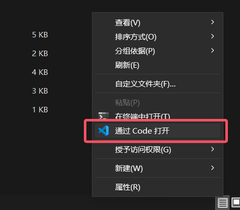

These four words may sound intimidating, but the setup is actually fairly simple—<br>
<u>You don't need to touch the environment at all; you're just installing a few archives.</u>

---

## Installing the Engine and SoulEngine

As of now, regardless of whether love 12+ has been delayed or officially released, please download the 12+ version.<br>
[Click here to download](https://nightly.link/love2d/love/workflows/main/main)

After that, [download SoulEngine](https://github.com/AnskiyyRenew/love2d-undertale-template)

Make sure you have installed at least version 3.0.0 or higher. The most obvious way to verify is to open `conf.lua` and check the **second line**—if it contains `3.0.0-stable` or a newer version string, then the version is correct.

```lua
-- Soul Engine Configuration File
_VER = "3.0.0-stable"      -- ← this is the line
```

!!! note "Where is `_VER`"
    It is written on **line 2** of `conf.lua` (line 1 is a comment). Note that there is **no** `_VERSION` in `conf.lua`—that is a built-in Lua global and has nothing to do with the engine version. See the [configuration file](../010_quick_start/000_conf.md) for details.

!!! warning "LOVE 12.0 is still in development"
    The `t.version` in `conf.lua` is set to `12.0`. If you only find the 11.x stable version on the official site, you need to download 12.x from the **nightly / test build** section, otherwise the APIs the engine uses will be missing.

The 3.0.0 APIs are essentially all stable now, so they won't change in future updates.

<u>Next we will branch by operating system, so please follow only the section that applies to you.</u>

---

## Windows Development

For Windows, there are many optional programming tools—you can even run the game by writing your own command line.

But if you have to pick the most convenient one, I currently recommend: `Visual Studio Code`. It is the blue ribbon—don't download the purple one.

---

## Linux Development

`VSCode` is also recommended, but Linux's command line is the main highlight.

After installing LOVE2D, the `love` command will be automatically registered in the environment.

So for `Linux` users, you can run the following command in the terminal to launch the game:
```bash
love .
```

---

## macOS Development

You can download from the link above (or the App Store, etc.).

`VSCode` is still recommended.

---

## Android Development

Domestic users can choose `MT Manager`. Although some of its features are paid, <u>none of them are needed at all throughout SoulEngine development</u>.

Download link: [https://mt2.cn](https://mt2.cn).

!!! info "About MT"
    This app is harmless; any detection as malicious is a false positive.

    **Provided you downloaded it from the official site mentioned in the link above.**

Foreign users can choose `Squircle CE` (I honestly don't believe any foreigner would specifically read the Chinese page).

Setting aside the tool choice, you first need to download `LOVE for Android`.

Two icons will appear on your desktop: one is the main program that launches a specific folder path by default, and the other lets you choose the path yourself, but usually you need to package it as a `.love` file first and then launch it with the Loader.

So during development, the software should ideally be able to open and modify `.love` files directly.

---

## iOS Development

`LOVE2D` is paid on the `iOS` operating system, although `SoulEngine` will never be paid.

!!! warning
    Decide for yourself whether to purchase it, but I generally do not recommend doing so.

---

***After completing all the setup methods above for the different operating systems, you can continue to the next subsection.***

---

## Opening the Project with VSCode

First, enter the SoulEngine project root directory, `right-click` in an empty area, and a menu will pop up—find `Open with Code`.



Or if you don't see the `Open with Code` option after opening the menu, you can skip the right-click graphical method. <u>We also have a command-line version:</u>

Open `cmd` or `Powershell` in the project directory and run:
```bash
code .
```

**After opening, if a security prompt appears, approve it unconditionally.**

??? info "Why approve unconditionally?"
    You are the author—why not approve it unconditionally? Don't you trust the game you're going to make?

After that, you'll see many files in the sidebar—these are all the project's contents.

### Extension Selection

!!! info "Why download an extension"
    The way `LOVE2D` launches a game is not by opening the program and selecting a folder, but by manually dragging the folder onto `love.exe` to open it.

    Having to repeat this operation every time you debug causes unnecessary trouble. For this reason, we choose an extension in `VSCode` that can <u>auto-launch</u> the game.

For the extension, I most recommend `LOVE Launcher - SK83RJOSH`.

<u>The reasons I recommend it:</u>

1. Use the `ALT + L` keybind to launch the game directly.
2. It does not over-interfere with the workspace, has no code completion support, and only offers lightweight quick-launch capability.
3. It is a lightweight extension that can be directly searched for and downloaded within `VSCode`.


### Configuring the Extension

After installation, we need to tell the `extension`: <u>where is the love.exe I need?</u>

Click the small gear in the bottom-left corner of `VSCode`, find the `Settings` option, then follow the settings shown in the image below:

1. Search for `love`—this helps us quickly locate the extension.
2. Change the second option to your `love.exe` path. (The path is not censored, but don't rigidly copy the settings—<u>the path in the image generally won't work</u>)


### Launch Verification

After completing this step, press the `Alt + L` key combination and check whether the game opens normally.

If, after launching, you see the situation shown in the image below, the launch was successful:


### Wrapping Up

At this point, the installation and configuration for all operating systems except `Android` and `iOS` are resolved.

---

## Developing with MT Manager

MT Manager is relatively simpler, because there is <u>only one choice</u>.

After downloading, you may get a `.love` file, which is directly usable.

If you downloaded a `.zip` file, you can also use it directly.

How to open: single-click the `LOVE Loader` program and select the corresponding archive to launch.
