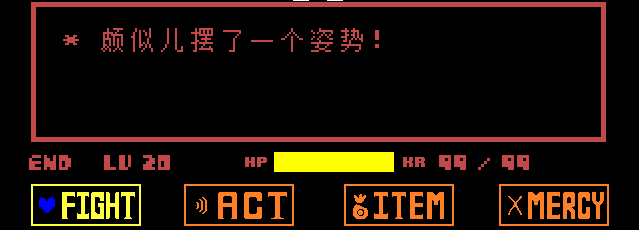

Here you can set author info, the game icon, the initial Scene, and similar options.

---

## Version & Info

Open `conf.lua` in the directory; this is the file used to fill in information.<br>
In most cases, you only need to look at the content before the `love.conf(t)` function.

```lua
_VER = "3.0.0-stable"
_RELEASED = false
_INFO = {
    TITLE = "Soul Engine - v3.0.0",
    VERSION = "0.0.0", -- THIS IS YOUR GAME'S VERSION, the "_VER" upon means the engine's version.
    AUTHOR = "end",
    CONTACT = "NaN",
    WEBSITE = "NaN",
}

LOGICAL_WIDTH, LOGICAL_HEIGHT = 640, 480
CANVAS_WIDTH, CANVAS_HEIGHT = 640, 480
SCREEN_SCALE = "integer"        -- how the game canvas is scaled
FILL_SCREEN = true              -- legacy switch, only takes effect when SCREEN_SCALE is nil
USE_ERRHANDLER = true
```

Below is an introduction to the main variables:

- `_VER` Engine version number. You may change this to your own game version number; this is not required, since it does not matter whether the engine version is displayed. A real game version follows below.
- `_RELEASED` Whether this is a released version. Set to `true` before packaging and exporting. (Though I think most people will forget.)
- `_INFO` Info table; this info is shown in the `error screen` and the `window title`.
    - `TITLE` Window title. Not viewable on Android.
    - `VERSION` Game version. This is the current version of your game; for example, once released, you can give it a label like `1.0.0`.
    - `AUTHOR` Game author. (Will be shown on the error screen)
    - `CONTACT` Contact info. (Will be shown on the error screen)
    - `WEBSITE` Game website, which can be a release page or an address for feedback. (Will be shown on the error screen)
- `LOGICAL_WIDTH / HEIGHT` Size of the game window, default `(640, 480)`. A second recommended size is `(960, 540)`; this size is for the case with a border.
- `CANVAS_WIDTH / HEIGHT` Size of the game canvas, default `(640, 480)`. Modifying the size is not recommended; just keep the default.
- `FILL_SCREEN` Whether to let the game scale itself proportionally as the window is enlarged to fullscreen. <u>Now only a legacy switch</u>: it only takes effect when `SCREEN_SCALE` is not written (`nil`); for new projects, change the following one directly.
- `SCREEN_SCALE` How the game canvas is scaled, default `"integer"`. The canvas is **always centered**; the border scales together with the canvas, so the window frame and the game image will not be misaligned.
    - `"integer"` Only scales by integer multiples, pixel-perfect. When the window is 1.5× larger than the canvas, use 1×; when more than 4× larger, use 4×.
    - `"auto"` Tries to fill the window, allowing fractional multiples.
    - A number means a fixed multiple; `false` keeps 1:1 with no scaling.
    - During runtime you can switch with `SetScreenScale(mode)` and read the current multiple with `GetScreenScale()`.
- `USE_ERRHANDLER` Whether to enable the custom error screen, default `true`. If an error occurs it enters the "Doge" (annoying dog) screen. If disabled, the default error style is kept.

Custom error screen:<br>


---

## Game Initialization

In the same directory as `conf.lua` there is another config file: `conf_pure.lua`. This file is responsible for the various initialization contents of the game.

There are actually **two** copies of the initialization config, and they are **stacked**:

| File | Purpose |
|---|---|
| Root `conf_pure.lua` | Engine defaults; lays out all variables |
| `Game/conf_pure.lua` | Your game's overrides; executed later, same-named variables override the engine copy |

So if you only want to change a few lines, just write those lines into `Game/conf_pure.lua`; anything not written automatically inherits the engine defaults. Even if you break the engine copy it won't freeze — when the Game-region copy errors out, the engine rolls back entirely to the defaults and prints a `[Conf] WARNING`. Press `F2` to re-run both config files.

By function, we divide the content of this file into four sections: initialization, Controller, Network, and memory management.

---

### Initialization

```lua
Global.SetVariable("FirstRoom", "Battle.scene_battle_init")
Global.SetVariable("MainColor", {1, 1, 1})
Global.SetVariable("EnableFriskDance", false)
Global.SetVariable("Language", "zh_CN")
Global.SetVariable("UseRealTime(dt)", false)
Global.SetVariable("ScreenShaders", {})
Global.SetVariable("FPS", 60)
Global.SetVariable("F2Room", "scene_logo")
Global.SetVariable("Volume", {
    Master = 1,
    Music  = 1,
    Sounds = 1
})
```

- `FirstRoom` Initial Scene. The first Scene after launching the game is this one. The engine default is `Battle.scene_battle_init`; note that the same variable is written several times in the file, **the last one wins** — when changing it to your own Scene, remember to write it at the very bottom.
- `MainColor` Main color. If you want to make an AU like `Underfell`, you can set this value to pink; the vast majority of elements will follow this color.
- `EnableFriskDance` Enables the "genocide dance" feature in the Overworld; the engine disables it by default (`false`).
- `Language` Language file, currently using `zh_CN` (Simplified Chinese).
- `UseRealTime(dt)` Use real-world time. Including Player movement, nothing is affected by lag.
- `ScreenShaders` Screen effects.
- `FPS` Frame rate.
- `F2Room` The Scene you go to after pressing `F2` (see [Developer Tools → Engine Hotkeys](../070_develop/030_hotkeys.md) for what each hotkey does).
- `Volume` Volume level.

Battle Scene with the `Underfell` main color set:<br>


---

### Input Control

```lua
Global.SetVariable("ControllerSimulation", {
    virtualKeyboard = false,
    joystick        = false,
})
Global.SetVariable("ControllerDeadzone", 0.15)
```

- `ControllerSimulation` Simulates input during the unreleased phase; can simulate a joystick and virtual touchscreen.
- `ControllerDeadzone` How large the gamepad deadzone is; if this value is too small the Player may start responding as soon as the stick is barely touched.

For the complete input interface (logical key table, `Controller.GetState`, etc.) see **[Input & Controller](./150_controller.md)**.

---

### Network

```lua
Global.SetVariable("GamejoltID", nil)
Global.SetVariable("GamejoltPK", nil)
Global.SetVariable("DiscordAppID", "1342517648348680202")
```

- `GamejoltID / PK` The game's ID and private key; see [Network Development → GameJolt](../090_network/000_gamejolt.md) for details. `GamejoltPK` also acts as the plain-text fallback of the [Native Secret Store](../070_develop/050_secrets.md) when no compiled library is present.
- `DiscordAppID` The app used to display Discord Rich Presence; you can create a new one; see [Network Development → Discord RPC](../090_network/010_discord.md) for details.

---

### Memory Safety

!!! danger "Risk"
    Disabling this part may cause the game to run out of memory.<br>
    Please think twice before disabling it.

```lua
Global.SetVariable("SE_MEMORY_SAFETY", true)    -- DANGEROUS
Global.SetVariable("OPT_COUNT_SPRITES", 2000)
Global.SetVariable("OPT_COUNT_TYPERS", 300)
Global.SetVariable("OPT_MEMORY_MAXSIZE", 0.8)
Global.SetVariable("OPT_LRU_SPRITES", {false, 180})
Guard = ImportFile("Engine.MemorySafety")
```

- `SE_MEMORY_SAFETY` This protects against the game running out of memory. Without protection, the computer's RAM may be filled up and crash. It can be disabled, but the consequences are yours to bear.
- `OPT_COUNT_SPRITES` Maximum number of images allowed at the same time, default 2000; warnings start at 2000, and creation is rejected at 4000.
- `OPT_COUNT_TYPERS` Maximum of 300 Typers allowed on screen at the same time.
- `OPT_LRU_SPRITES` Sprite cache recycling, default `{false, 180}`, meaning **off**: the second item's `180` seconds is the judgment duration, but when the first item is `false` the recycling is not triggered — once a sprite enters the cache it stays there. To turn it on, change to `{true, 180}` — any image unused for more than `180` seconds gets recycled, and re-read from disk next time it is used.

`Guard` is the execution library; after fetching the settings above, it will interfere with operations in the sprite library / typer library.
