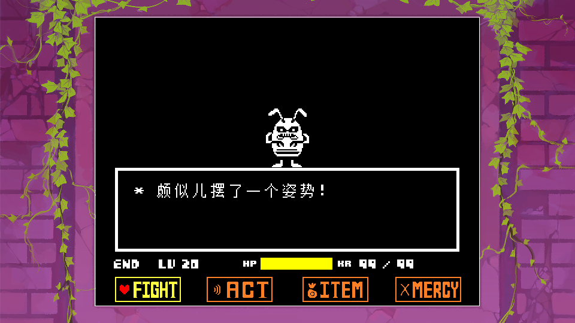

Perhaps you have played or seen works like `Undertale BNP`. 
Besides a centered game screen, their game also has a ring of outer border.

Border library location: `Scripts/Libraries/Utils/Border.lua`

---

## Registering a Border

The engine registers a border, but only the ruins and default borders are usable. 
The bad news is, due to offset and scaling issues, the `idle` border is not recommended. There used to be an alternative — drawing a 1px white line around the canvas — but it is now also turned off together with the border (see below).

Setting that aside, use `Border.RegisterImage(name, path)` to register a border, similar to a global variable, and it will need to be called by `name` later.

- `name` The border's code name.
- `path` The border's path, counted from the `Resources/Sprites/Border/` folder.

---

## Enabling the Border

!!! warning "The border and that white line are not drawn now"
    In `main.lua`'s `love.draw` **both places are commented out**:

    - `Border.Draw()` — the border image itself. It was originally drawn at a fixed window size, and the offset and scaling don't match.
    - The `1px` white line around the canvas (`rectangle("line", -1, -1, CANVAS_WIDTH + 2, CANVAS_HEIGHT + 2)`) — the "big white frame" that used to replace the border image.

    So the current default screen is **clean**, with no decoration around it. To restore either one, uncomment the corresponding lines, or call `Border.Draw()` manually in a Scene. The library itself is perfectly fine: it scales with `SCREEN_SCALE` and centers with the canvas.

If you want to see the border effect in the fastest time, use the following two functions:

Use `Border.SetEnabled(true)` to enable the border. 
Use `Border.FadeIn(dur)` to set the fade-in duration (seconds).

!!! example "Other functions"
    - `SetImage(img)` Switches the border to a registered image name.
    - `SetAlpha(a)` Sets the border's transparency, also an important approach for fade in/out.
    - `FadeOut(dur)` Spends `dur` seconds fading out and disappearing.
    - `SetOpening(x, y)` Manually specifies the top-left pixel coordinate of the "window opening" (i.e. where the game image is) on the border image.
    - `GetOpening(imgW, imgH)` Returns the offset of the window opening relative to the border image's top-left. When not manually set, it is auto-computed by canvas centering.

---

## Other Operations

If you want to draw something else in the border area, modify the `Border.Draw` function, but note you can only use `love2d`'s official drawing methods; see [With LOVE Development → Graphics](../060_with_love/000_graphics.md) for details.
