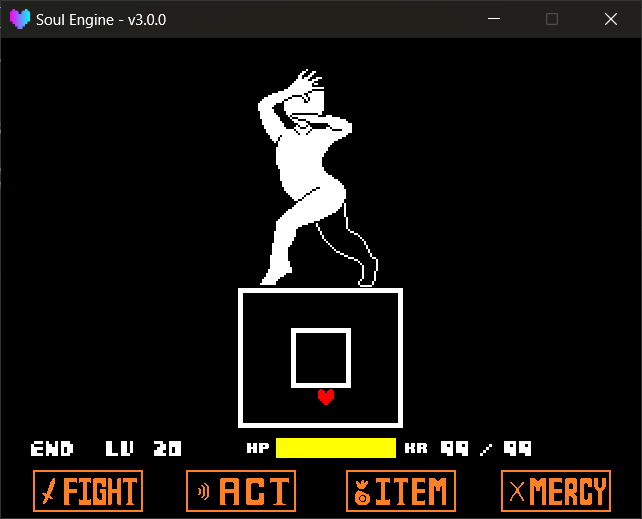

The battle box (`Arena`) is that white frame the player's Soul gets locked inside.<br>
In the engine it is an **independent, freely modifiable rectangular/elliptical region** — not a sprite. Scaling, rotating, punching holes, and moving are all driven by numbers.

Path: `Scripts/Libraries/Battle/Arenas.lua`.<br>
It appears in the battle scene as the global variable `Arenas`; the **main battle box** is fixed on `Battle.mainarena`.

---

## Two Modes

`mode` determines whether this box is a "place you can stand" or a "place you cannot stand":

| Mode | Meaning | Effect |
|---|---|---|
| `plus` | **Plus zone** | The player is locked inside; hitting an edge gets pushed back |
| `minus` | **Minus zone** | The player is blocked outside; walking in gets ejected to the nearest valid position |

The two can be stacked: a large `plus` box provides the activity area, then stack a few small `minus` boxes to punch holes in the middle — producing the original-game kind of battlefield with "pillars inside the box".

!!! tip "The Main Battle Box Is plus by Default"
    On entering battle, `Battle.mainarena` is a `plus` rectangle; during the player's turn its size is `565x130` (the battle box itself),<br>
    and on entering the enemy's turn it automatically shrinks to `155x130` (the bullet box). These two sizes are switched by `Battle` itself, so normally you don't need to change them manually.

---

## Creating a Box

!!! example "Arena Methods"
    - `Arenas.New(mode, shape, x, y, width, height, angle)` Create a new battle box, returns the box object.
        - `mode` `"plus"` or `"minus"`, default `"plus"`.
        - `shape` The shape; currently only `"rectangle"` is recommended; `"circle"` / `"ellipse"` work in some collision checks, but **will not generate a display sprite**.
        - `x` / `y` Center coordinates, default `320, 320`.
        - `width` / `height` Width and height, default `155, 130`; values below `16` are forced up to `16`.
        - `angle` Rotation angle (degrees), default `0`.
    - `Arenas.Clear()` Destroys all boxes **except the main battle box**.
    - `Arenas.PlayerOnGround(player)` Whether the player's "feet" touched the box edge (judged along the gravity direction; works for all four orientations).
    - `Arenas.PlayerOnCeiling(player)` Whether the player's "head" touched the box edge.
    - `Arenas.insts` The current instance list of all boxes.
    - `Arenas.stencils` The current list of all masks, usable for clipping bullets.


---

## Box Properties

The created box object can directly read/write these fields:

!!! example "Arena Properties"
    - `mode` / `shape` The mode and shape passed in at creation.
    - `x` / `y` / `width` / `height` / `rotation` The **current** values (smoothly moving toward the target values).
    - `target` The target value table `{x, y, width, height, rotation}`; change this to make the box move.
    - `speeds` The change-speed table `{x, y, width, height, rotation}`, default `7.5 / 7.5 / 15 / 15 / 15`.
    - `thickness` The white-border thickness, default `5`.
    - `is_active` Whether it participates in collision. When off, the box is still on screen but the player passes right through it.
    - `is_containing` Whether the player is currently inside this `plus` box.
    - `move_player` Whether to carry the player along when the box moves, default **`false`** — set it back to `true` when the box is meant to drag the player with it.
    - `white` / `black` The two sprites that make up the box (outer white, inner black).
    - `mask` The box's own mask object (only `plus` has one).

!!! warning "Change Speed Is Per-Frame, Not Per-Second"
    The values in `speeds` are **how many pixels to advance per frame**; the engine does not multiply by `dt` during smoothing.<br>
    That is, the same `speeds` at 60 FPS and 120 FPS will differ by a factor of two in how fast the box scales. When writing waves, tune by the `60 FPS` empirical values, or use `ResizeWithTime` to control precisely.

---

## Changing Shape

All the "change the value" functions write to `target`; the box smoothly moves there on its own. To apply instantly, find the variant with the `imm` parameter.

!!! example "Size and Position"
    - `Resize(w, h, imm)` Change width and height. When `imm` is `true`, applies immediately.
    - `ResizeWithSpeed(w, h, speedw, speedh)` Change width and height and specify the speed.
    - `ResizeWithTime(w, h, timew, timeh)` Change width and height; the speed is auto-computed from "how many frames to arrive".
    - `MoveTo(x, y, imm)` Move the center point. When `imm` is `true`, applies immediately.
    - `RotateTo(rotation)` Rotate to the specified angle.
    - `ResetSpeed()` Restore all speeds to default.

### Single-Side Stretch

Effects like "the box's top edge pushes out a block" in the original game are done with the four functions below; they **automatically correct the center point while stretching**, keeping the opposite edge fixed:

!!! example "Single-Side Methods"
    - `UpSide(value)` Extend the top edge upward by `value` pixels (negative shrinks).
    - `DownSide(value)` Extend the bottom edge downward.
    - `LeftSide(value)` Extend the left edge leftward.
    - `RightSide(value)` Extend the right edge rightward.

??? example "Opening/Closing a Box Top and Bottom"
    ```lua
    local Arena = Battle.mainarena

    -- When the enemy turn starts: push the box taller by 40 pixels, over about 15 frames
    Arena:UpSide(40)
    Arena:DownSide(40)

    -- After some frames, retract again
    Arena:UpSide(-40)
    Arena:DownSide(-40)
    ```

---

## Appearance

!!! example "Appearance Methods"
    - `SetThickness(t)` Set the white-border thickness.
    - `OuterColor(color)` Set the outer color, default follows the global variable `MainColor`.
    - `InnerColor(color)` Set the inner fill color, default black.

---

## Getting Coordinates

When writing bullets you often need "fire from somewhere on the box's top edge"; these two functions save you from hand-computing rotation:

!!! example "Coordinate Methods"
    - `GetCenterPos(side)` Returns the `x, y` of the **midpoint** of an edge. `side` is `"up"` / `"down"` / `"left"` / `"right"`.
    - `GetCornerPos(corner)` Returns the `x, y` of a corner. `corner` is `"ul"` / `"ur"` / `"dl"` / `"dr"`.

Both functions do rotation compensation — however many degrees the box is rotated, the returned point rotates along with it.

---

## Followers

Some things (e.g. decorations hanging on the box edge) need to move with the box; use `AddFollower` to attach them, and they auto-sync coordinates every frame:

!!! example "Follower Methods"
    - `AddFollower(sprite, position)` Make a sprite follow the box.
        - `sprite` The sprite object to follow.
        - `position` Where to attach; values are the same as the two coordinate functions above (`"up"`, `"ul"`, `"left"` ...).
    - `Destroy()` Destroy this box and its two sprites.

---

## Mask

If bullets are drawn directly, the parts outside the box also show up. The original game relied on a **mask** to clip the outside-of-box parts:

```lua
local wave = ImportFile("Battle.Waves")
local Arena = Battle.mainarena

-- Create a mask that follows the battle box
local mask = Masks.New("rectangle", 320, 320, 155, 130, 0, 0)

-- Make it follow the box every frame (mask syncs when the box scales/moves)
function wave.Update(dt)
    mask:Follow(Arena.black)
end

-- Apply the mask to bullets
bullet:SetStencils({mask})
```



---

## Common Pitfalls

- **The box scaled but the bullets didn't get clipped along** — you forgot to call `mask:Follow(Arena.black)` every frame.
- **The player gets ejected to an unexpected position** — after being pushed out by a `minus` box, if the landing spot is also invalid, the engine searches outward in rings for the nearest valid point; if none is found it stays put. This happens when you place `minus` boxes too tightly.
- **The box snaps into place instantly** — check whether you mistakenly passed `imm = true`, or gave `speeds` too large a value.
