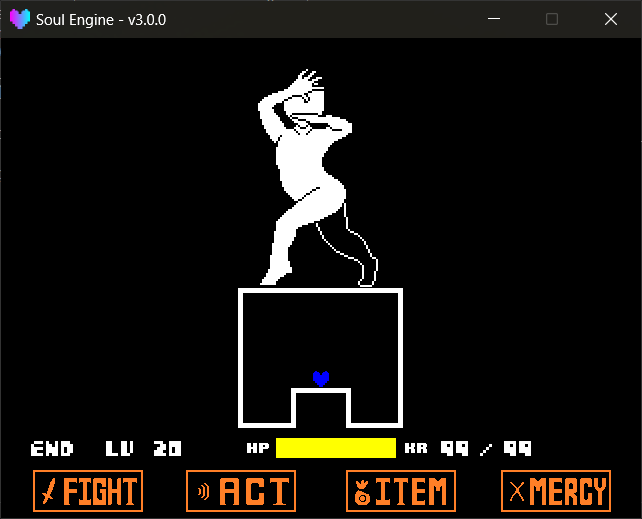

This page covers two things: the **Player itself** (HP, taking damage, KR), and the **Soul** (which decides how the player moves).

Path: `Scripts/Libraries/Battle/Player/`.<br>
It appears in the battle scene as the global variable `Player`.

---

## Player

`Player` holds the player's battle data and also owns the Soul's sprite.

!!! example "Player Properties"
    - `name` The player's name.
    - `lv` Level.
    - `maxhp` / `hp` Maximum HP / current HP.
    - `kr` The current `KR` (karma, i.e. the purple damage that keeps draining HP over time) value.
    - `canMove` Whether the player can control the Soul right now.
    - `sprite` The Soul's sprite object.
    - `action` **The Soul module itself** (see the next section).
    - `soul` The current Soul's name, e.g. `"red"`, `"blue"`.
    - `souls` The list of extra Souls created via `NewSoul`.
    - `platforms` The one-way platform list (built by `Player.BluePlatform`). **Any Soul can use it** — see "One-Way Platforms" at the end of this page.
    - `platform_ground` Whether the player is currently standing on a one-way platform.
    - `hurt_time` Remaining time of the invincibility frames after taking damage.

!!! example "Player Methods"
    - `Player.SetSoul(id, args, use_sound)` Switch Soul.
        - `id` The Soul's name, or numeric shortcut: `1` = `"red"`, `2` = `"orange"`, `6` = `"blue"`.
        - `args` Extra parameters passed to the Soul's `Init`.
        - `use_sound` When `true`, plays `snd_ding.wav`.
    - `Player.NewSoul(id, args, use_sound)` Create an extra **independent** Soul (its own sprite, its own state), commonly used for effects like twin Souls.
        - `args` Also passed to `Init`.
    - `Player.SetHitBox(width, height, soul)` Set the Soul's collision box, default `{4, 4}`.
        - `soul` When omitted, changes the main Soul; when a Soul table is passed, changes that one.
        - Passing `0` or a negative number is silently changed to `1`; to "disable collision" you must skip the collision loop yourself.
    - `Player.SetPerfectPixel(enabled)` Switch the main Soul and every extra Soul in `Player.souls` to **perfect-pixel collision** (judged by the sprite's actual pixels rather than the `_hitbox` rectangle), returns `(available, rectangle count)`.
        - For a `16×16` heart, enabling it makes the hit area **larger than the default `4×4`** — a feel tradeoff; choose between this and `SetHitBox`.
    - `Player.Heal(amount, use_sound)` Heal; won't exceed `maxhp`.
    - `Player.Hurt(amount, time, use_sound)` Deduct HP.
        - `amount` How much to deduct (a negative value heals).
        - `time` Invincibility-frame duration, default `60`; during this time the Soul flickers and no longer collides.
    - `Player.AddKR(kramount)` Increase `KR`. Only takes effect when `KR` is enabled, and won't directly drop HP below `0`.
    - `Player.AddParticle()` Generate a Soul afterimage at the current position.
    - `Player.Update(dt)` Called by the engine every frame; normally you don't need to call it manually.

!!! warning "HP Reaching Zero Switches Scene Directly"
    Inside `Player.Update` it is hardcoded: when `hp + kr <= 0`, it immediately `Scenes.switchTo("scene_gameover")`.<br>
    To make a "locked-HP, can't-die" story battle, manage `hp` yourself, or clamp the damage inside the `OnHit` callback.



---

## Soul

**A Soul is simply a Lua module** that must contain at least one `Update(dt)`.

Soul path: `Game/Souls/` (Game area, priority), `Scripts/Libraries/Battle/Player/Souls/` (engine default, fallback).

!!! danger "`Player.action` IS the Soul Module Itself"
    `SetSoul` does **not** copy the Soul module; it directly mounts the module table onto `Player.action`.<br>
    This means all `self.xxx` written inside the Soul stay in the module table. The engine **re-executes the file** every time it loads a Soul, precisely to avoid the previous battle's state leaking into the next — **so do not cache things in the Soul that "should only be initialized once"; write every `Update` as if it's a fresh game**.

### Soul Template

```lua
local action = {
    sprite = nil,
    can_move = true,
    is_moving = false,
    -- use_platforms = true,   -- optional: caught by Player.BluePlatform's one-way platforms
}

-- Default vars.
local speed = 2

-- Called once each time we switch to this Soul: bind sprite, color, reset state.
function action.Init(sprite, can_move, args)
    action.sprite = sprite
    if (can_move ~= nil) then
        action.can_move = (can_move ~= false)
    end
    if (sprite) then
        sprite.color = {1, 0, 0}   -- delete this line if you don't want to color it
    end

    speed = 2                       -- your own counter / switch is also reset here
    return action
end

function action.Update(dt)
    if (not action.sprite) then return end
    -- TODO: your movement logic
end

return action
```

!!! example "Soul Available Fields"
    - `sprite` The player sprite handed to the Soul by the engine inside `Init`.
    - `can_move` Copied in by the engine from `Player.canMove` at the moment of switching Souls; when `false` it should not move. Note it is not written back every frame — changing `Player.canMove` at runtime is the engine clamping movement inside `Player.Update` itself; you don't need to sync this field.
    - `is_moving` Maintained by yourself, used to decide whether to play a movement animation.
    - `use_platforms` **Optional field, omitted by default**. Only when written as `true` will it be caught by `Player.BluePlatform`'s one-way platforms; if not written, it passes straight through. See "One-Way Platforms" at the end of this page.

!!! note "Initialization Is Written Inside the Soul (the Engine No Longer Does It for You)"
    `SetSoul` only does three things: resolve the name, call `Init(sprite, can_move, args)`, and record the name into `Player.soul`.<br>
    What color the sprite gets, what the starting speed is, which direction it faces — all decided by the Soul itself inside `Init`. To change these **only edit the Soul file**; don't touch the engine.<br>
    Old Souls without `Init` still run fine: the engine will stuff `sprite` / `can_move` in itself and remind you once in the console.

When writing your own Soul, read input uniformly with `Controller.GetState("left")` and the like, not `Keyboard` — only gamepads respond.

---

## The Four Built-in Souls

These four Souls all color their own sprite inside their `Init` (red `{1, 0, 0}`, orange `{1, 0.5, 0}`, blue `{0, 0, 1}`, yellow `{1, 1, 0}`); to change the color, edit the Soul file.

### Red `red`

The most ordinary eight-directional free movement. Holding `cancel` halves the speed (the original's "slow walk").

```lua
Player.SetSoul(1)   -- or "red"
```

### Orange `orange`

Also eight-directional movement, but can **only move along the eight directions** (diagonals are also strictly 45°), and leaves a trail of afterimages behind while moving.

```lua
Player.SetSoul(2)   -- or "orange"
```

### Blue `blue`

A Soul with gravity; falls downward and can jump. Among the engine's built-in Souls, **only it** writes `use_platforms = true`, so only it can stand on one-way platforms by default — other Souls can too if they add this field.

```lua
Player.SetSoul(6)   -- or "blue"
```

!!! example "Blue Soul Methods"
    These methods hang on the Soul module, and `Player.action` **is** the Soul module itself, so call them all with a **dot**, without passing `self`:

    ```lua
    Player.action.SlamAuto(0, 1, 10)
    ```

    Writing `Player.action:SlamAuto(...)` would error on the spot.

    - `Angle(angle)` Only rotates the sprite, **does not change** the gravity direction.
    - `AngleDir(direction, angle)` Sets both the gravity direction and the sprite angle.
    - `AngleAuto(angle)` Sets the sprite angle; the gravity direction is auto-derived from the angle (`0` = down, `90` = left, `180` = up, `270` = right).
    - `Slam(angle, hp, inv)` Slam toward the current gravity direction. On landing, calls `Player.Hurt` with `hp` / `inv`.
    - `SlamDir(direction, angle, hp, inv)` Specify the gravity direction then slam.
    - `SlamAuto(angle, hp, inv)` Derive the gravity direction from the angle then slam.
    - `GetDirection()` Returns the current gravity direction.
    - `SetDirection(direction)` Only changes the gravity direction, leaves the sprite angle alone.
    - `GetSpeed()` Returns the current vertical speed (positive = falling).
    - `SetSpeed(value)` Directly change the vertical speed.
    - `SetCanJump(value)` Lock / unlock jumping.
    - `SetJumping(value)` Force enter / exit the "jumping" state.
    - `Land()` Land: zero the speed and restore jumping ability.
    - `Reset()` Restore all state to default.
    - `Init(sprite, can_move, args)` Called by the engine when switching to this Soul: colors blue, rotates sprite back to `0`, then `Reset()`.
    - `Update(dt)` Called by the engine every frame.

The `hp` / `inv` of the three `Slam` functions are for "self-damage from slamming": fill them in if you want a "slamming costs you" mechanic; if not, fill `0` or omit.

### Yellow `yellow`

Also eight-directional movement, but pressing `confirm` fires a **heart-shaped bullet**. The bullet has a bit of gravity, grows as it flies, and disappears off-screen or when it hits another bullet; to catch your own bullet, just add a `HitCall` function to the target bullet.

```lua
Player.SetSoul("yellow")   -- no numeric shortcut, must write the name
```

- Firing cooldown is 5 frames; sound is `snd_shoot.wav`.
- Bullet image is `Soul Library Sprites/spr_heartbullet_1.png`.
- Holding `cancel` also halves the movement speed.

!!! note "The Charge Performance Is Hooked Up, but the Big Bullet Itself Isn't Yet"
    Holding `confirm` starts charging (total duration `60` frames), with two staged performances:

    1. At 1/3 charged, four small dots spiral inward from the surroundings onto the Soul;
    2. When fully charged, a **semi-transparent, pulsing yellow shadow** overlays the Soul (the "charge complete" marker, which follows the Soul every frame).

    Any **release** clears the charge to zero, and the two effect layers fade out on their own — so releasing midway leaves no residue.

    But **releasing won't actually fire a big bullet**: that bullet pattern isn't written yet. So this part is currently just a "visible" performance.

    To actively clear the residual charge effects on screen (e.g. on wave switch), call:

    ```lua
    Player.action.ClearBigshot()
    ```

    It only clears the effects, not the charge counter. It's already auto-cleared once in `Init` when switching Souls.

---

## One-Way Platforms

A set of platforms that **only catch the player from above**: the player can jump up through them from below, and won't get mysteriously sucked up when standing beneath them.

The platform itself is **Soul-independent**; the `Player.BluePlatform` function name is a historical leftover (it was originally written only for the blue Soul).

!!! example "Platform Methods"
    - `Player.BluePlatform(x, y, width, args)` Create a platform, returns the platform object.
        - `x` / `y` Center coordinates, default `320, 320`.
        - `width` Width (pixels), default `50`.
        - `args` Optional settings table:
            - `mode` `"none"` (static) or `"move"` (carry the player along when the platform drifts sideways), default `"none"`.
            - `speed` `{x = n, y = n}` Per-frame displacement. **It applies whenever it is set, whatever `mode` is** — `mode` no longer gates movement.
            - `rotation` Platform angle, default `0`.
            - `color` Platform color, default `{1, 0.3, 1}`.
            - `layer` The layer it sits on, default `"BelowBullets"`.
            - `active` Whether it participates in collision, default `true`.
            - `surface_offset` Extra offset of the collision surface relative to the top edge, default `0`.
            - `surface_tolerance` Half-thickness of the collision band, default `2`.
            - `line_color` / `line_alpha` The color and alpha of the top highlight line.
    - `Player.ClearPlatforms()` Destroy all platforms.

!!! example "Platform Object Methods"
    - `MoveTo(x, y)` Move the platform (the highlight line auto-follows).
    - `SetRotation(angle)` Set the angle.
    - `SetWidth(w)` Set the width.
    - `Sync()` Manually sync the highlight line; normally not needed.
    - `SetStencils(stencils)` Apply a mask to the platform image **and** its highlight line, usually `platform:SetStencils({Arena.mask})`.
    - `Step` A convention field, not a built-in function: assign `platform.Step = function (self) ... end` and `Player.UpdatePlatforms(dt)` calls it once per frame — after the platform moves and `Sync()`s, before the ground check. **No `dt` argument.** See [Basic Development → Step Hook](../../020_basic/170_step.md).
    - `Destroy()` / `Delete()` Destroy this platform.

??? example "A Platform That Moves Left and Right"
    ```lua
    local p = Player.BluePlatform(320, 350, 60, {
        mode  = "move",
        speed = {x = 2, y = 0},
        color = {1, 1, 0.3}
    })

    -- You can also push it yourself in the wave's Update
    function wave.Update(dt)
        p.image.x = 320 + 40 * math.sin(math.rad(Battle.TIME_F))
    end
    ```

!!! tip "To Be Caught, the Soul Must Write a `use_platforms` Line Itself"
    Platforms are **opt-in**: only a Soul table that writes `use_platforms = true` gets caught; **without it, it passes straight through**.

    ```lua
    local action = {
        sprite = nil,
        can_move = true,
        use_platforms = true,   -- <- add this line, and Player.BluePlatform will catch it
    }
    ```

    - Among the engine's built-in Souls, currently **only blue** has this field — so the default behavior is the same as before: switch to red/orange/yellow and you fall through the platform.
    - The field only falls back to the old check (`Player.soul == "blue"`) **when missing**, so your own `Game/Souls/blue.lua` without the field still walks the platform fine; no need to change it.
    - The collision itself (`Player.BluePlatformCollide(sprite, vertical speed)`) only looks at the sprite and vertical speed, **Soul-independent**.<br>
      Souls created via `Player.NewSoul` are not auto-collided by the engine; if you want its own `Update` to stand on a platform, call once yourself:

    ```lua
    Player.BluePlatformCollide(soul.sprite, soul.GetSpeed())
    ```

---

## Damage Collision

Collision is not computed by the Soul itself, but uniformly by `Player.Update`:

1. During invincibility frames (`hurt_time > 0`), skip all collision directly.
2. Otherwise, iterate over all sprites with `isBullet`, first use `Sprites.GetHitbox` to get the Soul's hit box (with `_hitbox` override), then do the broad-phase check with `Collisions.ShapeWithShape` — rectangle × rectangle normally, but an ellipse for a side marked with `SetHitboxShape("ellipse")`.
3. After a broad-phase hit, use `Sprites.PPCollide(bullet, Player.sprite)` for a fine check:
    - Returns `true` / `false` and that is authoritative (meaning either the bullet or the Soul has **perfect pixel enabled on either side**);
    - Returns `nil` meaning neither side enabled it, falling back to the rectangular conclusion from step 2.
4. If the final judgment is a hit, call `Battle.OnHit(bullet)` — **this one you write yourself in the scene**, see [Battle Scene and Callbacks](./070_scene.md).

!!! warning "To Judge by Real Pixels, Enable Like This"
    ```lua
    Player.SetPerfectPixel(true)          -- switch main Soul + all extra Souls at once
    bullet:SetPPCollision(true)           -- or just let certain bullets use pixel collision
    ```
    The per-sprite-level switch is `sprite:SetPPCollision(enabled)` / `sprite:IsPPCollision()`; details in [Sprites → Perfect Pixel Collision](../020_basic/020_sprites.md).

!!! tip "Round bullets: mark them instead of paying for pixels"
    A circle only needs the corners of its box removed, which an ellipse test does for roughly what the rectangle test already costs — no rectangulation, no rectangle list:

    ```lua
    bullet:SetHitboxShape("ellipse")   -- this bullet is tested as a circle
    Player.SetHitboxShape("ellipse")   -- or the Soul itself (add a soul object to target it)
    ```

    The ellipse is inscribed in the same box, so it can only shrink the hit area. Details in [Intermediate → Collision](../../050_intermediate/030_collision.md).

!!! example "Bullet Color"
    The `HurtMode` field on the bullet object decides whether it counts as damage; common values:

    - `"normal"` Take damage on contact.
    - `"blue"` / `"cyan"` Take damage **only while moving**; standing still is safe.
    - `"orange"` Take damage **only while standing still**; moving is safe.
    - `"safe"` Completely harmless.

    How you write this field into the scene's `OnHit` is up to you; the engine only hangs it on the sprite and passes it along.
