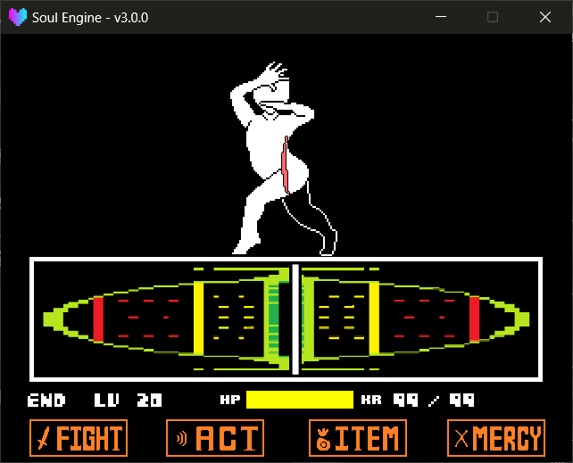

After pressing the `Fight` button, picking an enemy, and pressing confirm, the **back-and-forth sliding calibration bar** that appears in the middle of the screen is the Attack Pattern (`PlayerAttack`) at work.

It is responsible for three things: drawing the calibration bar, judging the timing of your press, and settling the damage to the enemy.

Path: `Game/Attacks/` (Game area, priority), `Scripts/Libraries/Battle/PlayerAttacks/` (engine default, fallback).



---

## Switching Attack Patterns

The default is `stick` (a stick, the most basic weapon from the original game). To switch to another weapon (e.g. the Real Knife, the gloves), write your own attack pattern file and switch:

!!! example "Switching Methods"
    - `Battle.SetAttackPattern(name)` Load and switch the attack pattern by name.
        - `name` The attack pattern file's name (without `.lua`).
    - `Battle.attack` The currently active attack pattern object.
    - `Battle.attack_paths` The list of already-loaded attack pattern module names; `Battle.Clear()` clears the cache according to it.

If the specified name can't be found, the engine prints a warning and **automatically falls back to `stick`**, ensuring the battle won't freeze:

```
[Battle - PlayerAttack] WARNING: attack pattern 'real_knife' not found. Searched, in order:
    Game.Attacks.real_knife  (Game/Attacks/real_knife.lua)
    Scripts.Libraries.Battle.PlayerAttacks.real_knife  (Scripts/Libraries/Battle/PlayerAttacks/real_knife.lua)
[Battle - PlayerAttack] Falling back to the default pattern (stick).
```

---

## What an Attack Pattern Must Provide

An attack pattern file is a Lua table; the engine calls the following functions at fixed moments:

!!! example "Required Interfaces"
    - `Restart(enemy)` Attack starts; the engine passes in the target enemy. Here you create the calibration bar and all sprites.
    - `Update(dt)` Called every frame; advances the calibration bar, reads the confirm key, settles damage.
    - `Destroy()` Cleanup: destroy sprites and set `_end` to `true`.

!!! example "Optional Interfaces"
    - `SetMaxDamage(dmg)` Force this attack's damage to a fixed value (skip the formula), used for "always deal full damage" performances.
    - `Hurt()` Notify the target enemy's animation "you got hit".
    - `Attack(data)` Notify the target enemy's animation "the attack **just launched**" (not yet settled); `data` carries:
        - `data.enemy` The target enemy table.
        - `data.damage` The planned damage for this hit.
        - `data.perfect` Whether it landed in the perfect zone.
        - `data.offset` Distance from the perfect zone, `0` = perfect.
        - `data.position` The enemy's on-screen coordinates `{x, y}`.
        - `data.attack` The attack pattern object itself.

!!! example "Fields the Engine Reads"
    - `_end` Whether the attack is finished. The engine only advances to the next enemy turn once it sees this become `true`.
    - `_missed` Whether this swing missed.
    - `_attacked` Whether the confirm key has already been pressed.

---

## How the Built-in stick Computes Damage

`stick`'s judgment logic can be copied directly:

- The calibration bar slides from one side of the screen to the other at a speed of `6` pixels/frame.
- The distance `offset` between the cursor and the target marker decides the damage:
    - `offset <= 12` → **perfect**, damage = `maxdamage + random(0, dmg_float)`.
    - Otherwise → damage = `max(maxdamage * 0.2, ceil(0.9 * maxdamage * (280 - offset) / 280))`.
- The cursor rushing out of bounds → judged as MISS, no damage added, and a `MISS` text pops at the enemy position.

When cutting in line with `SetMaxDamage(dmg)`, the formula above is skipped entirely and your given value is used directly; internally it uses a `_max` flag, **which auto-resets after each settlement**, so the next swing is unaffected.

Timeline (counted by frames):

| Frame | What happens |
|---|---|
| Press confirm | Stop the cursor, play the slash sound effect and blade flash, call `Attack(data)` |
| Frame 70 | Settle damage: HP bar animation, `Hurt()`, pop damage number, actually deduct HP |
| Frame 130 | `Destroy()` |

The MISS branch is much faster: pop MISS text on frame 1, and it ends on frame 30.

!!! tip "Where the Two Numbers in the Damage Formula Come From"
    `maxdamage` and `dmg_float` are both written in the encounter file, as properties of each enemy itself; see [Battle Initialization → Encounter File](./000_init.md).<br>
    The attack pattern only reads them, it doesn't define them.

---

## Writing Your Own Attack Pattern

The easiest approach: copy `Scripts/Libraries/Battle/PlayerAttacks/stick.lua` into `Game/Attacks/`, rename it, then modify.

Here is a minimal skeleton:

```lua
local atk = {_end = false}
local enemy = nil
local attacked = false

function atk.Restart(_enemy)
    atk._end = false
    enemy = _enemy
    attacked = false

    -- Create the calibration bar sprite here
end

function atk.Destroy()
    -- Destroy sprites
    atk._end = true
end

function atk.Update(dt)
    if (not attacked) then
        if (Controller.GetState("confirm") == 1) then
            attacked = true
            -- Compute damage, play sound, notify animation
        end
    else
        -- Play the closing performance, then call atk.Destroy() when done
    end
end

return atk
```

!!! warning "`_end` MUST be set to true"
    The engine polls `_end` to determine "is this swing finished". Forget to set it, and the battle will **permanently freeze on this swing**, with no error message.

---

## Coordinating with Enemy Animations

The attack pattern **should not** directly manipulate a particular monster's sprite — it only handles settlement; the visuals go to the animation.

These two notification functions exist for this purpose:

- `Attack(data)` Called the instant confirm is pressed; the enemy can dodge, block, or telegraph in `OnAttack`.
- `Hurt()` Called when the damage actually takes effect; the enemy can do the hit-shake in `Hurt`.

This way the same attack pattern can be applied to any monster without changing the attack pattern to swap enemies.

!!! note "How the Notification Actually Reaches the Animation"
    Both functions do only one thing: get the target animation instance from `enemy.animation`, then call its same-named method.

    ```lua
    local anim = enemy.animation
    if (type(anim) == "table" and anim._bound and anim.Hurt) then
        anim.Hurt()
    end
    ```

    That is, **the monster animation must implement `Hurt()` / `OnAttack(data)` itself to react**, and at the end of `New(pos)` it must have called `Battle.BindAnimation(self, this module)` to get `_bound`, otherwise this notification is silently skipped (no error). See [Battle Initialization → Enemy Animation](./000_init.md) for how to write the animation side.
