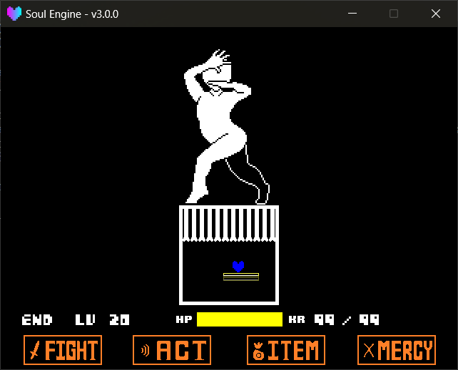
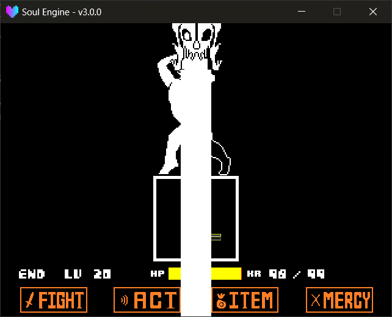

The bullet library is ready-made parts that encapsulate the original game's bones, walls, and blasters.

Path: `Scripts/Libraries/Attacks/`.<br>
Import in the wave via `wave.Import("Attacks.Bones")` and the like (see [Turn Script](./050_waves.md) for details).

After importing, you **must manually call its `Update` every frame**, otherwise the bullets won't move or collide.

---

## Bones `Bones`

```lua
local bones = wave.Import("Attacks.Bones")
bones.Update(dt)
```

### Regular Bone

!!! example "Creation Method"
    - `bones.New2D(whose, length, position, angle, velocity)` Create a bone, returns the bone object.
        - `whose` Whose bone, `"sans"` or `"papyrus"`, decides the sprite and thickness. A wrong value prints a warning and falls back to `"sans"`.
        - `length` The bone-body length (pixels).
        - `position` Center coordinates `{x, y}`, default `{320, 240}`.
        - `angle` Angle (degrees), default `0`.
        - `velocity` Per-frame displacement `{x, y}`, default `{0, 0}`.

!!! example "Bone Properties"
    - `x` / `y` / `rotation` / `length` Position, angle, length; directly modifiable.
    - `velocity` Per-frame displacement.
    - `isBullet` Whether it participates in player collision, default `true`.
    - `layer` The layer it sits on, default `"Bullets"`.
    - `width` Bone thickness; `sans` is `10`, `papyrus` is `13`.
    - `Step` Per-frame hook — assign a `function (self) ... end` (**no `dt` is passed**); it is called by `bones.Update` after the bone layout is resolved. See [Step Hook](../020_basic/170_step.md).

!!! note "Bones and Pixel Snapping"
    A bone is a composite of three sprites — head / body / tail. If you snap each to whole pixels individually, the seams would jitter.<br>
    The engine's approach: **all three parts are set with `pixel_snap = false`** (see `New2D` in `Bones.lua`), then inside `bones.Update` the shared anchor for all three is rounded **only once** (`Sprites.SnapEdge(ax + dx, half_x)`, where `half_x` is the rotation-aware AABB half-width), and from this integer anchor the three coordinates are computed.<br>
    So you **don't need** and **shouldn't** manually change the bone's `pixel_snap`; to disable snapping globally set `Sprites.pixel_snap = false`; details in [Basic Development → Sprites → Pixel Snapping](../020_basic/020_sprites.md).

!!! example "Bone Methods"
    - `SetLayer(layer)` Change layer (a bone is composed of head, body, tail sprites; changing layer must be done wholesale).
    - `SetPivot(xp, yp)` Set the pivot, values `0 ~ 1`.
        - `xp` Horizontal, `0` and `1` are the two sides of the width, `0.5` is centered.
        - `yp` Vertical, `0` is the head end, `1` is the tail end, `0.5` is the center of the whole bone.
    - `SetStencils(stencils)` Apply mask, usually `bone:SetStencils({mask})`.
    - `ToDown(arena)` / `ToUp(arena)` / `ToLeft(arena)` / `ToRight(arena)` Stick the bone to one edge of the battle box (handy for "grows out from the edge").
    - `SetMode(mode, color)` Set the damage mode and color.
        - `mode` Written into the sprite's `HurtMode`; values see [Player and Soul → Bullet Color](./030_player.md).
        - `color` The bone color; omitted means unchanged.
    - `SetColor(color)` Only change color; reverts to `MainColor` when omitted.
    - `Destroy()` Destroy. This method is **idempotent**; repeated calls won't error.


### 3D Bone

Give a set of 3D vertices; the engine projects them to 2D and connects them into bones, suitable for rotating 3D frames.

!!! example "Creation Method"
    - `bones.New3D(points, percent, mode)` Create a 3D skeleton, returns the skeleton object.
        - `points` The 3D point list, each point is `{x, y, z}`. Points with fewer than three components are auto-filled with `0`.
        - `percent` The length ratio of the connecting line to the whole edge, default `0.5`.
        - `mode` Projection method, `"orthographic"` (orthographic, default) or `"perspective"` (perspective).

!!! example "Skeleton Properties"
    - `x` / `y` / `z` Center coordinates. **Directly assigning moves all vertices together** (implemented via metatable internally).
    - `points` The original 3D point list.
    - `bulge` The "bulge" coefficient in orthographic mode; `0` is pure orthographic; greater than `0` means closer to the viewer is larger.
    - `xscale` / `yscale` The 2D scale after projection, purely visual, doesn't affect 3D data.

!!! example "Skeleton Methods"
    - `MoveTo(x, y, z)` Move the center to the specified position.
    - `Move(x, y, z)` Translate by an increment.
    - `Rotate(axis, angle)` Rotate around the center.
        - `axis` `"x"` / `"y"` / `"z"`.
        - `angle` Angle (degrees).
    - `Link(whose, point_1, point_2, percent_)` Connect a 2D bone between two vertices.
        - `point_1` / `point_2` The vertices' **1-based** indices in `points`.
        - `percent_` This bone's length ratio; omitted uses the `percent` from creation.
    - `Scale(sx, sy)` Set the 2D scale.
    - `SetLayer(layer)` Change layer (applies to all linked bones).

??? example "A Rotating Cuboid Skeleton"
    ```lua
    local bones = wave.Import("Attacks.Bones")

    local cube = bones.New3D({
        {-50, -50, -50}, { 50, -50, -50},
        { 50,  50, -50}, {-50,  50, -50},
        {-50, -50,  50}, { 50, -50,  50},
        { 50,  50,  50}, {-50,  50,  50},
    }, 0.9, "perspective")

    cube:MoveTo(320, 320, 0)

    -- 8 vertices, connect 12 edges
    cube:Link("sans", 1, 2)
    cube:Link("sans", 2, 3)
    cube:Link("sans", 3, 4)
    cube:Link("sans", 4, 1)
    cube:Link("sans", 5, 6)
    cube:Link("sans", 6, 7)
    cube:Link("sans", 7, 8)
    cube:Link("sans", 8, 5)
    cube:Link("sans", 1, 5)
    cube:Link("sans", 2, 6)
    cube:Link("sans", 3, 7)
    cube:Link("sans", 4, 8)

    function wave.Update(dt)
        cube:Rotate("y", 1)
        cube:Rotate("x", 0.5)
        bones.Update(dt)
    end
    ```

### Bone Wall

A whole wall pushed in from an edge, with a warning bar flashing.

!!! example "Wall Methods"
    - `bones.Wall(arena, whose, warntime, staytime, length, direction, rotation, interval, animation)`
    - `bones.WallComplex(arena, whose, warntime, staytime, length, direction, rotation, interval, animation)`
        - `arena` The reference battle box (usually pass `Battle.mainarena`).
        - `whose` `"Sans"` or `"Papyrus"`.
        - `warntime` How many frames the warning bar flashes.
        - `staytime` How many frames to stay fully extended.
        - `length` The wall's length.
        - `direction` Which side it comes from: `"up"` / `"down"` / `"left"` / `"right"`.
        - `rotation` Angle (degrees).
        - `interval` Bone spacing (`WallComplex` only).
        - `animation` The easing table, see below.

!!! example "Wall Object Methods"
    - `SetStencils(masks)` Apply mask to the warning bar and all bones.
    - `Destroy()` Tear down this wall early.

`Wall` is a single long-sprite strip sliding in; `WallComplex` has 20 bones per side extending individually. Both have exactly the same parameters.

The `animation` table is written like this:

```lua
{
    In  = "SineOut",   -- ease-in name
    Out = "BackIn",    -- ease-out name
    It  = 15,          -- frames used for ease-in
    Ot  = 60           -- frames used for ease-out
}
```

!!! warning "The Easing Name Gets Lowercased"
    Internally Tween resolves via `("" .. In):lower()`, so `"SineOut"` actually looks up `sineout`. Just write it as `"Sine"` + `"Out"` in two concatenated segments; don't write it like `"sineOut"`.



---

## Blasters `Blasters`

```lua
Blasters = ImportFile("Attacks.Blasters")
```

!!! danger "Blasters Are Driven by the Scene"
    `Blasters` is not mounted on the wave; `Blasters.Update(dt)` **must be written in the battle scene's `scene.update`**:

    ```lua
    function scene.update(dt)
        Battle.Update(dt)
        Blasters.Update(dt)
    end
    ```

    If written only in the wave's `Update`, the blasters stop once you leave that turn.

!!! example "Creation Method"
    - `Blasters.New(start_pos, final_pos, angles, wait_time, fire_time, gb_sprites, gb_sounds)` Create a blaster.
        - `start_pos` Spawn position `{x, y}`, default `{320, -100}`.
        - `final_pos` Where to move to (the firing position), default `{320, 240}`.
        - `angles` `{initial angle, final angle}`, default `{180, 0}`.
        - `wait_time` Frames to move into position, default `40`.
        - `fire_time` Frames the firing lasts, default `20`.
        - `gb_sprites` Sprite folder name (optional).
        - `gb_sounds` Sound folder name (optional).
    - `Blasters.NewTween(pos_tween, angles_tween, move_time, fire_time, gb_sprites, gb_sounds)` The tween version, where you can specify easing curves.
        - `pos_tween` `{start coords, end coords, easing name}`, default `{{320, -100}, {320, 240}, "QuartOut"}`.
        - `angles_tween` `{start angle, end angle, easing name}`, default `{180, 0, "QuartOut"}`.
        - `move_time` Move frames, default `30`.

!!! example "Blaster Methods"
    - `Beam(angle)` Manually fire a beam (relative to the blaster body angle). By default it auto-fires one when `wait_time` is reached.
    - `Destroy()` Destroy this blaster and all its beams early.

The engine auto-plays `snd_intro.wav` (entrance) and `snd_fire.wav` (firing).



---

## Blaster Resource Locations

Sprites and sounds are kept separate; both are **Game area priority**:

| Content | Game area | Engine directory |
|---|---|---|
| Sprites | `Game/Resources/Sprites/Blaster/<folder>/` | `Resources/Sprites/Blaster/<folder>/` |
| Sounds | `Game/Resources/Sounds/Blaster/<folder>/` | `Resources/Sounds/Blaster/<folder>/` |

The file names inside the folder are **fixed** and cannot be changed:

- `spr_gasterblaster_0.png` ~ `spr_gasterblaster_5.png` — the 6 frames from entrance to firing
- `beam.png` — the beam
- `snd_intro.wav` — entrance sound
- `snd_fire.wav` — firing sound

!!! warning "Silently Falls Back to Default When Not Found"
    When the specified folder lacks `spr_gasterblaster_0.png`, the engine prints a warning and falls back to the `Default` folder.<br>
    The sound side has one more layer of compatibility: when not found in the subfolder, it first tries the old flat layout (`Blaster/snd_intro.wav`), then falls back to `Default`.

    ```
    [Attacks - Blasters] WARNING: blaster sprites 'MyBlaster' not found at Blaster/MyBlaster/spr_gasterblaster_0.png, using 'Default' instead.
    ```

---

## Wrap-Up

!!! example "Global Cleanup"
    - `bones.Clear()` Destroy all walls and 2D bones.
    - `bones.Update(dt)` Advance all bones, skeletons, and walls.

!!! warning "`bones.Clear()` Won't Run Itself"
    Across the whole library, `bones.Clear()` **only has a definition, no caller** — the engine won't call it for you at the end of the turn.<br>
    Normally it's invisible, because you stuffed the bones into `wave.objects`, and `EndWave()` destroys everything in that table one by one (each bone object's own `Destroy()` also tears down its parts).<br>
    But if you **didn't** stuff the bones into `wave.objects`, or there are long-lived walls, you need to call `bones.Clear()` at the right time yourself. It only clears this library's own internal list, and won't touch other libraries.
