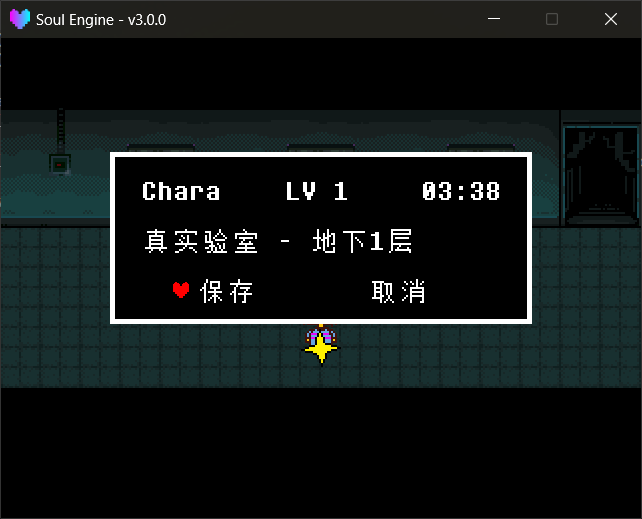

The Overworld's "pop-up that covers the screen" interfaces are all built by the engine — you only need to call them.

---

## Menu `Stat`

Automatically opened when the player presses the **menu key** (`Controller.GetState("menu")`) — no code needed.

Module path: `Scripts/Libraries/Overworld/stat.lua`, exposed as the global `Stat`.

!!! example "Menu methods"
    - `Stat.Update(dt)` called every frame, responsible for opening the menu and processing input. Already wired by the engine.
    - `Stat.Destroy()` closes the menu and restores player control.
    - `Stat._created` whether the menu is currently open.
    - `Stat._page` the current sub-page, a **lowercase string**: `"idle"` / `"item"` / `"item2"` / `"stat"` / `"cell"`.
        - `"idle"` is the state "menu open, cursor on the three big buttons" (corresponding to the `ITEM` / `STAT` / `CELL` layer below);
        - `"item2"` is the "Use / Info / Drop" three-choice after holding an item in the inventory.

### Three sub-pages

| Page | Content | Display condition |
|---|---|---|
| `ITEM` | Inventory (up to 8 slots) | Always; text dims when inventory is empty |
| `STAT` | Name, LV, HP, atk/def, weapon/armor, EXP | Always |
| `CELL` | Phone contacts (up to 10 slots) | Only when `DATA.player.getcell` is `true` |

> The `ITEM` / `STAT` / `CELL` in the table are the **names of the three buttons on the interface**, not the value of `Stat._page` — the latter is always lowercase.

After entering `ITEM`, pressing confirm again goes to the "Use / Info / Drop" three-choice (`_page` becomes `"item2"`).

!!! tip "To show CELL, set getcell"
    The third menu item only appears after `DATA.player.getcell = true`. <br>
    `stat.lua` already has `DATA.player.getcell = true` at the top level; to disable it by default, change it to `false`.


---

## Save Point `Save`

After touching a save point, just call `Overworld.SaveInteract` — it **plays dialogue first, then opens the save page**.

!!! example "Save methods"
    - `Overworld.SaveInteract(texts, location, position, direction)` plays dialogue and saves.
        - `texts` what the save point says.
        - `location` the place name shown on the save screen.
        - `position` the save coordinates `{x, y}`, usually taken from the `saves` object's properties.
        - `direction` the save facing.
    - `Save.Show()` opens the save page directly (without dialogue).
    - `Save.Hide()` closes the save page.
    - `Save.Update()` processes input, already wired by the engine.
    - `Save._active` whether the save page is open.

`SaveInteract` conveniently does three things: fully restores HP, plays `snd_heal.wav`, and writes `DATA.room` / `room_name` / `position` / `direction` / `savedpos`.

The actual save-to-disk happens when the player chooses `保存` (Save) on the save page:

```lua
Global.SetSaveVariable("Overworld", DATA)
```

!!! warning "The save is the entire DATA"
    The save writes the **entire `DATA` table**, with no whitelist and no version number. <br>
    Adding fields to `DATA` is safe; but **renaming a field will make old saves read `nil`** — think it through before release.



---

## Chest `Chest`

A chest is a **two-column exchange interface**: the left is the inventory (up to 8 slots), the right is the chest (up to 10 slots), and the confirm key moves the selected item to the other side.

!!! example "Chest methods"
    - `Overworld.ChestInteract(chest)` opens the chest page.
        - `chest` the key name in the `CHEST` table; **defaults to `"chest"` when omitted or passed `""`**.
    - `Chest.Show(chest)` same as above, opens directly. **`chest` is required** — there is no default here; passing `nil` errors directly on `#CHEST[chest]`.
    - `Chest.Hide()` closes.
    - `Chest.Update()` processes input, already wired by the engine.

!!! warning "`Chest.Show()` and `ChestInteract()` have different parameter rules"
    Only `ChestInteract` fills an empty chest name with `"chest"`; `Chest.Show` is bare and you must pass the correct name yourself.

The contents of a chest are defined in `Game/Logics/init.lua`, with the key name being the name passed above:

```lua
logic.chests = {
    chest  = {"Spider"},    -- the chest named chest contains one Spider
    chest1 = {},
}
```

It's full when it can't fit more (inventory 8 slots / chest 10 slots) — this is a hard cap.


---

## They All Lock the Player

All three interfaces set `Char.controlling` to `false` when opened and restore it when closed. So during the open period the player won't move and won't trigger any interaction.

But **only the save page and chest page** additionally call `Overworld.JustOnDialog()` once when closing (see `Hide` in `save.lua` / `chest.lua`):

| Interface | Locks player | Calls `JustOnDialog()` on close |
|---|---|---|
| `Stat` menu | Yes | **No** |
| `Save` save page | Yes | Yes |
| `Chest` chest page | Yes | Yes |

`JustOnDialog()`'s role is to lock interactions on **the closing frame**, preventing "the confirm key used to close the interface" from conveniently triggering another `onConfirm`.

!!! tip "Copy these two lines when writing your own interface"
    ```lua
    Char.controlling = false
    -- ... your interface ...
    Char.controlling = true
    Overworld.JustOnDialog()
    ```

    `JustOnDialog()` is not optional: your interface is very likely also closed with the confirm key; without it, there's a high chance that closing the interface accidentally triggers the sign / warp point underfoot.

!!! example "Frame-lock methods"
    - `Overworld.JustOnDialog()` locks all interaction results for the current frame (only affects `getInteractResult` / `onConfirm`). Should be called once after closing any custom interface.
