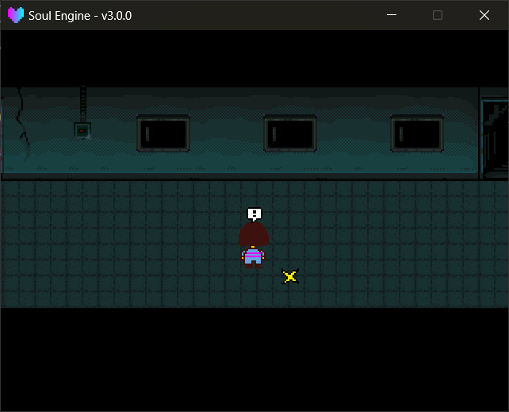

Overworld encounters are the "walk enough steps and bump into a monster" kind: the player accumulates a timer with each step, and when it fills, plays a `!` animation then switches to the Battle scene.

Module path: `Scripts/Libraries/Overworld/encounter.lua`, exposed as the global `Step`.

---

## Starting an Encounter

!!! example "Encounter methods"
    - `Overworld.InitEncounter(flag, start, range, amount)` sets this map's encounter parameters.
        - `flag` the switch name used for the kill counter (stored in `FLAG`).
        - `start` base step count.
        - `range` an additional random `0 ~ range` steps on top of `start`.
        - `amount` how many monsters this map can encounter in total.
    - `Overworld.SetBattleScene(scene, game)` specifies which Battle scene and which Encounter file to use after an encounter.
        - `scene` the scene name, e.g. `"Battle.scene_battle_ow"`.
        - `game` the Encounter file name, e.g. `"Poseur"`.
    - `Overworld.Encounter(type)` immediately triggers an encounter performance.
        - `type` the performance type; currently only `"default"` (omitted is also it).

```lua
ow.Init("Maps/main_scene/sol.lua")

-- encounter a monster every 100~160 steps, 12 monsters total on this map
ow.InitEncounter("test_killed", 100, 60, 12)
ow.SetBattleScene("Battle.scene_battle_ow", "Poseur")
```

!!! tip "More kills = slower encounters"
    The engine slows the pace based on how many `FLAG[flag]` has already killed:

    ```lua
    rho = math.min(8, amount / (amount - killed))
    time_target = rho * (start + math.random(range))
    ```

    In other words, **when only the last few are left, the interval is stretched up to 8× at most** — exactly the original game's "monsters have been wiped out" behavior.

!!! note "Four extra numbers appear in the terminal once running"
    `Step.Init` has a final line `print(time_target, rho, start, range)`, left over from early debugging. <br>
    Every `InitEncounter` prints this line of four numbers to the terminal — **it's not an error**, just ignore it.

---

## How Steps Are Counted

`Step.UpdateTime()` only increments when the player **actually moved** (pushing against a wall in place doesn't count). Already wired in `char.Update` by the engine — no need to call yourself.

The real "encounter when enough is accumulated" happens in `Step.Update()`, that line being called every frame by `Overworld.Update`.

!!! warning "Re-InitEncounter for every map"
    `rho` / `time_target` / `_run` are all **file-level local variables** in `encounter.lua`. <br>
    When switching scenes, `ow.Clear()` calls `ClearModuleTree("Scripts.Libraries.Overworld")`, dropping and reloading the entire module — so `time_target` goes back to `math.huge` and `_run` goes back to `true`.

    The result is not "carrying over the previous map's parameters", but that **this run will never encounter anything** (`step.time >= time_target` never holds), and no error is raised. <br>
    So each map's `InitEncounter` / `SetBattleScene` **must be written in that scene's own `update` or scene initialization**.

!!! tip "Don't put `InitEncounter` in `scene.update`"
    Calling it every frame keeps resetting everything except `step.time` (and prints a line of numbers each frame). <br>
    Putting it at the top level of the scene file, or guarding it with a flag on the first `update`, is enough.

---

## Nobody Came

When `FLAG[flag]` is already >= `amount` (monsters wiped out), walking another `60` steps triggers the original "Nobody came.":

- The global variable `OVERWORLD_NOBODYCAME` is set to `true`.
- Forces the Battle to switch to `Battle.scene_battle_ow` + the `NobodyCame` Encounter file.
- After the performance ends, `Overworld.ChangeScene` resets it back to `false`.

To hook your own performance, just read this global variable to decide.

---

## Encounter Performance

After `Overworld.Encounter()`, there is a fixed-length interlude (counted in frames):

| Frame | What happens |
|---|---|
| 0 | `!` pops above the player's head (uses `spr_exc_f.png` when `lv >= 10`) |
| 60 ~ 90 | `!` disappears, black screen and Soul flash every 5 frames, with `snd_tong.wav` |
| 90 | Soul flies toward the Battle box position, with `snd_encounter_fall.wav` |
| 130 | Records current position and facing, switches to the Battle scene |



---

## Bridging to the Battle Scene

The engine does this for you. While an overworld is loaded (that is, while the global `DATA` from `Game/Logics` exists), every Battle scene:

1. **On entry** — `Battle.SetGame()` pushes `DATA.player`'s real data into `Player` (name, LV, max HP, current HP) and clears `kr`, so it wins over the encounter module's template stats.
2. **On exit** — `Battle.Clear()` writes `Battle.EXP` / `Battle.GOLD` / remaining HP back into `DATA` and settles the level-up according to `DATA.lv_data` (on level-up, max HP is set per the table and the increase is added to current HP).

Both halves live in `Scripts/Libraries/Battle/init.lua` as `Battle.SyncFromOverworld()` / `Battle.SyncToOverworld()`. They are idempotent: the write-back consumes `Battle.EXP` / `Battle.GOLD`, so a scene that also does its own hand-off can never double-count.

!!! warning "Battle-only games are untouched"
    `DATA` is only created by the Overworld library (`require("Game.Logics")`). A game without an overworld never gets one, so both directions are skipped — no configuration needed.

!!! warning "Scripted fights that set their own HP"
    Set `Battle.auto_overworld_sync = false` before `Battle.SetGame(...)` for a battle that deliberately overrides `Player.hp` and must not touch `DATA`.

Use `Scripts/Scenes/Battle/scene_battle_ow.lua` as the encounter target anyway: it also sets the ending scene to `DATA.room`, meaning **after the fight you automatically return to the map you entered the Battle from**.

!!! example "Encounter-related globals"
    - `OVERWORLD_ENCOUNTER_BATTLE` `{Battle scene name, Encounter file name}`, written by `SetBattleScene`.
    - `OVERWORLD_NOBODYCAME` whether in the "nobody came" state.
    - `FLAG_KILLING_COUNTER` the kill-counter switch name currently used for encounters, written by `InitEncounter`.
    - `Battle.EXP` / `Battle.GOLD` this Battle's earnings, cleared to zero after being written back.

To write your own battle scene, copy `scene_battle_ow.lua` — but the hand-off itself is no longer something you can forget; it runs in the engine.
