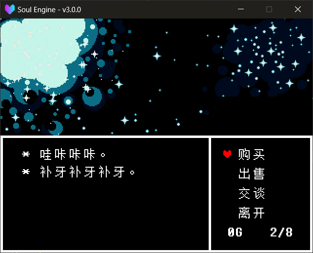

The Shop is **an independent scene**, not a page overlaid on the Overworld. When the player walks to the shop door, switch scene into it; when leaving, switch back to `DATA.room`.

Main module: `Scripts/Libraries/Overworld/shop.lua`, obtained with `ImportFile("Overworld.shop")`. <br>
Scene: `Scripts/Scenes/Overworld/Shops/scene_shop_0.lua`, scene name `Overworld.Shops.scene_shop_0`.

---

## A Complete Shop Scene

```lua
local scene = {}
local shop = ImportFile("Overworld.shop")

-- what it says on entry, and what it says when choosing "Leave"
shop.SetMainText("* 哇咔咔咔。\n* 补牙补牙补牙。")
shop.SetEndText("* 下次再来哦。")

-- shelf: fill in item ids, names looked up in ITEMS
shop.SetGoods({"CrabApple", "HotCat"})
shop.SetAmount("CrabApple", 4)              -- not set (or passed nil) = infinite stock
shop.SetBuyPrice("CrabApple", 7)
shop.SetBuyPrice("HotCat", 18)

-- right-side two columns: shopkeeper's quip + the intro panel that slides up
shop.SetBuyOpinion("CrabApple", "I\nmade\nthis.")
shop.SetIntroduction("CrabApple", "+20 HP")

-- no sell price = half the buy price (HotCat has no sell price set → 9G)
shop.SetSellPrice("CrabApple", 3)

-- rejection line: when an item with sell price 0 is selected, this plays instead of a deal
shop.SetCannotSellText("* 我这里废品已经够多了。")          -- whole-shop default
shop.SetCannotSellText("Stick", "* 如果我的店里都是木棍和绷带，\n  那我也不用开商店了。")

-- talk topics: one per line in the list
shop.AddTalk("天气", {"* 今天也一如既往。", "* 明天大概也一样。"})
shop.AddTalk("时间", "* 地下没有白天和黑夜。\n* 所以时间只是个概念。")
shop.SetQueue("天气", "时间")   -- bind into one queue, only one shown

-- background
local bg = shop.GetBackground()
bg:Scale(2, 2)
bg:SetAnimation({
    "Scene/Waterfall/spr_starpattern_0.png",
    "Scene/Waterfall/spr_starpattern_1.png",
}, 0.1)

function scene.update(dt)
    shop.Update(dt)
end

function scene.draw()
end

function scene.clear()
    shop.Clear()
    Layers.clear()
end

return scene
```

!!! danger "Both lines in `scene.clear` must be written, and the order cannot be reversed"
    `shop.Clear()` does two things: first it sets the `_onComplete` of the main text box and the opinion column to `nil`, then `ClearModuleTree("Scripts.Libraries.Overworld.shop")` unloads the module from the require cache.

    The order exists for this reason: `Layers.clear()` internally calls `Typers.ClearAll()` first, destroying each typewriter via `Destroy()`, and `Destroy()` triggers `_onComplete`. If `shop.Clear()` weren't called first, on leaving the shop that callback would re-enter shop logic on a half-dead object.

    The module **must** also be unloaded: on leaving, `shop._leaving` is set to `true`, and the first line of `shop.Update` is `if (shop._leaving) then return end`. If the module stays in the cache, **entering the shop a second time will not respond to input at all**.



---

## Interface and State Machine

The Shop has four actions, chosen by the player with the Soul:

| Action | Description |
|---|---|
| `Buy` | Open the **shelf**; confirm key deducts money at the `SetBuyPrice` price |
| `Sell` | Open **your own inventory**; confirm key adds money at the `SetSellPrice` price |
| `Talk` | Open the **topic list**; confirm key reads that topic |
| `Exit` | Leave, after saying `SetEndText` fade out back to `DATA.room` |

!!! warning "`Talk` does not show `SetMainText`"
    `SetMainText` is the greeting shown in the bottom text box **while idle** (cursor on the four buttons). <br>
    `Talk` opens the topic list, and the selected topic's body text **borrows** that same text box temporarily to display.

After choosing `Buy` / `Sell` / `Talk`, the list occupies the left column (5 rows per page, scrollable), with a red Soul as the cursor. <br>
For `Buy` / `Sell`, the right side simultaneously shows the shopkeeper's quip and the intro panel that slides up; for `Talk`, the right two columns clear.

The three actions block when **there's nothing to show**, play a line, then return to idle:

| Case | Trigger condition | Line said (localization key) |
|---|---|---|
| Shop buys nothing | `SetSellable(false)` | `Overworld.Shop.Text.NoSelling` |
| Inventory is empty | `DATA.player.items` is empty | `Overworld.Shop.Text.NoItems` |
| No topics | Not a single `AddTalk` called | `Overworld.Shop.Text.NoTalk` |

### State Machine

`IDLE → BUY / SELL / TALK`, plus two **transient** states — they hand the whole screen (and the confirm key) to the main text box:

| State | Description | Where it goes after |
|---|---|---|
| `IDLE` | Four buttons, cursor is a Soul | — |
| `BUY` / `SELL` / `TALK` | List states | Cancel key returns to `IDLE` |
| `MESSAGE` | A blocking line (not enough money, inventory full, topic body, rejection line) | Returns to the state it entered from |
| `EXITING` | Farewell line on leaving | After speaking, set `_leaving`, raise the black overlay and switch back to `DATA.room` |

!!! tip "Why the frame lock exists"
    `Typers.Update` runs **before** `scene.update`, so "the confirm key that finished reading this line" is read again by `shop.Update` in the same frame. <br>
    Without the lock, the confirm that closes the message would immediately re-open the list. The `input_lock` in the code exists for this.

### Key Bindings

| Key | Idle | In list |
|---|---|---|
| `confirm` | Enter selected action / leave | Deal, read topic, read rejection line |
| `cancel` | — | Return to idle |
| `up` / `down` | Move among the four buttons | Move in the list (scrolls at the bottom) |

---

## Method Reference

!!! example "Text"
    - `shop.SetMainText(text)` sets the line shown while idle. A string or a string array both work.
    - `shop.GetMainText()` reads it back (**always an array**, normalized internally).
    - `shop.SetEndText(text)` sets the line said on leaving.
    - `shop.GetEndText()` reads it back. Defaults to localization `Overworld.Shop.Text.Leave`.

!!! example "Shelf and stock"
    - `shop.SetGoods(list)` replaces the whole shelf.
        - `list` an array of item **id strings**, e.g. `{"CrabApple", "HotCat"}`.
        - An id not found in `ITEMS` is skipped, and `[Shop] Unknown item id: xxx` is printed.
        - Names are copied from `ITEMS` **when added to the shelf**; changing `ITEMS` afterwards does not affect items already on the shelf.
    - `shop.AddGoods(id)` adds one item to the end of the shelf.
    - `shop.RemoveGoods(index)` removes one by index.
    - `shop.GetGoods()` reads the shelf back (array of `{id, name}`).
    - `shop.SetAmount(id, amount)` sets stock.
        - `amount` passed `nil` = **infinite stock** (default); a number is clamped to `>= 0`.
    - `shop.GetAmount(id)` reads stock, returns `math.huge` when infinite.
    - `shop.IsSoldOut(id)` whether stock is `<= 0`.
        - Sold-out items stay on the shelf, but an extra `Overworld.Shop.Text.SoldOut` (`已售罄`) is appended at the line end; selecting it and confirming only plays a sound, no money deducted.

!!! example "Prices"
    - `shop.SetBuyPrice(id, price)` sets the buy price.
    - `shop.GetBuyPrice(id)` reads the buy price, returns `0` if never set.
    - `shop.SetSellPrice(id, price)` sets the sell price.
    - `shop.GetSellPrice(id)` reads the sell price. **When never set, returns half the buy price (rounded down)**, not `0`:

    ```lua
    shop.SetBuyPrice("CrabApple", 7)   -- SetSellPrice not called
    print(shop.GetSellPrice("CrabApple"))   -- 3
    ```

!!! warning "Sell price 0 = the shop doesn't buy this item"
    Selecting an item with sell price `0` and confirming will not complete a deal, but plays a rejection line (see below). <br>
    This is exactly the laziest way to write "don't buy this": **set the sell price to `0`** (or simply don't set a buy price either, in which case half of that is also `0`). <br>
    Note that for an item where `SetBuyPrice` was never even called, `GetSellPrice` also computes `0` — an item you forgot to set a buy price for cannot be sold.

!!! example "Opinion and intro"
    - `shop.SetBuyOpinion(id, opinion)` sets the quip shown on the right when buying.
    - `shop.GetBuyOpinion(id)` reads it back, defaults to localization `Overworld.Shop.Opinion.Default` (`……`) when unset.
    - `shop.SetSellOpinion(id, opinion)` sets the quip when selling.
    - `shop.GetSellOpinion(id)` reads it back, same default as above.
    - `shop.GetOpinion(id)` auto-selects by **which list is currently open**: the `SELL` page reads the sell one, the `TALK` page reads the topic-narration one, otherwise the buy one.
    - `shop.SetIntroduction(id, text)` sets the short description in the intro panel that slides up.
    - `shop.SetIntroductions(map)` batch: `SetIntroductions({CrabApple = "+20 HP", HotCat = "+12 HP"})`.
    - `shop.GetIntroduction(id)` reads it back, returns empty string `""` when unset.

!!! warning "Don't format opinion text like dialogue"
    The right-column quip and intro panel are **panel text**, not dialogue. Starting with an asterisk-space, `EText` does a two-space hanging indent, which pushes the text right out of the right column. <br>
    The topic body and rejection lines in the main text box still need the asterisk — those are real dialogue.

!!! example "Sell toggle and rejection lines"
    - `shop.SetSellable(value)` whether the shop buys anything, default `true`. After setting to `false`, choosing `Sell` only plays a line, no list opens.
    - `shop.IsSellable()` reads it back.
    - `shop.SetNoSellText(text)` the "shop buys nothing" line (used when `SetSellable(false)`).
    - `shop.SetCannotSellText(id, text)` sets the line for a **single** item being rejected. Passing a table as text means multiple segments, advancing one per confirm.
    - `shop.SetCannotSellText(text)` passing only one parameter = sets the **whole-shop default** rejection line.
    - `shop.GetCannotSellText(id)` the resolved result. **Table in, table out**: if you set multiple segments, you read back multiple segments.
    - `shop.SetCannotSellTexts(map)` batch: `SetCannotSellTexts({Stick = "...", Bandage = {"...", "..."}})`.
    - `shop.GetCannotSellTexts()` reads back that single-item table.
    - `shop.ClearCannotSellTexts()` clears all single-item lines (the whole-shop default stays).

    The `%s` in a line is replaced with the item name:

    ```lua
    shop.SetCannotSellText("Bandage", {"* 我可不需要%s。", "* 拿走拿走。"})
    ```

    Resolution order is **single item → whole-shop default → localization** `Overworld.Shop.Text.CannotSell` (`* 这个我不收。`).

!!! tip "A bare `%` in a line won't crash the shop"
    The copy is hand-written, and `formatRefusal` wraps `string.format` in a `pcall`. A broken format string is just displayed as-is, without dragging the whole shop down.

!!! example "Money and misc"
    - `shop.GetGold()` reads gold.
    - `shop.SetGold(value)` writes gold.
    - `shop.SetMaxItems(count)` inventory cap, default `8`. Buying, selling, and that `n/8` readout **share** this one value.
    - `shop.GetMaxItems()` reads it back.
    - `shop.Refresh()` redraws the gold/inventory readout; if a list is open, rebuilds the list too.
    - `shop.GetPlayer()` returns the red Soul sprite in the shop.
    - `shop.GetBackground()` returns the background sprite object; `Scale` / `SetAnimation` it yourself.
    - `shop.Update(dt)` called every frame, processes input and performance.
    - `shop.Clear()` see the danger note above.

!!! example "Text box widths"
    - `shop.SetMainTextWidth(width)` main text box width (greeting, rejection lines, topic body). Default `560` (panel `x=40..600`).
    - `shop.SetOpinionWidth(width)` right-column quip width. Default `170` (`x=460..630`).
    - `shop.SetIntroWidth(width)` intro panel width. Default `182` (`x=448..630`).
    - `shop.SetTextWidths(main, opinion, intro)` set all three at once; a `nil` argument leaves that item unchanged.
    - `shop.SetAutoWrap(enabled)` auto-wrap master switch, default **on**. When off, only hand-written `\n` is honored.
    - `shop.IsAutoWrap()` reads it back.

    After changing widths, the engine conveniently re-lays out the three panels — `EText` reads `size` while typing, and `InstText` is pre-rendered, so it needs `Rebuild()`.

---

## Talk Topics and Queues

A topic is **always a browsable list** — select and confirm to read. The body can be a single line, or an array (one segment per confirm):

```lua
shop.AddTalk("天气", "* 今天也一如既往。")
shop.AddTalk("时间", {"* 地下没有白天。", "* 所以时间只是个概念。"})
```

!!! example "Topic methods"
    - `shop.AddTalk(topic, text)` adds one, returns the new count.
        - Can also pass just a table: `AddTalk({"时间", "* 地下没有白天。"})` or `AddTalk({topic = "时间", texts = {...}})`.
    - `shop.SetTalks(list)` replaces the whole thing. Pass either an array (each entry is one item) or a `topic name = body` map.
    - `shop.RemoveTalk(index)` deletes by index.
    - `shop.ClearTalks()` deletes all.
    - `shop.GetTalks()` reads back the original table (**queues not collapsed**, order is the `AddTalk` order).

### Queue: Squeeze several topics into one line

`SetQueue` binds several topics into one queue, **showing only one of them at a time** — whichever the dialogue has progressed to. After reading the current one, reveal the next; after all are read, wrap back to the first.

```lua
shop.SetQueue("天气", "时间")        -- only one of the two is shown
shop.SetQueue({"天气", "时间"})      -- same as above
shop.SetQueue(1, 2)                  -- can also pass AddTalk order numbers
```

Members are given by **topic name** or **1-based index**, and are **lazily resolved** — `SetQueue` works whether written before or after `AddTalk`. Each call adds one queue, so a shop can have several independent queues; **topics not in any queue always show**.

!!! example "Queue methods"
    - `shop.SetQueue(...)` adds one queue, returns the new count.
    - `shop.SetQueues(list)` replaces the whole thing: `SetQueues({{"天气", "时间"}, {"出口", "秘密"}})`.
    - `shop.ClearQueues()` clears all.
    - `shop.GetQueues()` reads back the original table.
    - `shop.GetVisibleTalks()` reads the **rows actually shown on the list right now**, with queues already collapsed:

    ```lua
    -- {{topic = "天气", texts = {...}, seen = 0, is_new = false}, ...}
    ```

### When does "(New)" actually appear

Here there are two **easily-confused** judgments, implemented as two different functions in the code:

| Predicate | Internal field | Meaning |
|---|---|---|
| Unread | `seen <= 0` | determines which member the queue **currently shows** |
| Flagged | `fresh == true` | determines whether "(New)" is appended at line end |

The key point: **"(New)" does not mean "unread", but "just revealed by the queue paging forward".**

- **On entering the shop all topics are unfagged** — even if you've never read them.
- Only when the queue **moves forward** and reveals a **not-yet-read** member is that member flagged with "(New)".
- Once read, the flag is cleared immediately. So after a queue completes one full cycle, there are no more "(New)".
- **Topics not in any queue never flag themselves** — use `SetTalkNew` manually.

The flag appears as a localized "(New)" (`Overworld.Shop.Text.New`) appended at line end, with the whole row tinted `new_color` (default UNDERTALE yellow).

!!! example "Progress and flag methods"
    - `shop.IsTalkNew(index)` whether currently flagged "(New)".
    - `shop.SetTalkNew(index, value)` manually toggle "(New)". Use this when a topic is outside a queue.
    - `shop.IsTalkUnread(index)` never read?
    - `shop.SetTalkSeen(index, seen)` mark as read (`true`) / unread (`false`), and conveniently clears "(New)".
        - Setting to "unread" moves this member **to the front of the queue** — exactly the usage for restoring dialogue progress from a save.
    - `shop.ResetTalkProgress()` all topics back to unread, and each queue's pointer back to the first.
    - `shop.SetNewColor(r, g, b)` change the "(New)" color.

    The `index` for all the above methods accepts either a **topic name** or a **1-based index**.

### Right-column topic narration

When the topic list is open, the right column does not show the topic list, but the **shopkeeper's quip about the topic under the current cursor**.

It has a three-level resolution chain: **single topic → whole-shop default → localization** `Overworld.Shop.TalkOpinion.Default`.

```lua
shop.SetTalkOpinion("想聊点什么？")          -- only one parameter = whole-shop default
shop.SetTalkOpinion("天气", "又聊天气？")     -- two parameters = set a specific topic
```

!!! example "Topic narration methods"
    - `shop.SetTalkOpinion(topic, opinion)` with one parameter sets the **whole-shop default**; with two sets a specific topic's.
    - `shop.GetTalkOpinion(topic)` reads the resolved result. Passing `topic` as `nil` takes the whole-shop default layer.
    - `shop.SetTalkOpinions(map)` batch: `SetTalkOpinions({天气 = "又聊天气？", 时间 = "……"})`.
    - `shop.GetTalkOpinions()` reads back the single-topic table (excluding the whole-shop default).
    - `shop.ClearTalkOpinions()` clears all single-topic narrations, leaving the whole-shop default.

!!! warning "To make a topic return to default, you can't pass `nil`"
    `SetTalkOpinion("天气", nil)` is not treated as "clear the quip for `天气`" — with one fewer parameter, it takes the **one-parameter** branch, setting the **whole-shop default** to the string `"天气"`. To clear a single item, only `ClearTalkOpinions()` (clear all) works.

!!! tip "The `%s` in narration is replaced with the topic name"
    Like the rejection line, handled by `fillName`: the `%s` in the copy is replaced with the current topic name, and `string.format` is wrapped in `pcall`, so a bare `%` in the author's copy just displays as-is, without dragging the shop down.

!!! warning "Don't format narration like dialogue"
    It is **panel text**, don't start with `* ` — `EText` does a hanging indent on the asterisk, pushing the text right out of the right column. <br>
    The topic body in the main text box still needs the asterisk — that's real dialogue.

!!! note "The right column is retracted while topic body plays"
    After selecting a topic and the body starts typing, `hideElements()` clears the right column too; it reappears at the cursor position when back to the list.

!!! tip "How the queue pointer moves"
    A queue's current member is chosen like this: **first take the first unread one**; only when there are no unread ones does it rotate by `cursor`. So inserting a new topic into a queue mid-way makes it immediately jump to the front and show.

!!! warning "Don't add a so-called mode switch to the queue"
    Talking only has the **list** form; the queue only affects "which rows are visible". <br>
    If you're wondering "should the third menu item become the topic name directly" — don't. That's a different interaction, not the same thing as the queue.

---

## Money and Inventory

The Shop reads and writes `DATA.player.gold` and `DATA.player.items` directly, so:

- The inventory cap is `shop.max_items` (default 8); full means can't buy in (the UI shows `n/8`).
- When money is insufficient, can't buy, and `Overworld.Shop.Text.NoGold` pops.
- Trade results are **written into `DATA` immediately**, and carried along when saving.

Convenient things done on a deal: buy → `snd_buyitem.wav`, stock decremented by one; sell → `snd_buyitem.wav`, `table.remove` from `items`. <br>
After buy/sell completes, the right column switches to a settlement line (`Overworld.Shop.Text.Bought` / `Text.Sold`, both with a `%s` placeholder).

---

## How to Enter the Shop

The Shop is just a normal scene; from the Overworld call `Overworld.ChangeScene` to switch in:

```lua
if (ow.getInteractResult("warp", 1)) then
    ow.ChangeScene("Overworld.Shops.scene_shop_0")
end
```

`ChangeScene(scene, mark, direction)`'s other two parameters have defaults (`mark = 1`, `direction = "down"`). It **first checks `Char.controlling`**, returning directly when the player is out of control, then records `DATA.room = Scenes.name_current`. <br>
On leaving, the shop itself calls `Scenes.switchTo(DATA.room)` to return to the original scene — no extra handling needed.

!!! tip "To swap out a whole shop, no engine code changes needed"
    The scene name `Overworld.Shops.scene_shop_0` is looked up in turn under the two roots `Game.Scenes.` and `Scripts.Scenes.`, **Game area first**. <br>
    So to modify the built-in shop, just drop a copy of `scene_shop_0.lua` into `Game/Scenes/Overworld/Shops/` and edit it; the engine's copy need not be touched.
