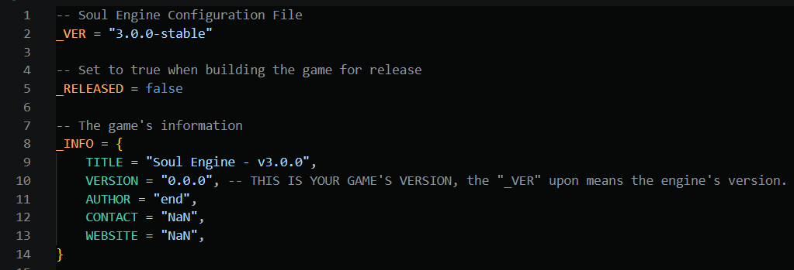

The game runs, the content is done — now it's time to turn it into **something others can download and open**.

This step has two parts: first get the config right (three spots in `conf.lua`), then hand the project to the packaging tool. The engine ships with a packaging tool at `Packager/` in the project root.

---

## Before Release: Get the Config Right

Open `conf.lua` in the project root — the top few lines are for release.

### `_RELEASED`

```lua
-- Set to true when building the game for release
_RELEASED = false
```

Change it to `true`. Right now it controls exactly one thing: **turns off the Windows black console window** (`t.console = not _RELEASED`).

!!! warning "Releasing with the console open is handing debug info to players"
    The console scrolls all kinds of `[WARNING]`, paths, and memory readouts. Keeping it during development is useful, **but the release package must turn it off**.

### `_INFO`

```lua
_INFO = {
    TITLE   = "Soul Engine - v3.0.0",
    VERSION = "0.0.0",   -- your own game's version number
    AUTHOR  = "end",
    CONTACT = "NaN",
    WEBSITE = "NaN",
}
```

- `TITLE` is the **window title**, and also the name printed on the error screen.
- `VERSION` is **your game's** version number, unrelated to the engine version (the engine version is `_VER`; don't change it).
- `AUTHOR` / `CONTACT` / `WEBSITE` are printed **verbatim on the error screen for players to see**.

!!! tip "Fill in `_INFO` completely before releasing"
    The "Fatal Error" screen players see when reporting a bug ends with these `_INFO` items.<br>
    Releasing with `NaN` left in is like leaving players with a bug screenshot and no way to reach you.

!!! warning "`_VER` is the engine version — don't touch it"
    The first line `_VER = "3.0.0-stable"` is the **engine** version number.<br>
    Change your project's version via `_INFO.VERSION`; don't mix the two up.



---

## Run a Compatibility Check Before Packaging

The packaging tool includes a **standalone** checker that reads-only-never-writes, specifically hunting for problems that "run fine on Windows but blow up on other platforms".

```bash
cd Packager
python check_compat.py            # default strictness 3 (strictest)
python check_compat.py --strict 2 # check for exe release / Linux
python check_compat.py --all      # compare all three strictness levels at once
```

On Windows you can also double-click `Packager/check_compat.bat` — it runs at **strictness 2 by default** (different from the default `python check_compat.py` value of 3).

The three strictness levels map to three target platforms:

| Strictness | Target platform | Description |
|---|---|---|
| `1` | Windows dev | Most lenient. NTFS is case-insensitive, so a mis-cased `require` still hits. |
| `2` | exe release / Linux, etc. | Stricter. After a `.love` is unpacked on a case-sensitive filesystem, referenced casing must match disk exactly. |
| `3` | love.js (Web) | Strictest. love.js uses Lua 5.1 semantics; `goto`, `::label::`, bitwise ops, and `0b` literals all fail to compile. |

It reports three tiers of issues: **error** (won't run at this strictness), **warning** (might hit a landmine, e.g. `loadstring` and other 5.1-only APIs), **info** (reference only).

!!! danger "Case sensitivity is the most common packaging pitfall"
    On Windows, `Sprites.CreateSprite("Overworld/frisk/xxx.png")` matches the actual file `Overworld/Frisk/xxx.png`,
    but **after packaging to Android / Linux the whole image goes missing**.<br>
    The checker catches all such references at strictness `2` / `3`. **If you package and find "image is white/gone", suspect this first.**

!!! note "It's a static check and can't replace actually running it"
    The checker can't reproduce 100% of runtime behavior. It only focuses on reliably detectable minefields (case, Lua-version syntax, missing modules, basic syntax).<br>
    To be safe, **at minimum run the exported exe on your own machine once**.

---

## Export with the Packaging Tool

The packaging tool is a Python + tkinter GUI program that **needs no third-party libraries** (standard library only).

How to launch (double-clicking works on Windows too):

```bash
cd Packager
run.bat            # or manually: python build_tool.py
```

Fields to fill in the UI:

| Field | What to put |
|---|---|
| Project directory | The **project root containing `main.lua`** (wrong path prompts "main.lua not found") |
| Output directory | Defaults to `<project>/Export` |
| Project name | Used as the output file name |
| LÖVE install directory | The level containing `love.exe`; **only needed for exe export** |
| rcedit path | Optional; writes icon / version info to the exe (repo already includes `rcedit-x64.exe`) |
| exe icon | Optional, `.ico` / `.png` |
| love-android template directory | Only needed to prepare files for Android export |
| love.js command | Optional, e.g. `npx love.js` |

Then check which targets to export:

| Target | Output | Description |
|---|---|---|
| `.love` file | `<name>.love` | Game zip, can be loaded directly by LÖVE |
| Windows executable | `<name>-win/` folder | `love.exe` merged with `.love` into a standalone exe, with required DLLs copied alongside |
| Android APK prep files | `<name>-android/` | Copies the love-android template and places `game.love`; optionally invokes `gradlew` to build the APK directly |
| love-js Web export | `<name>-web/` | Copies `game.love` for love.js; can auto-invoke love.js to generate the web version |
| Full source backup | `<name>-source.zip` | Whole-source backup archive |

After export, the output directory looks roughly like this:

```
Export/
├── game.love               # .love file
├── game-win/               # Windows exe folder (with DLLs)
│   ├── game.exe
│   ├── love.dll
│   └── ...
├── game-android/           # Android prep files
│   └── app/src/embed/assets/game.love
├── game-web/               # love-js prep files
└── game-source.zip         # source backup
```

!!! warning "The tool itself is always excluded — don't add it back manually"
    To avoid a **memory bomb** from "packing the tool itself and its output back in", the following are **always** excluded:

    - The tool's own scripts (`build_tool.py`)
    - The tool's folder (`Packager/`, when it's inside the project)
    - The output directory (default `<project>/Export`)
    - Existing `*.love` files (can be turned off in "Exclusion Settings")

    `.git` / `.vscode` / `__pycache__` / `.workbuddy` are skipped by default too; all of this can be adjusted in the UI.


---

## Windows: exe

Requires LÖVE installed on the machine (the UI needs to point at the directory containing `love.exe`).

The output is a **folder**, not a single exe — `love.dll`, `SDL2.dll`, etc. must sit with the exe; missing even one means it won't open.

When releasing, there are two ways to ship:

- Zip up the **entire folder** and send it; players unzip and double-click the exe inside.
- Build an installer (with Inno Setup / NSIS, etc. on your own) — not covered here.

!!! warning "Don't ship just the exe file"
    `game.exe` copied out on its own will surely report missing DLLs. Ship the whole `-win/` folder.

---

## Android: APK

Building an Android package has **two phases**; when something breaks you must first tell which phase is stuck:

1. **Content phase**: pack the project into `game.love` and drop it into the template. This phase needs no Android environment and fails fast.
2. **Toolchain phase**: JDK / SDK / NDK / CMake / Gradle must meet the versions required by **the template's own build files**. Almost all failures happen here, and they fail slowly.

### Prepare the Template (once only)

```bash
git clone --recurse-submodules https://github.com/love2d/love-android
```

`--recurse-submodules` **cannot be omitted**, otherwise you'll get `Missing LÖVE` or a missing `liblove.so`. Already cloned but missed submodules:

```bash
git submodule sync --recursive
git submodule update --init --force --recursive
```

You need **JDK 17** (no higher, no lower), **CMake ≥ 3.21**, and `ANDROID_HOME` set.

!!! danger "Version requirements follow the template's build files — don't copy a tutorial"
    NDK / SDK versions differ a lot across love-android branches; getting them wrong fails immediately at the CMake configure stage. **Read them from the template**:

    | Which file to read | What to read |
    |---|---|
    | `app/build.gradle` | `ndkVersion`, `compileSdk`, `targetSdk`, `minSdk`, `cmake { version }`, `abiFilters` |
    | `gradle/wrapper/gradle-wrapper.properties` | The required Gradle version |
    | `app/src/main/cpp/love/src/common/version.h` | Which LÖVE version this branch corresponds to |

    The current `main` branch (LÖVE 12.0) roughly requires: NDK `27.3.13750724`, compileSdk / targetSdk `35`, minSdk `23`, CMake `3.21.0+`, ABI `armeabi-v7a` / `arm64-v8a` / `x86_64`.

### Where `game.love` Goes

| Template version | Directory | Gradle task |
|---|---|---|
| Modern template (has `app/src/embed`) | `app/src/embed/assets` | `assembleEmbedNoRecordRelease` |
| Old template | `app/src/main/assets` | `assembleNormalRecord` |

The packaging tool **auto-detects** which one to use and says so in the log.

!!! danger "Wrong directory fails silently"
    Putting it in the wrong place only results in an APK that, once installed and launched, shows an **empty LÖVE screen**. So always double-check after building — don't just look at "build succeeded".

### Gradle Tasks

Defaults to `assembleEmbedNoRecordRelease`.

- Game needs microphone recording → switch to `assembleEmbedRecordRelease`
- AAB for Play Store release → `bundleEmbedNoRecordRelease`

The build log streams live to the panel on the right of the tool. **The first native-library compile can easily take ten-odd minutes to an hour.**

!!! warning "Don't get tempted to run clean later"
    `clean` throws away all native build artifacts, so the next build is another full hour.<br>
    Changing Lua or assets is normal iteration — repack `game.love` and an incremental Gradle build only takes tens of seconds.

### Signing: you'll likely need one more step after building

A release build very likely produces an **unsigned** APK (filename contains `-unsigned`). **An unsigned APK won't install** — the phone will just say "app not installed" without telling you why.

Sign it yourself once (`zipalign` and `apksigner` live in `<SDK>/build-tools/<version>/`):

```bash
zipalign -p -f 4 unsigned.apk aligned.apk

keytool -genkeypair -keystore my.keystore -alias my -keyalg RSA \
        -keysize 2048 -validity 10000 -storepass your_password -keypass your_password \
        -dname "CN=Your Name, O=Yourself, C=CN"

apksigner sign --ks my.keystore --ks-key-alias my \
          --ks-pass pass:your_password --key-pass pass:your_password \
          --out signed.apk aligned.apk

apksigner verify --verbose signed.apk
```

!!! danger "Permanently keep the keystore for official releases"
    A throwaway key is fine for your own testing; but **once published, you must always sign with the same key**.<br>
    Lose the key and you can never push updates to the already-published game — you'd have to republish under a new package name.

### Two Common Reasons It Won't Install

!!! warning "Package name collides with official LÖVE"
    The template's default package name is `org.love2d.android`, i.e. "yet another LÖVE for Android".<br>
    If official LÖVE is installed on the phone, your package **either won't install (same package name, different cert) or installs but you can't tell which is which**.<br>
    To confirm:

    ```bash
    aapt2 dump badging your.apk
    ```

    Just change `app.application_id` in the template (and the app name per language).

!!! warning "`libluajit.so` wasn't packed in"
    This is a silent pitfall in the love-android template: the native library **is linked but not packaged**, so it crashes on launch once installed:

    ```
    dlopen failed: library "libluajit.so" not found
    ```

    After building, unzip the APK to confirm all needed `.so` files are in `lib/<abi>/`:

    ```bash
    unzip -l your.apk | findstr lib/
    ```

    Watch out for this pitfall especially **after re-cloning the template**.

---

## love-js (Web)

Optional target, needs **Node.js** and [love.js](https://github.com/Davidobot/love.js).

The tool copies `game.love` over and (if `love.js command` is filled) auto-invokes it to generate the web version.

!!! danger "This tier needs the strictest check"
    The web version runs **Lua 5.1 semantics**; `goto`, `::label::`, bitwise ops, and `0b` literals fail to compile directly.<br>
    Run the compatibility check at **strictness 3** before packaging:

    ```bash
    python check_compat.py --strict 3
    ```

!!! warning "`os.execute` / `io.popen` don't exist in the web version"
    The checker flags them as info. If your code uses them, they're simply unavailable on the web — find another way.

---

## Source Backup

Checking "Full source backup" packs a `<name>-source.zip`. Besides archiving, it's also great for **version retention** — keep one per release so you don't have to dig through git to roll back later.

---

## Pre-Release Checklist

- [ ] `_RELEASED` in `conf.lua` changed to `true`
- [ ] `_INFO`'s `TITLE` / `VERSION` / `AUTHOR` / `CONTACT` / `WEBSITE` filled in completely
- [ ] `_INFO.VERSION` version number incremented
- [ ] Ran `check_compat.py` for the target platform (exe / Linux use `--strict 2`, web uses `--strict 3`)
- [ ] Ran the exported exe through a full playthrough on your own machine at least once
- [ ] Android: signed, checked package name with `aapt2 dump badging`, confirmed all `.so` files are in `lib/<abi>/`
- [ ] Verified on **real hardware**: phones are case-sensitive, and asset paths that worked on PC reveal themselves here
- [ ] The release package (especially Android) doesn't bundle dev directories like `.workbuddy/`, `Export/`

---

## Where to Publish

Packaging only turns the game into files; you still need a distribution channel for players to see it.

- **[GameJolt](../090_network/000_gamejolt.md)** — the engine has a built-in GameJolt API (trophies, scoreboards, cloud saves); publishing to GameJolt lets you use all of these.
- **itch.io** — the engine has no built-in integration; just upload it as a normal file.
- **Your own site / cloud storage** — just send out the exe folder or APK directly.

!!! danger "GameJolt's private key ships with the game package"
    `GamejoltPK` is written in plaintext in the code and **anyone who unpacks it can see it**.<br>
    It shouldn't be treated as a real secret key; see [Networking → GameJolt](../090_network/000_gamejolt.md) for details.<br>
    To drop the plain text, compile the key into a native library ([Developer Tools → Native Secret Store](../070_develop/050_secrets.md)) — the packager ships the artifact automatically: it copies `secrets.dll` beside the exe on Windows, and `libsecrets.so` into `jniLibs/<abi>/` on Android.
