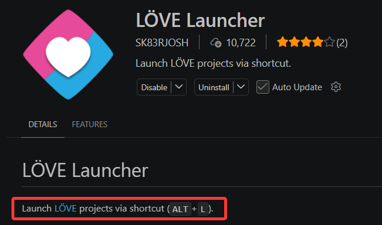
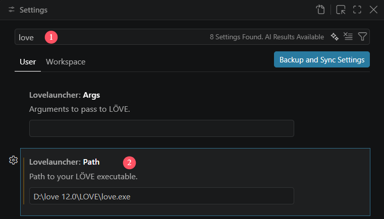
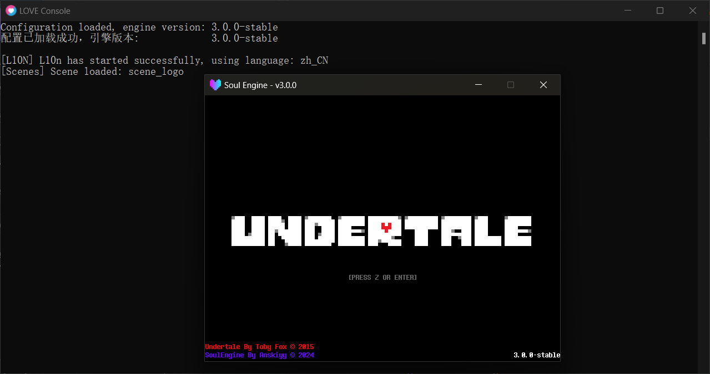

本页安装 LÖVE 与 SoulEngine，并按操作系统配置开发工具。<br>
配置内容为下载并解压安装包，不涉及环境变量等系统设置。

---

## 安装引擎与SoulEngine

截至目前，不论 love 12+ 版本是否已正式发布，均需下载 12+ 版本。<br>
[下载 LÖVE](https://nightly.link/love2d/love/workflows/main/main)

之后 [下载 SoulEngine](https://github.com/AnskiyyRenew/love2d-undertale-template) 。

需确保安装的版本不低于 3.0.0。验证方式为打开 `conf.lua` 查看**第二行**，其中包含 `3.0.0-stable` 或更新的版本字符串即表示版本正确。

```lua
-- Soul Engine Configuration File
_VER = "3.0.0-stable"      -- ← 版本字符串所在行
```

!!! note "`_VER` 在哪"
    它写在 `conf.lua` 的**第 2 行**（第 1 行是注释）。注意 `conf.lua` 里**没有** `_VERSION` —— 那个是 Lua 自带的全局量，和引擎版本无关，详见 [配置文件](../010_quick_start/000_conf.md) 。

!!! warning "LOVE 的 12.0 仍在开发中"
    `conf.lua` 里的 `t.version` 写的是 `12.0` 。如果官网只提供 11.x 稳定版，需要到 **nightly / 测试版** 一栏下载 12.x，否则引擎用到的 API 会缺失。

3.0.0 的 API 已稳定，后续版本不会再变更这些 API。

<u>以下内容按操作系统分流，请阅读与自身系统对应的部分。</u>

---

## Windows 开发

Windows 下可选的开发工具较多，也可以直接通过命令行运行游戏。

本文档以 `Visual Studio Code` 为例。下载时注意图标为蓝色，紫色图标对应的是另一款软件。

---

## Linux 开发

同样使用 `VSCode` ，并可直接通过命令行运行游戏。

安装 LOVE2D 后， `love` 命令会自动注册到环境中，可在终端执行如下命令运行：

```bash
love .
```

---

## macOS 开发

可从上述链接或应用商店等渠道下载。

同样使用 `VSCode` 。

---

## Android 开发

国内用户可选择 `MT管理器`，该应用部分功能收费，<u>但 SoulEngine 的全部开发流程均不涉及这些功能</u>。

下载地址：[https://mt2.cn](https://mt2.cn)。

!!! info "关于 MT 管理器的说明"
    该应用无害，若被判断为有害均属误报。

    **前提是从上述官网链接下载。**

其他地区用户可选择 `Squircle CE` 。

除工具外，还需下载 `LOVE for Android` 。

安装后桌面会新增两个图标：一个用于启动固定文件夹路径的主程序，另一个可自选路径，通常需打包成 `.love` 后用 Loader 启动。

因此开发工具需具备直接打开 `.love` 文件进行修改的能力。

---

## iOS 开发

`LOVE2D` 在 `iOS` 上为付费应用， `SoulEngine` 本身免费。

!!! warning
    是否购买请自行评估，不建议在 iOS 平台上进行开发。

---

***完成对应操作系统的配置后，可继续阅读下一小节。***

---

## 使用 VSCode 打开项目

进入 SoulEngine 的项目根目录，在空白区域 `右键` ，在弹出的菜单中选择 `通过 Code 打开` 。


若菜单中没有 `通过 Code 打开` 选项，也可使用命令行方式，在项目目录下打开 `cmd` 或 `Powershell` 执行：

```bash
code .
```

首次打开时会弹出工作区信任询问，选择信任以继续。

打开后，侧边栏显示的文件即为项目的全部内容。

### 拓展的选择

!!! info "为什么需要下载拓展"
    `LOVE2D` 的游戏启动方式并不是打开程序后选择文件夹，而是需要手动把文件夹 `拖拽` 至 `love.exe` 上打开。

    每次调试都需重复此操作，因此选用支持 <u>自动启动</u> 的 `VSCode` 拓展。

本文档使用 `LOVE Launcher - SK83RJOSH` 拓展。

<u>选择该拓展的原因：</u>

1. 使用 `ALT + L` 按键可直接启动游戏。
2. 它不会过多干预工作区，无代码补全支持，仅拥有轻量的快速启动能力。
3. 它是一个可以直接在 `VSCode` 中被搜索并下载的轻量拓展。



### 设置拓展

安装之后，需要为该 `拓展` 指定 `love.exe` 的路径。

点击 `VSCode` 左下角的小齿轮，找到 `Settings` 选项，随后按照下面图片中的设置：

1. 搜索 `love` ，可快速定位到该拓展。
2. 修改第二个选项为 `love.exe` 的路径。（<u>图片中的路径仅为示例，需替换为实际路径</u>）



### 启动验证

完成设置后，按下 `Alt + L` 组合键，检查游戏是否正常打开。

若出现如下图片中的界面，则说明启动成功：



### 收尾

至此，除 `Android` 与 `iOS` 外的操作系统安装配置已完成。

---

## 使用 MT 管理器进行开发

MT 管理器 <u>仅提供单一打开方式</u>，操作步骤如下。

下载完成后可能得到 `.love` 文件，该文件可直接打开使用。

若下载到 `.zip` 文件，同样可以直接使用。

打开方式：单击 `LOVE Loader` 程序，选择对应的压缩文件即可启动。
