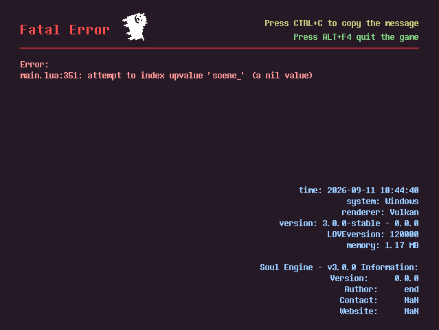

本页介绍作者信息、游戏图标、初始场景等内容的设置方式。

---

## 版本与信息

打开目录下的 `conf.lua` ，这是用来填写信息的文件。<br>
在大多数情况下，只需要看 `love.conf(t)` 函数之前的内容即可。

```lua
_VER = "3.0.0-stable"
_RELEASED = false
_INFO = {
    TITLE = "Soul Engine - v3.0.0",
    VERSION = "0.0.0", -- THIS IS YOUR GAME'S VERSION, the "_VER" upon means the engine's version.
    AUTHOR = "end",
    CONTACT = "NaN",
    WEBSITE = "NaN",
}

LOGICAL_WIDTH, LOGICAL_HEIGHT = 640, 480
CANVAS_WIDTH, CANVAS_HEIGHT = 640, 480
SCREEN_SCALE = "integer"        -- 游戏画布的缩放方式
FILL_SCREEN = true              -- 遗留开关，只在 SCREEN_SCALE 为 nil 时生效
USE_ERRHANDLER = true
```

下面对主要变量进行介绍：

- `_VER` 引擎版本号。可改为填写游戏版本号，此项不做强制要求。游戏版本由下方的 `VERSION` 指定。
- `_RELEASED` 是否为已发布版本。在打包导出之前修改为 `true` 。
- `_INFO` 信息表，这里的信息会展示在 `报错界面` 与 `窗口标题` 中。
    - `TITLE` 窗口标题。Android不支持查看。
    - `VERSION` 游戏版本。填写游戏当前的版本，例如发布时可填 `1.0.0` 。
    - `AUTHOR` 游戏作者。（将会在报错界面展示）
    - `CONTACT` 联系方式。（将会在报错界面展示）
    - `WEBSITE` 游戏网站，可以是发布页或者一个能反馈的地址。（将会在报错界面展示）
- `LOGICAL_WIDTH / HEIGHT` 游戏窗口的大小，默认 `(640, 480)` 。另一组可用尺寸为 `(960, 540)` ，该尺寸对应带边框的情况。
- `CANVAS_WIDTH / HEIGHT` 游戏画布的大小，默认 `(640, 480)` 。
- `FILL_SCREEN` 是否让游戏随着全屏放大而按比例放大自身。 <u>现在只是遗留开关</u>：只有当 `SCREEN_SCALE` 没写（ `nil` ）时才生效，新项目请直接改下面这个。
- `SCREEN_SCALE` 游戏画布的缩放方式，默认 `"integer"` 。画布**始终居中**，边框会跟着画布一起缩放，所以窗框和游戏画面不会错位。
    - `"integer"` 只按整数倍放大，像素完美。窗口比画布大 1.5 倍时用 1 倍，比 4 倍大时用 4 倍。
    - `"auto"` 尽量铺满窗口，允许小数倍。
    - 填数字则固定倍数，填 `false` 保持 1:1 不缩放。
    - 运行中可以用 `SetScreenScale(mode)` 切换、 `GetScreenScale()` 读取当前倍数。
- `USE_ERRHANDLER` 是否启用自定义报错界面，默认为 `true` ，如果报错了会进入神烦狗界面。若关闭则保持默认报错样式。

自定义报错界面：<br>


---

## 游戏初始化

和 `conf.lua` 同目录下，有另一个配置文件： `conf_pure.lua` ，这个文件负责游戏的各种初始化内容。

初始化配置分为**两份**，两者**叠加**生效：

| 文件 | 作用 |
|---|---|
| 根目录 `conf_pure.lua` | 引擎默认值，会定义全部变量 |
| `Game/conf_pure.lua` | 游戏的覆盖配置，后执行，同名变量覆盖引擎默认值 |

只需在 `Game/conf_pure.lua` 中写入需要修改的行，未写入的变量沿用引擎默认值。`Game` 区的该文件执行出错时，引擎会整体回滚到默认值并打印 `[Conf] WARNING` 。按 `F2` 会重新执行这两份配置。

按功能，该文件的内容分为四个部分：初始化、控制器、网络、内存管理。

---

### 初始化

```lua
Global.SetVariable("FirstRoom", "Battle.scene_battle_init")
Global.SetVariable("MainColor", {1, 1, 1})
Global.SetVariable("EnableFriskDance", false)
Global.SetVariable("Language", "zh_CN")
Global.SetVariable("UseRealTime(dt)", false)
Global.SetVariable("ScreenShaders", {})
Global.SetVariable("FPS", 60)
Global.SetVariable("F2Room", "scene_logo")
Global.SetVariable("Volume", {
    Master = 1,
    Music  = 1,
    Sounds = 1
})
```

- `FirstRoom` 初始场景。启动游戏后的第一个场景为本场景。引擎默认给的是 `Battle.scene_battle_init` ；注意同一个变量在文件里被写了好几次，**最后一次生效**，修改为自定义场景时需写在文件末尾。
- `MainColor` 主色调。若想制作 `Underfell` 等AU，可以将此值设置为粉红色，绝大部分元素都会遵循这个颜色。
- `EnableFriskDance` 在Overworld中启用屠杀之舞功能，引擎默认关闭（ `false` ）。
- `Language` 语言文件，目前使用 `zh_CN` （简体中文）。
- `UseRealTime(dt)` 使用现实时间。包括玩家移动在内均不会因卡顿造成影响。
- `ScreenShaders` 屏幕特效。
- `FPS` 帧数。
- `F2Room` 按下 `F2` 按键后会去的场景（各热键的作用见 [辅助开发 → 引擎热键](../070_develop/030_hotkeys.md) ）。
- `Volume` 音量大小。

设置了 `Underfell` 主色调的战斗场景：<br>


---

### 输入控制

```lua
Global.SetVariable("ControllerSimulation", {
    virtualKeyboard = false,
    joystick        = false,
})
Global.SetVariable("ControllerDeadzone", 0.15)
```

- `ControllerSimulation` 在未发布阶段进行输入测试模拟，可以模拟摇杆和虚拟触屏。
- `ControllerDeadzone` 手柄死区的大小。该值过小时，轻微触碰摇杆即会触发输入。

完整的输入接口（逻辑键位表、 `Controller.GetState` 等）见 **[输入与控制器](./150_controller.md)** 。

---

### 网络

```lua
Global.SetVariable("GamejoltID", nil)
Global.SetVariable("GamejoltPK", nil)
Global.SetVariable("DiscordAppID", "1342517648348680202")
```

- `GamejoltID / PK` 游戏的ID与private key，详情见 [网络开发 → GameJolt](../090_network/000_gamejolt.md) 。没有编译产物时， `GamejoltPK` 同时充当 [密钥原生库](../070_develop/050_secrets.md) 的明文回退值。
- `DiscordAppID` 用来展示Discord Rich Presence的app，可以自创一个新的，详情见 [网络开发 → Discord RPC](../090_network/010_discord.md) 。

---

### 内存安全

!!! danger "风险"
    关闭这部分功能可能导致游戏内存溢出。<br>
    关闭前需确认内存占用风险。

```lua
Global.SetVariable("SE_MEMORY_SAFETY", true)    -- DANGEROUS
Global.SetVariable("OPT_COUNT_SPRITES", 2000)
Global.SetVariable("OPT_COUNT_TYPERS", 300)
Global.SetVariable("OPT_MEMORY_MAXSIZE", 0.8)
Global.SetVariable("OPT_LRU_SPRITES", {false, 180})
Guard = ImportFile("Engine.MemorySafety")
```

- `SE_MEMORY_SAFETY` 内存溢出保护。关闭后，运行内存被占满时游戏会崩溃。
- `OPT_COUNT_SPRITES` 最大允许同时存在的图片，默认2000，在2000时开始发出警告，4000驳回创建操作。
- `OPT_COUNT_TYPERS` 最大允许同时存在 300 个打字机。
- `OPT_LRU_SPRITES` 贴图缓存回收，默认 `{false, 180}` ，即默认关闭：第二项的 `180` 秒是判定时长，第一项为 `false` 时不触发回收，贴图进入缓存后一直保留。启用时改为 `{true, 180}` ：某张图超过 `180` 秒未被使用即回收，下次使用时重新读盘创建。

`Guard` 是执行库，读取上述设置后，将会在贴图库/打字机库中进行操作干涉。