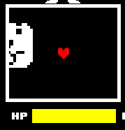

遮罩用于限定绘制范围。例如战斗中，弹幕被遮罩限制在战斗框范围内。

制作 UI 时，若多个选项需要显示在一个窗口内，可使用遮罩限定绘制范围，使所有选项只在该范围内绘制。

遮罩库位置： `Scripts/Libraries/Masks.lua`

---

## 新建遮罩

新建遮罩时会创建一个临时表，无需处理回收。

使用 `Masks.New(shape, x, y, w, h, r, value)` 创建一个新遮罩。

- `shape` 可以填写 `rect` / `rectangle` ，会创建矩形遮罩；也可以填写 `ellipse` / `circle` ，创建一个椭圆形遮罩；填写 `image` / `img` ，会创建贴图形状遮罩（详见下方贴图遮罩一节）。
- `x / y` 遮罩的位置，通常无需额外设置，后续可通过方法跟随贴图运动。
- `w / h` 遮罩的宽高，同样无需额外设置。
- `r` 角度。
- `value` 用于指定渲染到特定层，通常设置为 1。

---

## 使用遮罩

### 跟随图片

创建遮罩后，无需手动设置位置与宽高，通过 `Follow` 函数跟随贴图即可。

使用 `mask:Follow(spr)` 来让遮罩跟随一个 `spr` 。

!!! example "跟随战斗框"
    此做法常见于回合中，可直接令遮罩跟随黑色区域。
    ```lua
    local mask = Masks.New("rect", 320, 320, 155, 130, 0, 1)

    function wave.Update(dt)
        mask:Follow(Arena.black)
    end
    ```

### 图片使用

使用 `sprite:SetStencils({mask})` 来设置贴图的遮罩，内部可以放置多个遮罩，例如： `sprite:SetStencils({mask1, mask2, mask3})` 。

下面是一个大狗弹幕使用遮罩的案例：



---

## 贴图遮罩

矩形与椭圆形遮罩无法覆盖部分形状，例如心形、星形或怪物剪影，这些形状无法用 `love.graphics` 原语绘制。此类形状可使用 **贴图遮罩** 。

### 原理

`Masks.Draw` 内部调用 `love.graphics.setStencilState("increment", "always", 1)` 并关闭颜色写入，此时所有被绘制的图元都会向 stencil 缓冲区 `+1` 。关键在于：**`love.graphics.draw` 绘制一张图片时，被默认 sprite shader 丢弃掉的透明 fragment 不会参与 stencil action**，遮罩的形状因此等价于 ImageData 中透明度非 0 的像素区域。

简言之：**贴图的 alpha 决定遮罩的形状**，完全不透明为全遮罩，完全透明为无遮罩，半透明部分按比例写入，与视觉结果一致。

### 创建

在 `Masks.New` 的最后追加一个 `image` 参数即可：

```lua
local img = love.graphics.newImage("Sprites/shapes/heart.png")
local mask = Masks.New("image", 320, 320, 0, 0, 0, 1, img)
```

- `image` 可以传入 `love.Image` 对象，也可以传入引擎的 sprite 表（`Sprites.GetSprite` 之类的返回值），后者会自动取其 `.image` 字段。
- 此时的 `w / h` 用于把贴图整体 **缩放到目标尺寸**（如 64×64）；填 `0` 则保留原始尺寸。贴图遮罩同样支持 `Follow` 跟随 sprite 的尺寸变化。
- 需要更精细的缩放控制时，可直接对 `mask.scaleX` / `mask.scaleY` 赋值，会覆盖 `w / h` 的换算。
- `mask.ox` / `mask.oy` 可自定义绘制原点，默认取图片几何中心，使 `(x, y)` 对应贴图中心，与矩形 / 椭圆遮罩以 `(x, y)` 为几何中心的语义一致。

!!! tip "贴图要求"
    - 必须带 alpha 通道，PNG 格式带有 alpha 通道。
    - 透明度阈值是 **完全为 0**——介于 0~255 之间的半透明像素会按 GPU 的混合规则写入栅格，不会形成硬边。
    - 引擎默认对贴图使用 `nearest` 过滤并关闭 mipmap，遮罩边缘不会产生模糊；需要抗锯齿时，需预先对图片做 alpha 修正。

!!! warning "性能"
    图片遮罩每帧重新绘制贴图，数量多或尺寸较大时会增加 stencil 写入的开销。可复用同一张 ImageData / love.Image。

### 使用与跟随

贴图遮罩同样是配套 `Masks.Draw` -> `Masks.Use` -> 绘制内容 -> `Masks.Clear` 的标准流程，也可以走 `sprite:SetStencils({mask})` 交给贴图管线。

!!! example "用心形贴图裁切弹幕"
    ```lua
    local img = love.graphics.newImage("Sprites/shapes/heart.png")
    local mask = Masks.New("image", 320, 320, 64, 64, 0, 1, img)

    function wave.Update(dt)
        mask:Follow(Arena.black)
    end

    bone_sprite:SetStencils({ mask })
    ```

贴图遮罩同样可以和矩形/椭圆遮罩混用，只要它们 `value` 一致，`Masks.Draw` 会把它们逐个累加到 stencil 缓冲区里，最终裁剪出来的就是几个形状的并集。