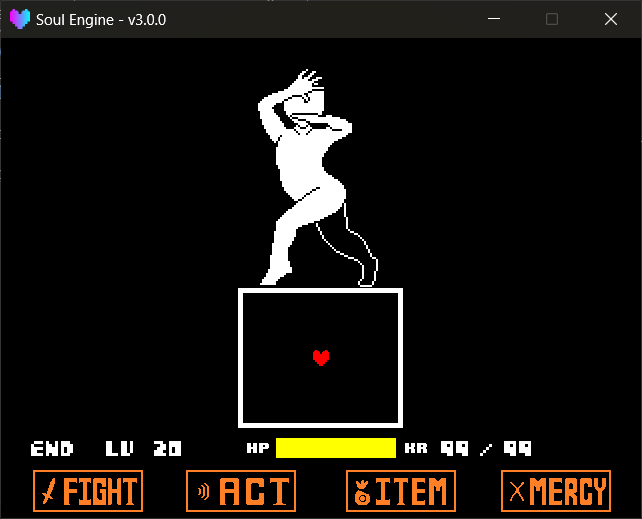

战斗框（ `Arena` ）是限制玩家灵魂活动范围的白色框体。<br>
引擎将其实现为**独立的、可任意改造的矩形或椭圆区域**，而非一张贴图，缩放、旋转、挖洞、移动均由数值驱动。

路径： `Scripts/Libraries/Battle/Arenas.lua` 。<br>
在战斗场景中以 `Arenas` 作为全局变量存在；**主战斗框**则固定在 `Battle.mainarena` 上。

---

## 两种模式

`mode` 决定该框是可站立区域还是阻挡区域：

| 模式 | 含义 | 效果 |
|---|---|---|
| `plus` | **加区** | 玩家被关在里面，撞到边缘会被推回来 |
| `minus` | **减区** | 玩家被挡在外面，走进去会被弹出到最近的合法位置 |

二者可以叠加使用：一个大的 `plus` 框提供活动范围，再叠几个小的 `minus` 框挖出中间的空洞，即可得到原版中框内带柱子的战场。

!!! tip "主战斗框默认是 plus"
    进战斗时 `Battle.mainarena` 是一个 `plus` 矩形，玩家回合时尺寸为 `565x130` （战斗框本体），<br>
    进入敌人回合时自动缩成 `155x130` （弹幕框）。这两个尺寸由 `Battle` 自己切换，一般不用手动改。

---

## 创建一个框

!!! example "Arena 方法"
    - `Arenas.New(mode, shape, x, y, width, height, angle)` 新建一个战斗框，返回框对象。
        - `mode` `"plus"` 或 `"minus"` ，默认 `"plus"` 。
        - `shape` 形状，目前只建议使用 `"rectangle"` ； `"circle"` / `"ellipse"` 在部分判定里可用，但**不会生成显示用的贴图**。
        - `x` / `y` 中心坐标，默认 `320, 320` 。
        - `width` / `height` 宽高，默认 `155, 130` ，小于 `16` 会被强制抬到 `16` 。
        - `angle` 旋转角度（度），默认 `0` 。
    - `Arenas.Clear()` 销毁**除主战斗框以外**的所有框。
    - `Arenas.PlayerOnGround(player)` 玩家的"脚"是否碰到了框边缘（沿重力方向判定，四种朝向通用）。
    - `Arenas.PlayerOnCeiling(player)` 玩家的"头"是否碰到了框边缘。
    - `Arenas.insts` 当前所有框的实例列表。
    - `Arenas.stencils` 当前所有遮罩列表，可用于给弹幕套裁剪。



---

## 框的属性

创建出来的框对象可以直接读写这些字段：

!!! example "Arena 属性"
    - `mode` / `shape` 创建时传入的模式与形状。
    - `x` / `y` / `width` / `height` / `rotation` **当前**数值（正在朝目标值平滑移动中）。
    - `target` 目标值表 `{x, y, width, height, rotation}` ，改它才会让框动起来。
    - `speeds` 变化速度表 `{x, y, width, height, rotation}` ，默认 `7.5 / 7.5 / 15 / 15 / 15` 。
    - `thickness` 白边厚度，默认 `5` 。
    - `is_active` 是否参与碰撞。关掉之后框还在屏幕上，但玩家会直接穿过去。
    - `is_containing` 玩家此刻是否在这个 `plus` 框里面。
    - `move_player` 框移动时是否带着玩家一起走，默认 **`false`** 。需要框带动玩家移动时将其改为 `true` 。
    - `white` / `black` 组成框的两张贴图（外圈白、内里黑）。
    - `mask` 该框自带的遮罩对象（仅 `plus` 有）。

!!! warning "变化速度是按帧算的，不是按秒"
    `speeds` 里的数值是**每帧推进多少像素**，引擎在平滑时并没有乘 `dt` 。<br>
    也就是说同样的 `speeds` 在 60 帧和 120 帧下，框缩放的快慢差一倍。编写波次时按 `60 FPS` 的数值调整，或使用 `ResizeWithTime` 精确控制。

---

## 改变形状

所有修改数值的函数都写入 `target` ，框会自动平滑过渡；需要立即生效时使用带 `imm` 参数的函数。

!!! example "尺寸与位置"
    - `Resize(w, h, imm)` 改变宽高。 `imm` 为 `true` 时立刻生效。
    - `ResizeWithSpeed(w, h, speedw, speedh)` 改变宽高并指定速度。
    - `ResizeWithTime(w, h, timew, timeh)` 改变宽高，速度按设定的帧数自动计算。
    - `MoveTo(x, y, imm)` 移动中心点。 `imm` 为 `true` 时立刻生效。
    - `RotateTo(rotation)` 旋转到指定角度。
    - `ResetSpeed()` 把所有速度恢复默认。

### 单边伸缩

原版中框的上边向外扩展一块这类效果，使用以下四个函数实现，它们会**在伸缩的同时自动修正中心点**，使对边保持不动：

!!! example "单边方法"
    - `UpSide(value)` 上边向上扩展 `value` 像素（传负数即收缩）。
    - `DownSide(value)` 下边向下扩展。
    - `LeftSide(value)` 左边向左扩展。
    - `RightSide(value)` 右边向右扩展。

??? example "上下开合一个框"
    ```lua
    local Arena = Battle.mainarena

    -- 敌人回合开始：把框撑高 40 像素，用时约 15 帧
    Arena:UpSide(40)
    Arena:DownSide(40)

    -- 若干帧后再收回去
    Arena:UpSide(-40)
    Arena:DownSide(-40)
    ```

---

## 外观

!!! example "外观方法"
    - `SetThickness(t)` 设置白边厚度。
    - `OuterColor(color)` 设置外圈颜色，默认跟随全局变量 `MainColor` 。
    - `InnerColor(color)` 设置内部填充色，默认黑色。

---

## 取坐标

编写弹幕时常需要从框的某条边缘发射，使用以下两个函数可免去手动计算旋转：

!!! example "坐标方法"
    - `GetCenterPos(side)` 返回某条边**中点**的 `x, y` 。 `side` 为 `"up"` / `"down"` / `"left"` / `"right"` 。
    - `GetCornerPos(corner)` 返回某个角的 `x, y` 。 `corner` 为 `"ul"` / `"ur"` / `"dl"` / `"dr"` 。

两个函数都做了旋转补偿，框转了多少度，取出来的点就跟着转多少度。

---

## 跟随者

部分对象（如挂在框边上的装饰）需要跟随框移动，使用 `AddFollower` 挂载后每帧自动同步坐标：

!!! example "跟随者方法"
    - `AddFollower(sprite, position)` 让一张贴图跟着框走。
        - `sprite` 要跟随的贴图对象。
        - `position` 挂载位置，取值与上面两个取坐标函数一致（ `"up"` 、 `"ul"` 、 `"left"` 等）。
    - `Destroy()` 销毁这个框以及它的两张贴图。

---

## 遮罩

弹幕如果直接画，超出框的部分也会显示出来。原版是靠**遮罩**把框外的部分裁掉的：

```lua
local wave = ImportFile("Battle.Waves")
local Arena = Battle.mainarena

-- 建一个跟随战斗框的遮罩
local mask = Masks.New("rectangle", 320, 320, 155, 130, 0, 0)

-- 每帧让它跟上框（框缩放/移动时遮罩同步）
function wave.Update(dt)
    mask:Follow(Arena.black)
end

-- 弹幕套上遮罩
bullet:SetStencils({mask})
```


---

## 常见问题

- **框缩放了但弹幕未同步裁剪**：遮罩未每帧执行 `mask:Follow(Arena.black)` 。
- **玩家被弹出到与预期不符的位置**：被 `minus` 框推出去后若落点同样不合法，引擎会以逐圈扩散的方式查找最近的合法点，查找失败则原地不动。 `minus` 框布置过密时会出现该现象。
- **框瞬间就位**：检查是否误传了 `imm = true` ，或 `speeds` 取值过大。
