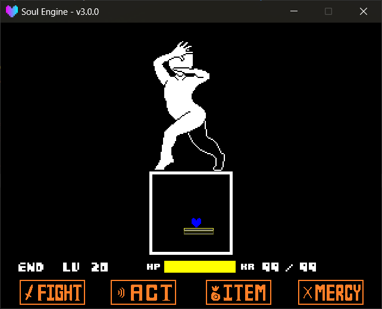

敌人回合的全部内容写在**回合脚本**（ `Wave` ）中：弹幕的生成方式、生成时机以及结束条件。

路径： `Game/Waves/` （Game 区，优先）、 `Scripts/Waves/` （引擎默认，兜底）。<br>
名字的解析规则见 [战斗初始化 → 回合脚本](./000_init.md) 。

---

## 一个回合里发生了什么

```
玩家回合结束（按下敌人回合）
  ↓
Battle.Defending()
  ├─ 灵魂归位到 (320, 320)
  ├─ 主战斗框激活并缩到 155x130
  └─ Battle.LoadWave(...) 加载并执行你的波次文件（顶层代码只跑这一次）
  ↓
每帧调用 wave.Update(dt)
  ↓
你在里面调用 EndWave()
  ↓
引擎销毁 wave.objects、清掉已导入的库缓存
  ↓
状态回到 ACTIONSELECT，战斗框平滑恢复成 565x130
```

!!! tip "顶层代码只跑一次"
    波次文件是被 `require` 进来的，**顶层代码只在加载时执行一次**。<br>
    每帧执行的代码必须写进 `wave.Update` ；进回合时初始化一次的内容写在顶层。



---

## 文件骨架

```lua
local wave = ImportFile("Battle.Waves")
local EndWave = wave.EndWave
local Arena = Battle.mainarena

-- 让玩家可以动
Player.canMove = true
-- 换成蓝色灵魂
Player.SetSoul(6)

-- 弹幕遮罩：跟着战斗框走
local mask = Masks.New("rectangle", 320, 320, 155, 130, 0, 0)

local time = 0
function wave.Update(dt)
    mask:Follow(Arena.black)

    -- TODO: 生成弹幕、推进逻辑

    time = time + 1
    if (time == 300) then
        EndWave()
    end
end

return wave
```

第一行是固定的： `ImportFile("Battle.Waves")` 返回**所有波次共享的表**，引擎通过它收尾。

---

## 波次可用方法

!!! example "波次方法"
    - `EndWave()` 结束本回合。会销毁 `wave.objects` 里的所有对象、清掉 `wave.Import` 导入过的库缓存，并把 `ENDED` 置为 `true` 。
    - `Import(path)` 导入一个引擎库，出错时仅打印错误信息，不中断运行。
        - `path` 库路径，例如 `"Attacks.Bones"` 。
    - `objects` 存放本回合创建对象的表。 `EndWave` 会自动销毁其中的所有对象，无需手动清理。
    - `Update(dt)` **由波次文件定义**，引擎每帧调用。
    - `ENDED` 本回合是否已结束（引擎会读它）。

!!! example "波次里常用的全局量"
    - `Battle.mainarena` 主战斗框，修改形状时改动该对象（详见 [战斗框](./020_arena.md) ）。
    - `Battle.TIME_F` 从战斗开始到现在过了多少**帧**。
    - `Battle.TIME_R` 从战斗开始到现在过了多少**秒**。
    - `Player.canMove` 玩家能不能操作灵魂，开场记得设回 `true` 。
    - `Player.SetSoul(id)` 换灵魂。
    - `Arenas` 战斗框库。**这是全局量**（战斗库加载时已挂好）。
    - `Player` / `UI` 同样是全局量，直接可用。

!!! warning "弹幕库不是全局量"
    `Bones` 、 `Blasters` 都**没有**挂在全局上，直接用会拿到 `nil` 。<br>
    `Bones` 用波次自己的 `wave.Import("Attacks.Bones")` 拿；<br>
    `Blasters` 需要**战斗场景**自行 `ImportFile("Attacks.Blasters")` 并挂成全局（引擎自带的 `scene_battle_init.lua` 、 `scene_battle_template.lua` 即采用该方式），波次中才能访问到它。

!!! danger "改过的东西要记得还原"
    `Player.canMove` 、 `Player.SetSoul` 、战斗框尺寸这些东西**不会**在回合结束时自动恢复。<br>
    一个波次里把灵魂换成了蓝色，下一个波次若未换回，玩家仍为蓝色灵魂。在每个波次开头显式设置一次可避免该问题。

---

## 生成弹幕

弹幕库要先 `Import` 进来，再手动调它的 `Update` —— **波次不写 `bones.Update(dt)` ，骨头就是不会动的**。

```lua
local wave = ImportFile("Battle.Waves")
local EndWave = wave.EndWave
local Arena = Battle.mainarena

local bones = wave.Import("Attacks.Bones")
local mask  = Masks.New("rectangle", 320, 320, 155, 130, 0, 0)

-- 一根从上边掉下来的骨头
local bone = bones.New2D("sans", 40, {320, 180}, 0, {0, 2})
bone:SetStencils({mask})
table.insert(wave.objects, bone)

function wave.Update(dt)
    mask:Follow(Arena.black)
    bones.Update(dt)

    if (Battle.TIME_R > 5) then
        EndWave()
    end
end

return wave
```

关于骨头与追踪炮的完整方法列表，见 [弹幕库](./060_bullets.md) 。

---

## 自己做弹幕

不使用弹幕库同样可以创建弹幕。任何一张贴图，只要 `isBullet = true` ，就会被纳入玩家碰撞判定：

```lua
local bullet = Sprites.CreateSprite("bullet.png", "Bullets")
bullet:Scale(2, 2)
bullet:MoveTo(320, 240)
bullet:SetStencils({mask})
bullet.isBullet = true
table.insert(wave.objects, bullet)
```

!!! warning "需将弹幕加入 wave.objects"
    未加入时， `EndWave` 不会销毁该弹幕，它会保留在屏幕上，下一个回合仍然可见。

---

## 多段波次

一个回合分为多段演出时，可使用 `time` 作为状态机：

??? example "三段式波次"
    ```lua
    local wave = ImportFile("Battle.Waves")
    local EndWave = wave.EndWave
    local Arena = Battle.mainarena
    local bones = wave.Import("Attacks.Bones")

    local time = 0

    -- 第一段：骨头雨
    local function phase1()
        local b = bones.New2D("sans", 40, {math.random(220, 420), 200}, 0, {0, 3})
        b:SetStencils({Arena.mask and {Arena.mask} or {}})
        table.insert(wave.objects, b)
    end

    function wave.Update(dt)
        bones.Update(dt)

        if (time < 120 and time % 20 == 0) then
            phase1()
        elseif (time == 180) then
            Arena:Resize(200, 130)       -- 第二段：框变宽
        elseif (time == 300) then
            Arena:RotateTo(15)           -- 第三段：框转起来
        elseif (time == 480) then
            EndWave()
        end

        time = time + 1
    end

    return wave
    ```

---

## 缓存与热重载

波次模块在两个位置都可能有缓存， `Battle.ClearWaveModule` 会**同时**清掉两边：

!!! example "缓存方法"
    - `Battle.ClearWaveModule(wave_name)` 清除某个波次的模块缓存，留空则清当前 `Battle.wave` 。
    - `Battle.waveModule` 上一次实际加载成功的模块全名，例如 `Game.Waves.bones.wave1` ，可以用来确认 Game 区覆盖有没有生效。

引擎在回合结束时会自动清理一次，正常游玩无需处理。仅当**调试时修改了波次文件但未生效**，才需要手动清理缓存。
