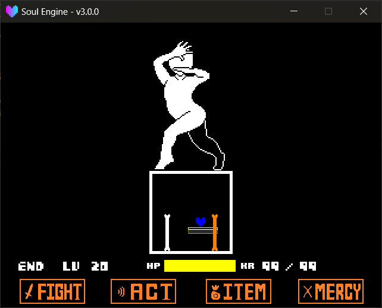

弹幕库提供原版中骨头、骨墙、追踪炮的封装实现。

路径： `Scripts/Libraries/Attacks/` 。<br>
在波次里用 `wave.Import("Attacks.Bones")` 之类的方式导入（详见 [回合脚本](./050_waves.md) ）。

导入之后**必须每帧手动调用它的 `Update`** ，否则弹幕不会动也不会判定。

---

## 骨头 `Bones`

```lua
local bones = wave.Import("Attacks.Bones")
bones.Update(dt)
```

### 普通骨头

!!! example "创建方法"
    - `bones.New2D(whose, length, position, angle, velocity)` 创建一根骨头，返回骨头对象。
        - `whose` 谁的骨头， `"sans"` 或 `"papyrus"` ，决定贴图与粗细。写错会打印警告并退回 `"sans"` 。
        - `length` 骨身长度（像素）。
        - `position` 中心坐标 `{x, y}` ，默认 `{320, 240}` 。
        - `angle` 角度（度），默认 `0` 。
        - `velocity` 每帧位移 `{x, y}` ，默认 `{0, 0}` 。

!!! example "骨头属性"
    - `x` / `y` / `rotation` / `length` 位置、角度、长度，可直接改。
    - `velocity` 每帧位移。
    - `isBullet` 是否参与玩家碰撞，默认 `true` 。
    - `layer` 所在图层，默认 `"Bullets"` 。
    - `width` 骨头粗细， `sans` 为 `10` 、 `papyrus` 为 `13` 。
    - `Step` 每帧回调钩子，赋一个 `function (self) ... end` 即可（**不传 `dt`** ），在骨头摆位算完之后由 `bones.Update` 调用，详见 [Step 每帧回调](../020_basic/170_step.md) 。

!!! note "骨头与像素吸附"
    一根骨头是头 / 身 / 尾三张贴图拼出来的组合体，如果逐张去吸整像素，接缝会抖。<br>
    引擎的做法是：**三张部件都设 `pixel_snap = false`** （见 `Bones.lua` 的 `New2D` ），然后在 `bones.Update` 里对三张共享的那个锚点**只取整一次**（ `Sprites.SnapEdge(ax + dx, half_x)` ，`half_x` 是旋转感知后的 AABB 半宽），再由这个整数锚点算出三张的坐标。<br>
    因此**不需要**也**不应该**手动修改骨头的 `pixel_snap` 。需要整体关闭吸附时设置全局 `Sprites.pixel_snap = false` ，细节见 [基础开发 → 精灵 → 像素吸附](../020_basic/020_sprites.md) 。

!!! example "骨头方法"
    - `SetLayer(layer)` 换图层（骨头由头、身、尾三张贴图拼成，换层要整体换）。
    - `SetPivot(xp, yp)` 设置锚点，取值 `0 ~ 1` 。
        - `xp` 横向， `0` 与 `1` 分别是宽度的两边， `0.5` 居中。
        - `yp` 纵向， `0` 是头端、 `1` 是尾端， `0.5` 是整根骨头的中心。
    - `SetStencils(stencils)` 套遮罩，一般用 `bone:SetStencils({mask})` 。
    - `ToDown(arena)` / `ToUp(arena)` / `ToLeft(arena)` / `ToRight(arena)` 把骨头贴到战斗框的某一条边上（用于实现从边上长出的效果）。
    - `SetMode(mode, color)` 设置伤害模式与颜色。
        - `mode` 写进贴图的 `HurtMode` ，取值见 [玩家与灵魂 → 弹幕颜色](./030_player.md) 。
        - `color` 骨头颜色，省略则不变。
    - `SetColor(color)` 只改颜色，省略时改回 `MainColor` 。
    - `Destroy()` 销毁。这个方法是**幂等**的，重复调用不会出错。



### 3D 骨头

给定一组三维顶点，引擎将其投影为二维并连接成骨头，可用于制作旋转的立体框架。

!!! example "创建方法"
    - `bones.New3D(points, percent, mode)` 创建一个 3D 骨架，返回骨架对象。
        - `points` 三维点列表，每个点是 `{x, y, z}` 。少于三个分量的点会被自动补 `0` 。
        - `percent` 连线长度占整条边的比例，默认 `0.5` 。
        - `mode` 投影方式， `"orthographic"` （正交，默认）或 `"perspective"` （透视）。

!!! example "骨架属性"
    - `x` / `y` / `z` 中心点坐标。**直接赋值即可整体平移所有顶点**（内部用元表实现）。
    - `points` 原始三维点列表。
    - `bulge` 正交模式下的膨胀系数， `0` 为纯正交；大于 `0` 时越靠近观察者越大。
    - `xscale` / `yscale` 投影后的二维缩放，纯视觉，不影响三维数据。

!!! example "骨架方法"
    - `MoveTo(x, y, z)` 把中心移动到指定位置。
    - `Move(x, y, z)` 按增量平移。
    - `Rotate(axis, angle)` 绕中心旋转。
        - `axis` `"x"` / `"y"` / `"z"` 。
        - `angle` 角度（度）。
    - `Link(whose, point_1, point_2, percent_)` 在两个顶点之间连一根 2D 骨头。
        - `point_1` / `point_2` 顶点在 `points` 里的**从 1 开始**的序号。
        - `percent_` 这一根的长度比例，省略则用创建时的 `percent` 。
    - `Scale(sx, sy)` 设置二维缩放。
    - `SetLayer(layer)` 换图层（作用于所有连出来的骨头）。

??? example "一个旋转的立方体骨架"
    ```lua
    local bones = wave.Import("Attacks.Bones")

    local cube = bones.New3D({
        {-50, -50, -50}, { 50, -50, -50},
        { 50,  50, -50}, {-50,  50, -50},
        {-50, -50,  50}, { 50, -50,  50},
        { 50,  50,  50}, {-50,  50,  50},
    }, 0.9, "perspective")

    cube:MoveTo(320, 320, 0)

    -- 8 个顶点，连 12 条棱
    cube:Link("sans", 1, 2)
    cube:Link("sans", 2, 3)
    cube:Link("sans", 3, 4)
    cube:Link("sans", 4, 1)
    cube:Link("sans", 5, 6)
    cube:Link("sans", 6, 7)
    cube:Link("sans", 7, 8)
    cube:Link("sans", 8, 5)
    cube:Link("sans", 1, 5)
    cube:Link("sans", 2, 6)
    cube:Link("sans", 3, 7)
    cube:Link("sans", 4, 8)

    function wave.Update(dt)
        cube:Rotate("y", 1)
        cube:Rotate("x", 0.5)
        bones.Update(dt)
    end
    ```

### 骨头墙

一整面从边上推过来的骨墙，带预警条闪烁。

!!! example "墙方法"
    - `bones.Wall(arena, whose, warntime, staytime, length, direction, rotation, interval, animation)`
    - `bones.WallComplex(arena, whose, warntime, staytime, length, direction, rotation, interval, animation)`
        - `arena` 参照的战斗框（一般传 `Battle.mainarena` ）。
        - `whose` `"Sans"` 或 `"Papyrus"` 。
        - `warntime` 预警条闪烁多少帧。
        - `staytime` 完全展开后停留多少帧。
        - `length` 墙的长度。
        - `direction` 从哪一边来： `"up"` / `"down"` / `"left"` / `"right"` 。
        - `rotation` 角度（度）。
        - `interval` 骨间距（ `WallComplex` 专用）。
        - `animation` 缓动表，见下。

!!! example "墙对象方法"
    - `SetStencils(masks)` 给预警条和所有骨头套遮罩。
    - `Destroy()` 提前拆掉这面墙。

`Wall` 是一整张长条贴图滑进来； `WallComplex` 则是每边 20 根骨头分别伸长，两者参数完全一致。

`animation` 表的写法：

```lua
{
    In  = "SineOut",   -- 进场缓动名
    Out = "BackIn",    -- 退场缓动名
    It  = 15,          -- 进场用多少帧
    Ot  = 60           -- 退场用多少帧
}
```

!!! warning "缓动名会被拼成小写"
    Tween 内部按 `("" .. In):lower()` 解析，因此 `"SineOut"` 实际查询的是 `sineout` 。使用 `"Sine"` + `"Out"` 两段拼接的写法，不要写成 `"sineOut"` 这类形式。


---

## 追踪炮 `Blasters`

```lua
Blasters = ImportFile("Attacks.Blasters")
```

!!! danger "追踪炮要由场景驱动"
    `Blasters` 不挂在波次上，`Blasters.Update(dt)` **必须写在战斗场景的 `scene.update` 里**：

    ```lua
    function scene.update(dt)
        Battle.Update(dt)
        Blasters.Update(dt)
    end
    ```

    只写在波次的 `Update` 里的话，离开这个回合后追踪炮就停住了。

!!! example "创建方法"
    - `Blasters.New(start_pos, final_pos, angles, wait_time, fire_time, gb_sprites, gb_sounds)` 创建一门追踪炮。
        - `start_pos` 出现位置 `{x, y}` ，默认 `{320, -100}` 。
        - `final_pos` 开火位置，默认 `{320, 240}` 。
        - `angles` `{初始角度, 最终角度}` ，默认 `{180, 0}` 。
        - `wait_time` 移动到位的帧数，默认 `40` 。
        - `fire_time` 开火持续帧数，默认 `20` 。
        - `gb_sprites` 贴图文件夹名（可选）。
        - `gb_sounds` 音效文件夹名（可选）。
    - `Blasters.NewTween(pos_tween, angles_tween, move_time, fire_time, gb_sprites, gb_sounds)` 用补间版本，可以指定缓动曲线。
        - `pos_tween` `{起始坐标, 终点坐标, 缓动名}` ，默认 `{{320, -100}, {320, 240}, "QuartOut"}` 。
        - `angles_tween` `{起始角度, 终点角度, 缓动名}` ，默认 `{180, 0, "QuartOut"}` 。
        - `move_time` 移动帧数，默认 `30` 。

!!! example "追踪炮方法"
    - `Beam(angle)` 手动发射一道光束（相对炮身角度）。默认会在 `wait_time` 到达时自动发一发。
    - `Destroy()` 提前销毁这门炮和它的所有光束。

引擎会自动播放 `snd_intro.wav` （出场）与 `snd_fire.wav` （开火）。


---

## 追踪炮的资源位置

贴图与音效分开放，两边都是 **Game 区优先**：

| 内容 | Game 区 | 引擎目录 |
|---|---|---|
| 贴图 | `Game/Resources/Sprites/Blaster/<文件夹>/` | `Resources/Sprites/Blaster/<文件夹>/` |
| 音效 | `Game/Resources/Sounds/Blaster/<文件夹>/` | `Resources/Sounds/Blaster/<文件夹>/` |

文件夹内的文件名是**固定**的，不能改：

- `spr_gasterblaster_0.png` ~ `spr_gasterblaster_5.png`：出场到开火的 6 帧
- `beam.png`：光束
- `snd_intro.wav`：出场音
- `snd_fire.wav`：开火音

!!! warning "找不到会静默退回默认"
    指定的文件夹里没有 `spr_gasterblaster_0.png` 时，引擎会打印一条警告然后退回 `Default` 文件夹。<br>
    音效多一层兼容：子文件夹中找不到时，会先查找旧版平铺布局（ `Blaster/snd_intro.wav` ），再退回 `Default` 。

    ```
    [Attacks - Blasters] WARNING: blaster sprites 'MyBlaster' not found at Blaster/MyBlaster/spr_gasterblaster_0.png, using 'Default' instead.
    ```

---

## 收尾

!!! example "全局清理"
    - `bones.Clear()` 销毁所有墙与 2D 骨头。
    - `bones.Update(dt)` 推进所有骨头、骨架与墙。

!!! warning "`bones.Clear()` 不会被自动调用"
    全库里 `bones.Clear()` **只有定义、没有调用者**，引擎不会在回合结束时调用它。<br>
    通常不易察觉，是因为骨头被加入了 `wave.objects` ， `EndWave()` 会逐个销毁该表中的对象（骨头对象自己的 `Destroy()` 会连带拆掉部件）。<br>
    但未将骨头加入 `wave.objects` ，或存在长期存活的墙时，需要在合适的时机自行调用 `bones.Clear()` 。该函数只清理本库的内部列表，不影响其他库。
