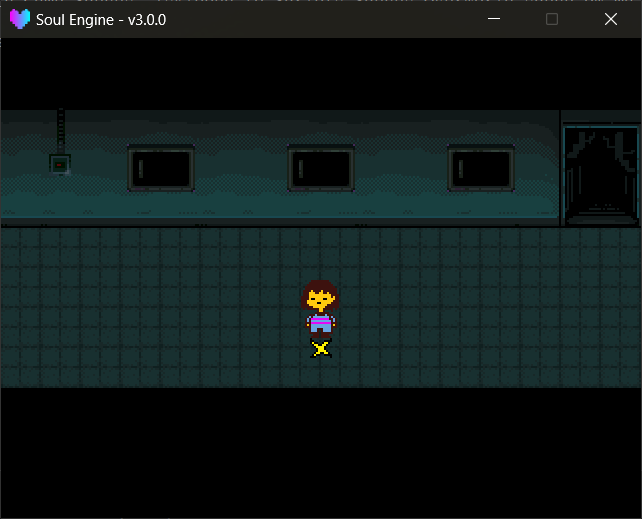

主世界场景只负责三件事：载入地图、播放音乐、每帧驱动 `Overworld`。

路径： `Scripts/Scenes/Overworld/` 。引擎自带 `scene_sol.lua` ，可参照该文件实现。

与其他场景相同，`Game/Scenes/Overworld/<同名>.lua` 会**覆盖**引擎自带的那份，详见 [基础开发 → 场景](../020_basic/010_scene.md) 。

---

## 最小场景

```lua
local scene = {}
local ow = ImportFile("Overworld")

ow.Init("Maps/main_scene/sol.lua")
ow.SetMusic("Start.ogg")

function scene.update(dt)
    ow.Update(dt)
end

function scene.draw()
    ow.Draw()
end

function scene.clear()
    ow.Clear()
    Layers.clear()
end

return scene
```

!!! danger "`scene.clear` 里两行都不能少"
    `ow.Clear()` 实际做的事： `Map.Destroy()` 销毁地图的所有碰撞体与贴图 → `Camera:unBounds()` 解开镜头边界 → 清掉整棵 `Scripts.Libraries.Overworld` 的模块缓存 → `Camera:reset()` 。<br>
    `Layers.clear()` 清图层。少写前者会导致第二次进主世界时拿到上一局的残留状态。

!!! note "`Overworld` 也是 Game 区可覆盖的那一类"
    `Overworld` 属于 `Scripts.Libraries.Overworld` 这棵模块树，`Game/` 区**不覆盖**它（能覆盖的是 `Encounter` / `Animations` / `Waves` / `Souls` / `Sprites` / `Fonts` 这些）。<br>
    修改主世界行为需通过 `Game/Hacks/` 里的 hack 脚本，见 [基础开发 → Game 区与资源覆盖](../020_basic/110_game_area.md) 。

!!! tip "`World.Destroy()` 当前无调用点"
    `World.Destroy()` 是存在的，但全库里**没有任何调用点**——`ow.Clear()` 走的是 `Map.Destroy()` ，物理世界本身会随模块缓存一起被丢弃。<br>
    编写扩展时不应假定该函数已被调用。



---

## 图层

`Overworld` 在被导入时会**自动**建立下面这些图层，顺序即遮挡顺序：

| 图层 | 值 | 放什么 |
|---|---|---|
| `Background` | -100 | 背景 |
| `Map` | 0 | 地图本身（由引擎绘制，不手动添加内容） |
| `BelowPlayer` | 49 | 玩家身后能挡住他的东西（箱子、告示牌） |
| `Player` | 50 | 玩家 |
| `UponPlayer` | 51 | 玩家身前的东西 |
| `GUI` | 80 | 对话框、菜单、存档页 |
| `TOP` | 100 | 全屏黑幕（切换场景淡入淡出） |
| `DEBUG` | 200 | 调试绘制 |

箱子、告示牌这类遮挡关系随玩家位置变化的物件，引擎会**每帧**按玩家位置自动在 `BelowPlayer` 与 `UponPlayer` 之间切换，无需手动处理。

---

## 载入地图

!!! example "初始化方法"
    - `Overworld.Init(lua_file)` 载入一张地图。
        - `lua_file` 地图文件相对项目根的路径，例如 `"Maps/main_scene/sol.lua"` 。
    - `Overworld.ResolveMapPath(lua_file)` 返回实际会交给 STI 的路径（Game 区优先）。一般不用手动调。
    - `Overworld.AutoCameraBounds()` 按地图实际覆盖范围重算镜头边界。 `Init` 里已经自动调过一次。
    - `Overworld.SetMusic(mpath)` 播放背景音乐，已经在放的同名音乐不会重复播放。

地图的 Game 区覆盖规则： `Maps/main_scene/sol.lua` 会先查找 `Game/Maps/main_scene/sol.lua` ，存在则使用该文件。

!!! warning "覆盖地图要连图块一起带"
    STI 是按**地图文件的相对路径**去找图块的（ `.lua` 里写的是 `../images/...` ）。<br>
    所以 Game 区那份地图旁边必须也有对应的 `../images/` 目录树，否则图块会整片丢失。

---

## 全局变量

`Overworld` 被导入时会注册以下全局变量，场景逻辑中可直接引用：

| 全局 | 是什么 |
|---|---|
| `Overworld` | 主世界总控表 |
| `Map` | 地图模块（= `Overworld.map` ） |
| `World` | 物理世界（= `Map.world` ） |
| `Char` | 玩家（= `Map.char` ） |
| `Stat` | 菜单 |
| `Save` | 存档页（= `Overworld._pages.save` ） |
| `Chest` | 箱子页（= `Overworld._pages.chest` ） |
| `Step` | 遇敌步数计数器 |
| `DATA` | 存档数据（见下） |
| `FLAG` | = `DATA.flags` |
| `CHEST` | = `DATA.chests` |
| `ITEMS` | 物品数据库 |

另外还有两个全局函数：

!!! example "全局函数"
    - `GetRelativePos(x, y)` 把屏幕坐标换算为跟随镜头的世界坐标。自定义 UI 时需要调用该函数。
    - `SpawnBlock(x, y, width, height, thickness)` 画一个白边黑底的框，返回带 `Destroy()` 的块对象。

---

## DATA：存档数据

`DATA` 就是存档本身。它来自 `Game/Logics/init.lua` ，如果之前存过档则直接用存档那份。

下面是引擎默认值（ `Game/Logics/init.lua` 的原始内容）：

```lua
logic = {
    time = 0,                  -- 游玩时长（秒）
    room_name = "--",          -- 存档点显示的地名
    room = "Overworld",        -- 当前场景名
    marker = 2,                -- 进入下一张地图时用第几个 mark
    position = {0, 0},         -- 存档位置
    direction = "down",        -- 存档朝向
    savedpos = false,          -- 是否有"读档位置"待消费

    player = {
        name = "Chara", lv = 1,
        maxhp = 20, hp = 20,
        gold = 0, exp = 0,
        atk = 0, watk = 0, def = 0, edef = 0,
        weapon = "stick", armor = "bandage",
        items = {              -- 背包（存物品 id 字符串）
            "ButterscotchPie",
            "PunchCard"
        },
        getcell = false,       -- 是否开放 CELL 菜单
        cells = {              -- 电话联系人
            {id = "Toriel_1", name = "叫妈妈"},
            -- ...
        }
    },
}
```

!!! tip "玩家落点的确定（三步覆盖）"
    `Map.Init` 里对玩家的位置连续写入三次，**后写入的覆盖先写入的**：

    1. 先放到**第一个** mark（ `map.objects.marks[1]` ）；
    2. 再用 `Overworld.FindObject("mark", DATA.marker)` 找 `id` 等于 `DATA.marker` 的 mark，找到后移动到该 mark 的位置——**找不到时保持在第一步的位置**，不会报错；
    3. 最后如果 `DATA.savedpos` 为 `true` ，直接放到 `DATA.position` （读档 / 从战斗回来走的就是这条）。

    所以 `marker = 2` 只在这张地图里真的有个 `id = 2` 的 mark 时才有意义。

!!! example "DATA 上的其它字段"
    - `flags` 自定义开关表，通过全局 `FLAG` 访问。 `FLAG["test_killed"] = 1` 这样用。
    - `chests` 箱子里有什么，通过全局 `CHEST` 访问，格式是 `CHEST["chest"] = {"Spider"}` 。
    - `lv_data` 等级表，20 级，每级有 `hp` / `at` / `df` / `totalExp` 。**升级结算与菜单显示都读它**。

!!! tip "`Game/Logics/` 有专门一页"
    世界规则（等级曲线怎么定、满级怎么扩、剧情开关、箱子内容）统一写在 **[游戏逻辑与世界规则](../020_basic/120_game_logics.md)** ，本页只讲 `DATA` 在运行时怎么用。

!!! warning "`Game/Logics/init.lua` 是硬 require，没有兜底"
    `DATA` 的来源写死成 `require("Game.Logics")` （ `Scripts/Libraries/Overworld/init.lua` 第 85 行）。<br>
    引擎自身不包含该文件，**删除或改名会导致崩溃**。重置存档时删除存档变量，而不是删除文件。

!!! tip "修改 Logics 未生效的原因"
    `Game/Logics/init.lua` 的最后有一段：如果 `Global.GetSaveVariable("Overworld")` 存在，就把 `logic` 整体替换为存档那份——对默认值的修改会被跳过。<br>
    调试时注释掉那两行，或先删除存档变量。

---

## ITEMS：物品数据库

物品表的查找顺序是 `Game.Logics.items` → `Scripts.Logics.items` （ `Scripts.Libraries.Overworld/init.lua` 里的 `owRequireGameFirst` ）。

!!! warning "`Scripts/Logics/` 这个兜底目录目前并不存在"
    引擎侧**根本没有** `Scripts/Logics/items.lua` ，所以列表里那一档永远命中不了，物品表**事实上只有 `Game/Logics/items.lua` 一个来源**。<br>
    两份都找不到时会打印 `[Overworld] WARNING: items table not found under Game.Logics or Scripts.Logics.` ，随后调用 `ITEMS.FindItemByID` 会因索引 `nil` 而崩溃。

```lua
local db = {
    {id = "MonsterCandy", name = "Monster Candy"},
    {id = "Spider",       name = "Spider", _color = {0.5, 1, 0}},
    -- ...
}

db._actions = {
    {
        id = "Spider",
        use  = {"* You ate the Spider...", "* I CAN'T UNDERSTAND."},
        info = {"* A spider."},
        drop = {"* You dropped the Spider...\n* But nothing happened."}
    }
}
```

!!! example "ITEMS 方法"
    - `ITEMS.FindItemByID(id)` 按 id 取物品定义，返回含 `id` / `name` / `_color` 的表。
    - `ITEMS.GetActionByID(id, action)` 取某物品的一段文本。
        - `action` `"use"` / `"info"` / `"drop"` 。

背包里存的**只是 id 字符串**，显示时再 `FindItemByID` 查名字和颜色。

---

## Overworld 总控方法速查

!!! example "Overworld 方法"
    - `Overworld.Init(lua_file)` 载入地图。
    - `Overworld.Update(dt)` 每帧推进（菜单 → 地图 → 存档页 → 箱子页 → 遇敌计数）。
    - `Overworld.Draw()` 绘制，目前是空实现，HUD 由场景自行绘制。
    - `Overworld.Clear()` 全部销毁并清缓存。
    - `Overworld.SetMusic(mpath)` 放音乐。
    - `Overworld.CalcNextEXP()` 返回距离下一级还差多少 EXP。

!!! example "Overworld 属性"
    - `Overworld.map` 地图模块。
    - `Overworld.stat` 菜单模块。
    - `Overworld.debug` 是否开启调试绘制，默认 `false` 。
    - `Overworld.follow_player` 镜头是否自动跟随玩家，默认 `true` 。
    - `Overworld.ui_prefer` 对话框默认出现在上还是下， `"down"` （默认）或 `"up"` 。

---

## 调试

把 `Overworld.debug` 设为 `true` ：

- 所有 Tiled 对象的碰撞体会被画出来（按类型分颜色）。
- 按 **空格** 可将镜头瞬移到鼠标所指的世界坐标，用于核对坐标。

详见 [地图与对象层 → 调试](./010_map.md) 。
