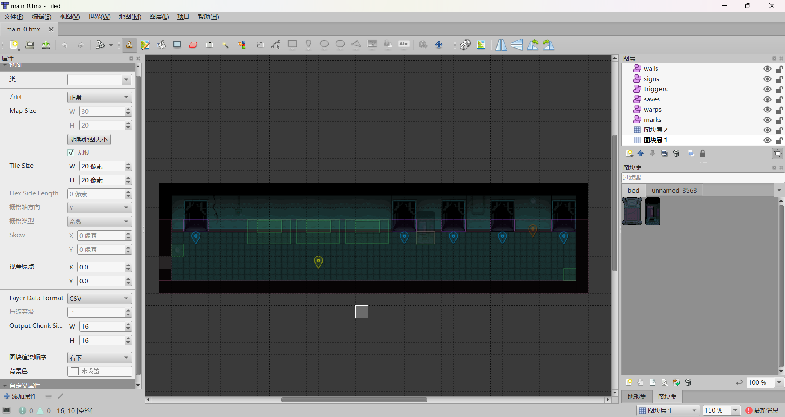
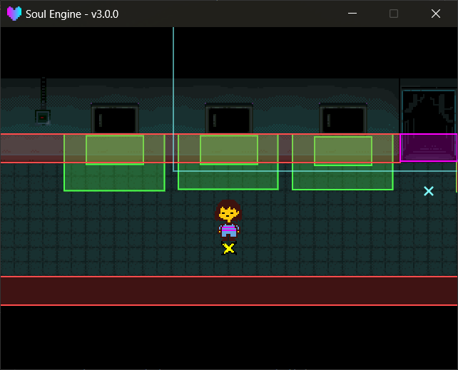

地图用 **Tiled** 编辑，导出成 `.lua` 后放进 `Maps/` 。引擎用内置的 `STI` 库读取它，并把对象层翻译成碰撞体。

路径： `Maps/` （引擎默认）、 `Game/Maps/` （Game 区，同名覆盖）。<br>
模块路径： `Scripts/Libraries/Overworld/map.lua` ，以全局 `Map` 出场。

---

## 地图的基本参数

引擎自带的地图均使用以下参数，新建地图时可参照设置：

| 项 | 值 |
|---|---|
| 朝向 | `orthogonal` |
| 瓦片大小 | `20 x 20` |
| 地图大小 | `30 x 20` （可改） |
| 导出格式 | `.lua` |

导出后的 `.lua` 放在 `Maps/` 下（或 `Maps/子目录/` 下）。Tiled 工程与 `.tmx` 放在 `Maps/tmx/` 属于目录约定，便于后续修改时定位源文件。

!!! tip "图块集还有两条硬约束"
    **图块集必须嵌入地图（不能使用外部 `.tsx` ）**，否则 STI 会直接 assert 导致场景崩溃；**图块尺寸必须是 20 × 20** 。<br>
    图块图片路径与动画图块的处理方式统一写在 **[STI 与图块集](./015_sti.md)** 。



---

## 对象层

**对象层的名字决定它会被怎么处理**，名字写错（或写成中文）就整层被忽略。

| 层名 | 用途 | 常用属性 |
|---|---|---|
| `marks` | 出生点 / 传送落点 | `id` 、 `direction` |
| `walls` | 墙（实体碰撞） | `id` （可选） |
| `warps` | 传送区域（碰到就换场景） | `id` |
| `triggers` | 自定义触发区 | `id` + 任意自定义属性 |
| `signs` | 告示牌 | `id` （可选） |
| `saves` | 存档点 | `id` 、 `room` 、 `x` 、 `y` |
| `chests` | 箱子 | `id` 、 `give` |

这些层分成三类，处理方式**不一样**：

| 类别 | 层 | 物理体 | 玩家能走过去吗 |
|---|---|---|---|
| 纯数据 | `marks` | 没有 | 是（它不参与碰撞） |
| 实体 | `walls` | `static` 矩形 / 多边形 / 椭圆 | **不能**，会产生阻挡 |
| 传感器 | `warps` 、 `triggers` | `kinematic` + `setSensor(true)` | 是，走进去就记进交互列表 |
| 会挡路的交互物 | `signs` 、 `saves` 、 `chests` | `kinematic`（**不是** sensor） | **不能**，但碰到照样记进交互列表 |

只有 `warps` 与 `triggers` 是可穿过的区域；告示牌、存档点、箱子与墙一样会阻挡玩家，需要接触后才能触发。这三者内部走的是同一套接触事件（ `beginContact` ），只是碰撞外形取的是贴图底部的一条窄边。

!!! warning "`marks` 没有物理体"
    `marks` 只被读成一个 `{x, y, direction}` 的坐标点，不生碰撞体、也没有贴图。所以它既可以摆在墙里，也可以拿来当纯逻辑锚点。

!!! warning "坐标要乘 2"
    引擎在读对象时会把 `x` / `y` / `width` / `height` 全部乘 `2` 再建碰撞体。<br>
    因此运行时读到的坐标已是世界坐标，但 Tiled 中显示的数字为缩放前的值。

---

### marks 出生点

决定玩家进这张地图时站在哪。`id` 是它的编号，`direction` 是进来后朝哪边。

- 什么都不指定 → 用第一个 mark。
- `DATA.marker` 有值 → 用 `id` 匹配的那个 mark（切场景时由 `Overworld.ChangeScene` 写入）。
- `DATA.savedpos` 为真 → 用 `DATA.position` 存档位置（读档 / 从战斗回来）。

!!! tip "进战斗回来靠的就是 savedpos"
    遇敌时引擎会自动把 `DATA.savedpos` 置为 `true` 并记下当时的位置，所以打完仗玩家会回到原地而不是出生点。

---

### walls 墙

`walls` 是唯一会真正阻挡玩家的层。三种形状都支持：

- 矩形（默认）
- 多边形：斜墙、尖角均可
- 椭圆 / 圆：以 `width` 与 `height` 中较小的值为直径

`rotation` 属性会被正确应用（多边形与椭圆都会跟着转）。

!!! example "墙的摩擦"
    墙与玩家的摩擦均为 `0.01` ，该值是刻意调低的：摩擦较低时，玩家撞到斜墙会**沿墙滑动**而不是被粘住。<br>
    两个值分别在 `map.lua` 的 `wall_friction` 与 `char.lua` 里，调大后玩家会**贴墙**。

---

### warps 传送区

碰到即切换场景的区域。它只记录碰撞发生，切换场景的动作在场景脚本中实现（见 [交互与对话](./030_interact.md) ）。

### triggers 自定义触发区

与 `warps` 同为传感器，但没有固定用途，属性可自由添加。常见用法是添加一个自定义属性（例如 `rr` ）作为房间编号，再按该属性分流。

```lua
if (Overworld.getInteractResult("trigger", 1, "rr")) then
    -- 碰到了 rr == 1 的触发区
end
```

### signs / saves / chests

`signs` / `saves` / `chests` 三层的贴图由引擎**自动生成**（告示牌、存档点、箱子），无需自行绘制。属性如下：

- `signs`：`id` 不填时按摆放顺序自动编号。
- `saves`：`room` 是存档点上显示的地名， `x` / `y` 是存档坐标。
- `chests`：`give` 会被原样读入运行时对象的 `give` 字段（不填为 `false` ），但**引擎内没有任何位置读取该字段**。箱子给出的物品由 `CHEST` （= `DATA.chests` ）与场景脚本决定，见 [菜单 · 存档 · 箱子](./040_menu.md) 。

---

## 运行时访问

所有对象都会被收进 `Map.objects` ，按类型分表：

!!! example "对象容器"
    - `Map.objects.marks` / `.walls` / `.warps` / `.triggers` / `.signs` / `.saves` / `.chests` 各自类型的运行时对象列表。
    - `Map.objects.unknowns` 层名未匹配的对象层。**该表当前始终为空**——引擎只按已知层名分发，遇到未识别的层会直接跳过，不会写入此处。层名拼写错误需通过 `Map.debug_objects` 排查（见下）。
    - `Map.debug_objects` 原始 Tiled 对象，按**层名**索引（包括拼错的层），调试绘制专用。

!!! tip "层名拼写错误的排查"
    开启 `Overworld.debug` 后，`Map.debug_objects` 里**所有**对象层都会被绘制，包括层名拼写错误的那层。<br>
    颜色表中没有对应层名时，会落到 `unknowns` 的**暗红色**；出现暗红色框表示该层名未被引擎识别。详见本页末尾「调试」。

运行时对象的结构如下：

```lua
{
    x, y,               -- 世界坐标（已 ×2）
    width, height,      -- 尺寸（已 ×2）
    id,                 -- 属性里的 id
    properties,         -- 该对象在 Tiled 里填的所有属性
    body, fixture,      -- 物理体（walls / warps / triggers / signs / saves / chests 有）
    sprite,             -- 贴图（signs / saves / chests 有）
}
```

若只需按条件取一个对象而不涉及碰撞，可使用 `Overworld.FindObject` ，见 [交互与对话](./030_interact.md) 。

---

## 地图与物理世界

!!! example "Map 方法"
    - `Map.Init(lua_file)` 载入地图。已初始化时会跳过并打印提示。
    - `Map.Update(dt)` 推进瓦片动画、物理世界、玩家与镜头。引擎自动调用。
    - `Map.Destroy()` 销毁所有碰撞体与贴图。
    - `Map.current` 当前地图文件的实际路径（可能是 Game 区那份）。
    - `Map.char` 玩家模块。
    - `Map.world` 物理世界。

!!! example "World 方法"
    - `World.Init()` 建物理世界并注册碰撞回调。重复调用会被忽略。
    - `World.Update(dt)` 推进物理世界。
    - `World.Destroy()` 销毁物理世界及其中所有物体。
    - `World.interactions` 交互状态（详见 [交互与对话](./030_interact.md) ）。

!!! warning "瓦片动画需要 Update"
    Tiled 的动画瓦片只有在 `Map.Update` 里被调用 `map:update(dt)` 时才会推进。<br>
    该调用已由引擎写入，优化时不要删除。

---

## 镜头

`Overworld.Init` 会扫描所有可见瓦片层，算出**实际有内容的那块矩形**（考虑图层偏移与无限地图的负坐标区块），再按视口大小换算成 `Camera:setBounds` 。

覆盖区域比视口小时，镜头会被锁在正中央。

如需手动控制镜头：

```lua
ow.Init("Maps/main_scene/sol.lua")
Camera:setBounds(min_x, min_y, max_x, max_y)   -- 覆盖自动结果
Camera:setPosition(x, y)                        -- 手动定位
Overworld.follow_player = false                 -- 关掉自动跟随
```

---

## 调试

```lua
Overworld.debug = true
```

开启后：

- 所有对象层的碰撞体会被画出来，按类型分色（ `walls` 红、 `triggers` 绿、 `warps` 洋红、 `saves` 黄、 `chests` 橙、 `signs` 紫、 `marks` 青）。
- 按 **空格** 把镜头瞬移到鼠标位置。


