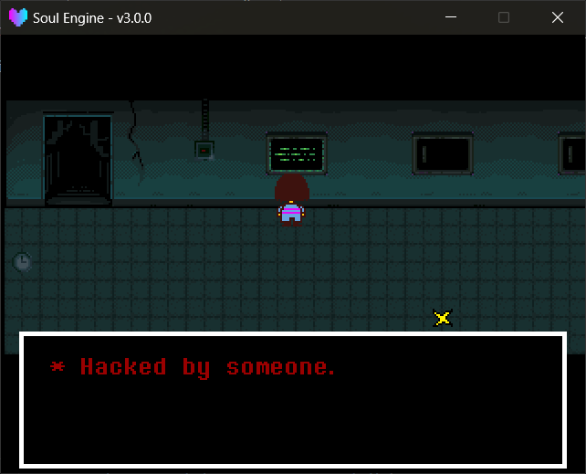

玩家碰到对象之后的行为全部由**场景脚本**决定。引擎只记录碰撞发生与碰撞对象。

---

## 交互的产生

物理世界的碰撞回调会把接触到的对象记进 `World.interactions` ：

!!! example "interactions 字段"
    - `can_interact` 此刻是否正碰着某个可交互物。
    - `current_object` 碰到的类型（ `"warp"` / `"chest"` / `"sign"` / `"save"` / `"trigger"` ）。
    - `current_id` 碰到的对象的 `id` 。
    - `current_obj` 碰到的运行时对象本身，可以读它的 `properties` 。
    - `touching` **当前碰着的所有对象**的列表（可能不止一个）。

!!! tip "不需要面朝该对象"
    判定只看碰撞，**不要求玩家面向该方向**。原版中需走到告示牌正面的限制在此未实现，发生碰撞即计入。

---

## 读取交互

!!! example "读取方法"
    - `Overworld.getInteractResult(obj_type, id, extra_key)` 是否正碰着符合条件的对象。
        - `obj_type` 类型名，例如 `"warp"` 。
        - `id` 省略时只要类型对就返回 `true` 。
        - `extra_key` 省略（或传数字）时按 `id` 匹配；传**字符串**时按该名字的**自定义属性**匹配（例如 `"rr"` ）。
        - 按属性匹配时**返回该属性的值**（不是 `true` ）：`rr` 为 `3` 时返回 `3` ，可直接作为编号使用。
    - `Overworld.getTouchResult(obj_type, id, extra_key)` 同上，但检查 `touching` 里的**每一个**对象而不是只查最后碰到的那个。
    - `Overworld.FindObject(obj_type, id, extra_key)` 不要求碰到，直接在整个地图上找，返回运行时对象表。
        - `obj_type` 写**单数**（ `"warp"` / `"mark"` / `"chest"` ），内部会拼成 `objects["warps"]` 去查。

!!! warning "`getTouchResult` **不受**两个常见保护"
    `getInteractResult` 和 `onConfirm` 都有两道闸：对话刚结束的那一帧直接返回 `false` ， `Char.controlling` 为 `false` 时直接返回 `nil` 。<br>
    **`getTouchResult` 两道都没有。** 它只读 `touching` 列表，所以：

    - 玩家被锁着（对话中 / 菜单里）时它照样返回 `true` ；
    - 用 `getTouchResult` 做触发时，关闭对话的那一次确认键会再次打开对话，需自行添加 `FLAG` 等去重手段。

!!! tip "旧脚本的第四个参数会被忽略"
    `getInteractResult` 的旧签名有一个第 4 参数（原为朝向判定的开关）。<br>
    当前**接收但直接忽略**，仅为兼容旧场景脚本。朝向判定已移除（见上一条），新代码不传入该参数。

!!! warning "重叠时用 getTouchResult"
    `getInteractResult` 只看"最后碰到的那一个"。两个触发区叠在一起时，先碰到的会被后碰到的顶掉。<br>
    只要有一个命中即生效的场合（例如进入某个房间），均使用 `getTouchResult` 。

```lua
-- 碰到了 id 为 1 的 warp
if (Overworld.getInteractResult("warp", 1)) then ... end

-- 碰到了 rr 这个自定义属性等于 1 的 trigger
if (Overworld.getInteractResult("trigger", 1, "rr")) then ... end

-- 只要碰到任意告示牌
if (Overworld.getInteractResult("sign")) then ... end
```

---

## 一键确认

`onConfirm` 将碰撞判定与确认键合并为一次调用：

!!! example "确认方法"
    - `Overworld.onConfirm(type_name, id, sub_key, func)` 条件满足且按下确认键时执行 `func` 。
        - `sub_key` 可省略；传了就额外按该自定义属性匹配一次。
        - 省略 `sub_key` 时第三个参数直接就是回调函数。

```lua
Overworld.onConfirm("sign", 1, function ()
    Overworld.dialogNew({"* 这是一块告示牌。"})
end)

Overworld.onConfirm("trigger", 1, "rr", function ()
    Overworld.ChangeScene("Overworld.scene_ruins", 2, "down")
end)
```

---

## 对话

!!! example "对话方法"
    - `Overworld.dialogNew(texts, position)` 弹一个对话框，返回 `dialog` 对象。
        - `texts` 文本数组。
        - `position` `"down"` （屏幕下方）或 `"up"` （上方）。省略时由 `Overworld.ui_prefer` 决定。
    - `Overworld.ui_prefer` 不传 `position` 时采用的值。
        - `"auto"` （默认）按玩家在画面中的位置判定：低于 `ui_threshold` 时出在上方，否则出在下方。
        - `"down"` ／ `"up"` 固定一侧，不再自动判定。
    - `Overworld.ui_threshold` `"auto"` 的判定线，画布坐标 Y，默认 `320` （480 的三分之二）。
    - `Overworld.ResolveUIPosition()` 返回这一帧会采用的值， `"up"` 或 `"down"` 。
    - `Overworld.FlipY(y)` 把画布 Y 绕中线 `240` 镜像，即 `480 - y` 。

两个位置共用同一个框与同一份文字偏移：切换时只移动框，框内文字相对框的偏移量保持不变，因此文字不会跟着镜像翻转。

返回的 `dialog` 有两个字段： `block` （那个白边黑底的框）与 `text` （打字机对象）。

引擎默认在文本播完后销毁框并解锁玩家。若需要在文本播完后执行其他逻辑，覆盖 `text._onComplete` ：

```lua
local dialog = Overworld.dialogNew({"* 你捡起了一块石头。"})

dialog.text._onComplete = function ()
    dialog.block:Destroy()
    Char.controlling = true
    -- 后续逻辑
end
```



---

## 切换场景

!!! example "切场景方法"
    - `Overworld.ChangeScene(scene, mark, direction)` 淡出并切换到另一个场景。
        - `scene` 目标场景名，例如 `"Overworld.scene_ruins"` 。
        - `mark` 落到目标地图的第几个出生点，默认 `1` 。
        - `direction` 落地后的朝向，默认 `"down"` 。

它会立刻锁住玩家、开始淡出，等到黑幕全黑时才真正切场景。同时把 `DATA.room` / `marker` / `direction` 写进存档。

!!! tip "跨地图传数据用 DATA"
    切场景时 `DATA` 是全局的、不会丢，需要带过去的状态（剧情进度、掉落物之类）直接往 `DATA` 或 `FLAG` 里写。

---

## 一份完整的场景脚本

将上述各部分组合起来：

```lua
local scene = {}
local ow = ImportFile("Overworld")

ow.Init("Maps/main_scene/sol.lua")
ow.SetMusic("Start.ogg")

function scene.update(dt)
    ow.Update(dt)

    -- 告示牌
    ow.onConfirm("sign", 1, function ()
        ow.dialogNew({"* 欢迎来到遗迹。", "* 请小心脚下。"})
    end)

    -- 存档点
    ow.onConfirm("save", 1, function ()
        local save = ow.FindObject("save", 1)
        ow.SaveInteract({"* 你感到了希望。"}, "遗迹 - 入口", save.position, "down")
    end)

    -- 箱子
    ow.onConfirm("chest", 1, function ()
        ow.ChestInteract("chest")
    end)

    -- 传送
    ow.onConfirm("warp", 1, function ()
        ow.ChangeScene("Overworld.scene_ruins", 2, "down")
    end)

    -- 自定义触发区：走进去就说一句话（只说一次）
    if (ow.getTouchResult("trigger", 1, "rr") and not FLAG["said_hello"]) then
        FLAG["said_hello"] = true
        ow.dialogNew({"* ……这里好安静。"})
    end
end

function scene.draw()
    ow.Draw()
end

function scene.clear()
    ow.Clear()
    Layers.clear()
end

return scene
```

---

## 常见问题

!!! warning "对话刚结束的那一帧，`getInteractResult` 一律返回 false"
    引擎有一个**单帧锁**：文本播完的那一帧，所有 `getInteractResult` 调用都会返回 `false` （ `getTouchResult` 不受影响）。<br>
    该锁用于避免关闭对话的那一次确认键立即再次打开对话的死循环。<br>
    在同一帧内连续触发两个交互时，第二个不会执行，需将其移至下一帧，或自行实现状态机。

!!! warning "`Char.controlling` 为 false 时 `getInteractResult` 不生效"
    `getInteractResult` 里有 `if (not Char.controlling) then return end` （注意返回的是 `nil` ，不是 `false` ）。<br>
    锁定玩家后未恢复时，通过 `getInteractResult` / `onConfirm` 实现的交互会**静默失效**。<br>
    但 `getTouchResult` 与 `FindObject` **不读取该字段**，始终正常返回。

!!! tip "对话框要跟随镜头"
    自定义 UI 时使用 `GetRelativePos(x, y)` 换算坐标，不直接写入屏幕坐标——镜头位置会变化。
