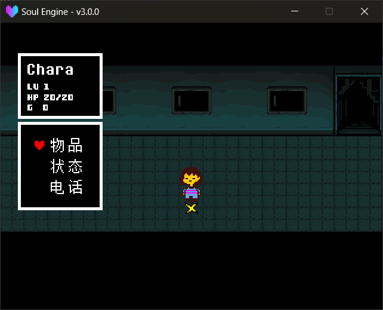
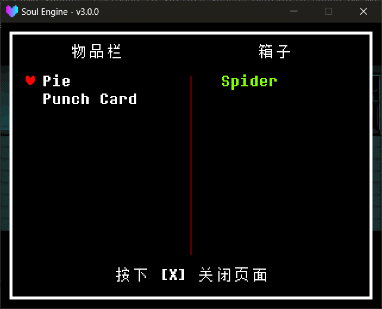

主世界中弹出并覆盖画面的界面已由引擎实现，直接调用即可。

---

## 菜单 `Stat`

玩家按 **菜单键**（ `Controller.GetState("menu")` ）自动打开，无需额外代码。

模块路径： `Scripts/Libraries/Overworld/stat.lua` ，以全局 `Stat` 出场。

!!! example "菜单方法"
    - `Stat.Update(dt)` 每帧调用，负责开菜单与处理输入。引擎已经接好。
    - `Stat.Destroy()` 关闭菜单并恢复玩家操作。
    - `Stat._created` 菜单此刻是否开着。
    - `Stat._page` 当前子页面，取的是**小写字符串**： `"idle"` / `"item"` / `"item2"` / `"stat"` / `"cell"` 。
        - `"idle"` 表示菜单已打开、光标停留在三个大按钮上的状态（对应下面的 `ITEM` / `STAT` / `CELL` 那一层）；
        - `"item2"` 表示在背包中选中某件物品后进入的 `使用` / `信息` / `丢弃` 三选一界面。

### 三个子页面

| 页面 | 内容 | 显示条件 |
|---|---|---|
| `ITEM` | 背包（最多 8 格） | 始终有；背包为空时文字变暗 |
| `STAT` | 名字、LV、HP、攻防、武器防具、EXP | 始终有 |
| `CELL` | 电话联系人（最多 10 格） | `DATA.player.getcell` 为 `true` 时才有 |

> 表里的 `ITEM` / `STAT` / `CELL` 是**界面上三个按钮的名字**，不是 `Stat._page` 的值——后者一律小写。

进入 `ITEM` 后再按一次确认会进入 `使用` / `信息` / `丢弃` 三选一界面（ `_page` 变为 `"item2"` ）。

!!! tip "启用 CELL 页面的条件"
    `DATA.player.getcell = true` 之后菜单才会出现第三项。<br>
    `stat.lua` 顶层已写入 `DATA.player.getcell = true` ，默认关闭该项时改为 `false` 。



---

## 存档点 `Save`

碰到存档点后调用 `Overworld.SaveInteract` 即可，它会**先播对话、再打开存档页**。

!!! example "存档方法"
    - `Overworld.SaveInteract(texts, location, position, direction)` 播对话并存档。
        - `texts` 存档点要说的话。
        - `location` 存档界面上显示的地名。
        - `position` 存档坐标 `{x, y}` ，一般从 `saves` 对象的属性里取。
        - `direction` 存档朝向。
    - `Save.Show()` 直接打开存档页（不带对话）。
    - `Save.Hide()` 关闭存档页。
    - `Save.Update()` 处理输入，引擎已自动接好。
    - `Save._active` 存档页是否开着。

`SaveInteract` 还会执行三步：将血量补满、播放 `snd_heal.wav` 、写入 `DATA.room` / `room_name` / `position` / `direction` / `savedpos` 。

真正落盘是在玩家在存档页上选了 `保存` 时：

```lua
Global.SetSaveVariable("Overworld", DATA)
```

!!! warning "存档就是整份 DATA"
    存档写的是**整个 `DATA` 表**，没有白名单也没有版本号。<br>
    为 `DATA` 增加字段是安全的；但**修改字段名会使旧存档中该字段读出 `nil`** ，需在发布前确认。


---

## 箱子 `Chest`

箱子是一个**左右两栏的交换界面**：左边是背包（最多 8 格），右边是箱子（最多 10 格），确认键把当前选中项移动到另一栏。

!!! example "箱子方法"
    - `Overworld.ChestInteract(chest)` 打开箱子页。
        - `chest` 箱子在 `CHEST` 表里的键名，**省略或传 `""` 时用 `"chest"`** 。
    - `Chest.Show(chest)` 同上，直接打开。**`chest` 必须给**——这里没有默认值，传 `nil` 会在 `#CHEST[chest]` 上直接报错。
    - `Chest.Hide()` 关闭。
    - `Chest.Update()` 处理输入，引擎已自动接好。

!!! warning "`Chest.Show()` 和 `ChestInteract()` 的参数规则不一样"
    只有 `ChestInteract` 会将空的箱子名补为 `"chest"` ；`Chest.Show` 不做该处理，必须传入正确的名字。

箱子的内容定义在 `Game/Logics/init.lua` 里，键名即为上面传入的名字：

```lua
logic.chests = {
    chest  = {"Spider"},    -- 名为 chest 的箱子里有一个 Spider
    chest1 = {},
}
```

满了就放不进去（背包 8 格 / 箱子 10 格），这是硬上限。



---

## 它们都会锁玩家

三个界面在打开时都会把 `Char.controlling` 置为 `false` ，关闭时恢复。所以打开期间玩家不会动，也不会触发任何交互。

但**只有存档页和箱子页**在关闭时还会多调一次 `Overworld.JustOnDialog()` （见 `save.lua` / `chest.lua` 的 `Hide` ）：

| 界面 | 锁玩家 | 关闭时调 `JustOnDialog()` |
|---|---|---|
| `Stat` 菜单 | 是 | **否** |
| `Save` 存档页 | 是 | 是 |
| `Chest` 箱子页 | 是 | 是 |

`JustOnDialog()` 的作用是锁住**关闭那一帧**的交互，防止用于关闭界面的确认键再次触发 `onConfirm` 。

!!! tip "自定义界面的写法"
    ```lua
    Char.controlling = false
    -- ... 界面实现 ...
    Char.controlling = true
    Overworld.JustOnDialog()
    ```

    `JustOnDialog()` 为必需调用：自定义界面通常也通过确认键关闭，不调用时该确认键会误触发脚下的告示牌或传送点。

!!! example "帧锁方法"
    - `Overworld.JustOnDialog()` 锁住当前这一帧的所有交互结果（只对 `getInteractResult` / `onConfirm` 生效）。关闭任何自定义界面后都该调一次。
