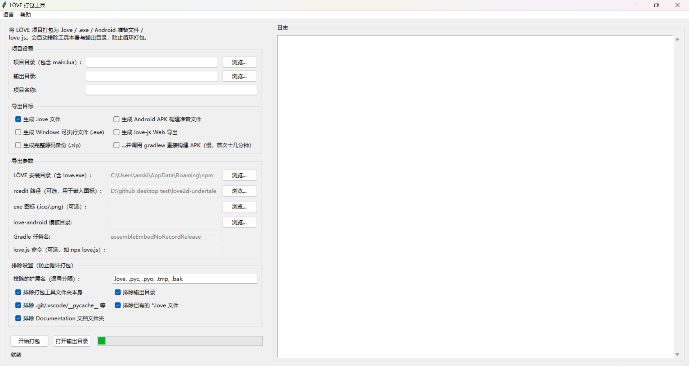

游戏可运行且内容完成后，下一步是将其打包为**可分发、可直接打开的文件**。

这一步分两件事：先把配置改对（`conf.lua` 里的三个地方），再把项目交给打包工具。引擎自带打包工具，路径是项目根目录下的 `Packager/` 。

---

## 发布前：先把配置改对

打开项目根目录的 `conf.lua` ，最上面几行就是给发布用的。

### `_RELEASED`

```lua
-- Set to true when building the game for release
_RELEASED = false
```

改成 `true` 。它现在只控制一件事：**关掉 Windows 的黑色控制台窗口**（ `t.console = not _RELEASED` ）。

!!! warning "开启控制台发布会将调试信息暴露给玩家"
    控制台中会滚动输出各类 `[WARNING]` 、路径、内存读数。开发阶段保留控制台用于调试，**发布包中必须关闭**。

### `_INFO`

```lua
_INFO = {
    TITLE   = "Soul Engine - v3.0.0",
    VERSION = "0.0.0",   -- 游戏自身的版本号
    AUTHOR  = "end",
    CONTACT = "NaN",
    WEBSITE = "NaN",
}
```

- `TITLE` 是**窗口标题**，也是出错画面上印的名字。
- `VERSION` 是**游戏自身**的版本号，与引擎版本无关（引擎版本见 `_VER` ，不修改该值）。
- `AUTHOR` / `CONTACT` / `WEBSITE` 会**原样印在出错画面上**给玩家看。

!!! tip "发布前填全 `_INFO`"
    玩家遇到错误时显示的 Fatal Error 画面，最后一段即为 `_INFO` 这几项。<br>
    保留 `NaN` 时，玩家即使提供报错截图也无法联系到作者。

!!! warning "`_VER` 是引擎版本，不要修改"
    第一行的 `_VER = "3.0.0-stable"` 是**引擎**版本号。<br>
    项目的版本写在 `_INFO.VERSION` ，两者不要混淆。


---

## 打包前先跑一次兼容性检查

打包工具附带一个**独立**的检查器，只读取不修改，用于检查在 Windows 上可运行、在其他平台上会出错的问题。

```bash
cd Packager
python check_compat.py            # 默认严格度 3（最严格）
python check_compat.py --strict 2 # 按 exe 发布 / Linux 检查
python check_compat.py --all      # 三种严格度一次性对比
```

Windows 下也可以直接双击 `Packager/check_compat.bat` —— 它**默认按严格度 2** 跑（和直接跑 `python check_compat.py` 的默认值 3 不同）。

三种严格度对应三种目标平台：

| 严格度 | 目标平台 | 说明 |
|---|---|---|
| `1` | Windows 开发端 | 最宽松。NTFS 大小写不敏感，`require` 写错大小写也能命中 |
| `2` | exe 发布 / Linux 等 | 较严格。`.love` 在区分大小写的文件系统上解包后，引用的大小写必须和磁盘一致 |
| `3` | love.js (Web) | 最严格。love.js 是 Lua 5.1 语义，`goto` 、`::label::` 、位运算、`0b` 字面量都会编译失败 |

它会报出三档问题：**error**（该严格度下无法运行）、**warning**（存在风险，例如 `loadstring` 这类 5.1 专属 API）、**info**（仅供参考）。

!!! danger "大小写是打包时最常见的问题"
    Windows 上 `Sprites.CreateSprite("Overworld/frisk/xxx.png")` 与实际文件 `Overworld/Frisk/xxx.png` 可以匹配，
    **打包到 Android / Linux 后整张图会找不到**。<br>
    检查器在严格度 `2` / `3` 下会列出所有这类引用。**打包后出现图片缺失时，应首先排查大小写。**

!!! note "该检查为静态检查，不能替代实际运行"
    检查器无法完全复现运行时行为，只覆盖可静态判定的问题（大小写、Lua 版本语法、模块缺失、基础语法）。<br>
    为确保可用，**至少在本机运行一次导出的 exe**。

---

## 用打包工具导出

打包工具是一个 Python + tkinter 的图形界面程序，**不需要装任何第三方库**（只用标准库）。

启动方式（Windows 上双击也行）：

```bash
cd Packager
run.bat            # 或手动：python build_tool.py
```

界面上要填的东西：

| 字段 | 填什么 |
|---|---|
| 项目目录 | **包含 `main.lua` 的项目根目录**（填错会提示找不到 `main.lua` ） |
| 输出目录 | 默认是 `<项目>/Export` |
| 项目名称 | 产物文件名用它 |
| LÖVE 安装目录 | 含 `love.exe` 的那一层，**导出 exe 才需要** |
| rcedit 路径 | 可选，给 exe 写图标 / 版本信息用（仓库里已经带了 `rcedit-x64.exe` ） |
| exe 图标 | 可选，`.ico` / `.png` |
| love-android 模板目录 | 导出 Android 准备文件才需要 |
| love.js 命令 | 可选，例如 `npx love.js` |

然后勾选要导出哪些目标：

| 目标 | 产物 | 说明 |
|---|---|---|
| `.love` 文件 | `<名称>.love` | 游戏 zip，可直接被 LÖVE 加载 |
| Windows 可执行文件 | `<名称>-win/` 文件夹 | `love.exe` 与 `.love` 合并成独立 exe，连同所需 DLL 一起复制 |
| Android APK 准备文件 | `<名称>-android/` | 复制 love-android 模板并把 `game.love` 放好；可勾选顺带调 `gradlew` 直接出 APK |
| love-js Web 导出 | `<名称>-web/` | 复制 `game.love` 供 love.js 使用，可自动调用 love.js 生成网页版 |
| 完整源码备份 | `<名称>-source.zip` | 整份源码打包备份 |

导出后输出目录的结构如下：

```
Export/
├── game.love               # .love 文件
├── game-win/               # Windows exe 文件夹（含 DLL）
│   ├── game.exe
│   ├── love.dll
│   └── ...
├── game-android/           # Android 准备文件
│   └── app/src/embed/assets/game.love
├── game-web/               # love-js 准备文件
└── game-source.zip         # 源码备份
```

!!! warning "工具自身始终被排除，不要手动加回"
    为避免把工具本身与产物再次打包导致产物体积异常增大，以下内容**始终**被排除：

    - 工具自身脚本（ `build_tool.py` ）
    - 工具所在文件夹（ `Packager/` ，当它在项目内时）
    - 输出目录（默认 `<项目>/Export` ）
    - 已存在的 `*.love` 文件（可在"排除设置"里关掉）

    `.git` / `.vscode` / `__pycache__` / `.workbuddy` 默认也会跳过，这些都可以在界面上调。



---

## Windows：exe

需要本机装了 LÖVE（界面里要指向含 `love.exe` 的目录）。

产物是一个**文件夹**，不是单个 exe —— `love.dll` 、`SDL2.dll` 等必须与 exe 位于同一目录，缺少其中任何一个都无法启动。

发布时有两种送法：

- **整个文件夹**压成 zip 发出去，玩家解压后双击里面的 exe。
- 做成安装包（自行用 Inno Setup / NSIS 之类），这里不做展开。

!!! warning "不要只分发 exe 单个文件"
    `game.exe` 单独复制出去会提示缺少 DLL，需分发整个 `-win/` 文件夹。

---

## Android：APK

Android 出包是**两段**，出问题时要先分清卡在哪一段：

1. **内容段**：把项目打成 `game.love` 并放入模板。该段不需要 Android 环境，失败时能较快定位。
2. **工具链段**：JDK / SDK / NDK / CMake / Gradle 必须满足**模板自身的构建文件**要求的版本。多数失败发生在这一段，且构建耗时较长。

### 准备模板（只需一次）

```bash
git clone --recurse-submodules https://github.com/love2d/love-android
```

`--recurse-submodules` **不能省**，否则会报 `Missing LÖVE` 或缺 `liblove.so` 。已经克隆过但漏了子模块：

```bash
git submodule sync --recursive
git submodule update --init --force --recursive
```

需要 **JDK 17**（不能更高也不能更低）、**CMake ≥ 3.21**，并设置 `ANDROID_HOME` 。

!!! danger "版本要求以模板的构建文件为准，不套用教程中的版本"
    NDK / SDK 版本在不同 love-android 分支上存在差异，写错会直接在 CMake 配置阶段失败。**以模板中的文件为准**：

    | 看哪个文件 | 读什么 |
    |---|---|
    | `app/build.gradle` | `ndkVersion` 、`compileSdk` 、`targetSdk` 、`minSdk` 、`cmake { version }` 、`abiFilters` |
    | `gradle/wrapper/gradle-wrapper.properties` | 需要的 Gradle 版本 |
    | `app/src/main/cpp/love/src/common/version.h` | 这个分支对应哪版 LÖVE |

    当前 `main` 分支（LÖVE 12.0）的要求为：NDK `27.3.13750724` 、compileSdk / targetSdk `35` 、minSdk `23` 、CMake `3.21.0+` 、ABI `armeabi-v7a` / `arm64-v8a` / `x86_64` 。

### `game.love` 放在哪

| 模板版本 | 目录 | Gradle 任务 |
|---|---|---|
| 现代模板（有 `app/src/embed` ） | `app/src/embed/assets` | `assembleEmbedNoRecordRelease` |
| 旧模板 | `app/src/main/assets` | `assembleNormalRecord` |

打包工具会**自动判断**用哪个，并在日志里说明。

!!! danger "放错目录不会报错"
    放错只会让 APK 安装后启动为一个**空的 LÖVE 界面**。因此出包后需要复核，不只依据构建是否成功。

### Gradle 任务

默认填 `assembleEmbedNoRecordRelease` 。

- 游戏要用麦克风录音 → 换成 `assembleEmbedRecordRelease`
- 要上架 Play 的 AAB → `bundleEmbedNoRecordRelease`

构建日志会实时输出到工具右侧的面板。**首次需要编译原生库，耗时从十几分钟到一小时不等**。

!!! warning "之后不要执行 clean"
    `clean` 会删除全部原生编译产物，下一次构建需要重新完整编译。<br>
    改 Lua 或素材属于常规迭代，重打包 `game.love` 再加增量 Gradle 只要几十秒。

### 签名：出包后通常需要补充签名

release 构建产出的很可能是**未签名**的 APK（文件名里带 `-unsigned` ）。**未签名的 APK 无法安装**，手机上只提示应用未安装，不给出具体原因。

要自己签一次（`zipalign` 和 `apksigner` 在 `<SDK>/build-tools/<版本>/` 里）：

```bash
zipalign -p -f 4 unsigned.apk aligned.apk

keytool -genkeypair -keystore my.keystore -alias my -keyalg RSA \
        -keysize 2048 -validity 10000 -storepass 你的密码 -keypass 你的密码 \
        -dname "CN=你的名字, O=你自己, C=CN"

apksigner sign --ks my.keystore --ks-key-alias my \
          --ks-pass pass:你的密码 --key-pass pass:你的密码 \
          --out signed.apk aligned.apk

apksigner verify --verbose signed.apk
```

!!! danger "正式发布的密钥需要永久保存"
    测试阶段可自行创建密钥；但**上架后必须使用同一密钥签名**。<br>
    密钥丢失后无法为已发布的游戏推送更新，只能更换包名重新发布。

### 装不上的两个常见原因

!!! warning "包名和官方 LÖVE 撞了"
    模板默认的包名是 `org.love2d.android` ，即另一个 LÖVE for Android。<br>
    若手机已安装官方 LÖVE，该包**要么因同包名不同证书而无法安装，要么安装后无法区分二者**。<br>
    确认方法：

    ```bash
    aapt2 dump badging 你的.apk
    ```

    修改模板里的 `app.application_id` （以及各语言的 app 名称）即可。

!!! warning "`libluajit.so` 没被包进去"
    这是 love-android 模板的一个静默问题：原生库**已被链接但未被打包**，安装后启动即崩溃：

    ```
    dlopen failed: library "libluajit.so" not found
    ```

    出包后解开 APK 确认一下 `lib/<abi>/` 里该有的 `.so` 都在：

    ```bash
    unzip -l 你的.apk | findstr lib/
    ```

    重新克隆模板后需要特别检查该项。

---

## love-js（网页版）

可选目标，需要 **Node.js** 和 [love.js](https://github.com/Davidobot/love.js) 。

工具做的是把 `game.love` 复制过去，并（如果填了 `love.js 命令` ）自动调用它生成网页版。

!!! danger "这一档要用最严格的检查"
    网页版跑的是 **Lua 5.1 语义**，`goto` 、`::label::` 、位运算、`0b` 字面量会直接编译失败。<br>
    打包前先按**严格度 3** 跑一遍兼容性检查：

    ```bash
    python check_compat.py --strict 3
    ```

!!! warning "`os.execute` / `io.popen` 在网页版中不存在"
    检查器会将其标记为 info。代码中使用了这两个函数时，网页版中不可用，需改用其他实现。

---

## 源码备份

勾选"完整源码备份"会生成 `<名称>-source.zip` 。除备份用途外，也可用于**版本留档**：每发布一个版本保留一份，回滚时无需查阅 git 历史。

---

## 发布前的一张清单

- [ ] `conf.lua` 里 `_RELEASED` 改成 `true`
- [ ] `_INFO` 的 `TITLE` / `VERSION` / `AUTHOR` / `CONTACT` / `WEBSITE` 填全
- [ ] `_INFO.VERSION` 版本号已自增
- [ ] 按目标平台跑过 `check_compat.py`（exe / Linux 用 `--strict 2` ，网页用 `--strict 3` ）
- [ ] 至少把导出的 exe 在本机跑一遍完整流程
- [ ] Android：签名补过了、`aapt2 dump badging` 看过包名、`lib/<abi>/` 里的 `.so` 都在
- [ ] 在**真机**上验证一遍：手机文件系统区分大小写，PC 上正常的素材路径需在此确认
- [ ] 发布包（尤其 Android）里没有夹带 `.workbuddy/` 、`Export/` 这些开发目录

---

## 发布到哪里

打包只是把游戏变成文件，让玩家看见还需要一个发布渠道。

- **[GameJolt](../090_network/000_gamejolt.md)** —— 引擎内置了 GameJolt API（奖杯、分数榜、云端存档），发布到 GameJolt 可以把这些一起用上。
- **itch.io** —— 引擎没有内置集成，当作普通文件上传即可。
- **自己的站点 / 网盘** —— 直接把 exe 文件夹或 APK 发出去也行。

!!! danger "GameJolt 的私钥会跟着游戏包一起发出去"
    `GamejoltPK` 以明文写在代码里，**任何人解包都能看到**。<br>
    它不应作为密钥使用，详见 [网络开发 → GameJolt](../090_network/000_gamejolt.md) 。<br>
    若需要避免明文存储，可将密钥编译进原生库（ [开发辅助 → 密钥原生库](../070_develop/050_secrets.md) ）：打包脚本会自动带上产物——
    Windows 把 `secrets.dll` 拷到 exe 同目录，Android 把 `libsecrets.so` 拷进 `jniLibs/<abi>/` 。
